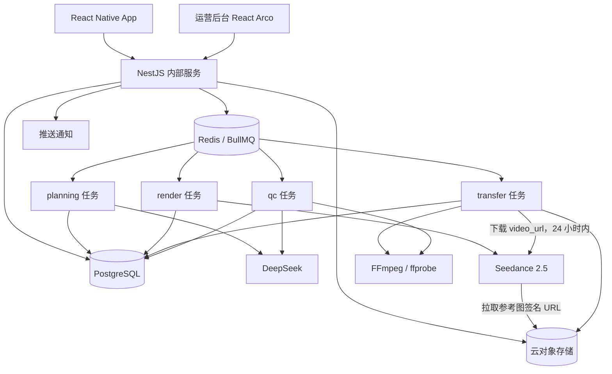
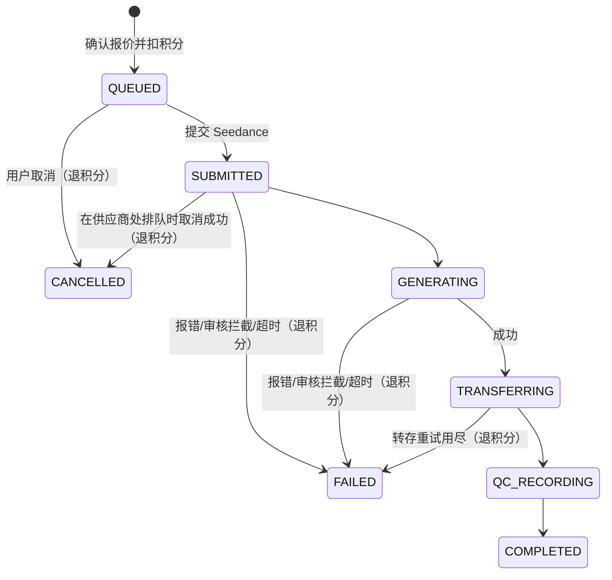

# 04｜技术架构、数据模型与内部工程协议

> 版本：v0.2 · 2026-11-10。工作流见 [03](03-AI创作工作流与质量成本.md)，模型约束见 [06](06-模型能力与约束.md)，决策见 [decisions.md](decisions.md)。

## 1. 技术栈（MVP，D-21）

| 层 | 技术 | 责任 |
|---|---|---|
| iOS/Android | React Native + Expo + TypeScript | 相机/相册/上传、故事板卡、生成确认、任务进度、作品预览/下载/分享、积分明细 |
| 运营后台 | React + Arco Design | 发积分、看任务和成本、看质检记录、案例授权审核（D-20） |
| 业务后端 | NestJS + TypeScript（单个服务） | 登录、商品、案例、项目、故事板、报价与积分、内部接口、后台任务 |
| 后台任务 | BullMQ + Redis（与 NestJS 同一代码库，可单独起 worker 进程） | planning、render、transfer、qc 四类任务；并发、重试、超时 |
| 数据库 | PostgreSQL | 业务实体、版本、积分流水、供应商任务、审计 |
| 媒体存储 | 云对象存储（OSS/S3 兼容）+ CDN | 商品图、成片、封面、质检抽帧；临时签名 URL |
| 视频生成 | Seedance 2.5（火山方舟，经 VideoProvider 适配器） | 画面、口播、环境音、画面字幕一次生成 |
| 大模型 | DeepSeek（官方 API 或方舟托管，经 LlmProvider 适配器） | 看图建议属性、Storyline、Storyboard、质检看图 |
| 媒体工具 | FFmpeg / ffprobe | **只用于**质检抽帧、截封面、校验成片时长和尺寸 |
| 监控 | 结构化日志 + 指标（OpenTelemetry 按需） | 任务分段耗时、成本、失败率、排队长度、告警 |

**推迟到真正需要时的组件**：

- **Python AI 服务**：Seedance 和 DeepSeek 都是 HTTP 接口，NestJS 直接调用即可。
- **ComfyUI**：MVP 不自建生成工作流。
- **Remotion**：MVP 不做后期合成，口播、字幕都由 Seedance 生成（D-17）。

**重要边界**：这是移动 App 的内部服务架构，**不是对外出售的公共 API**。不部署对外开发者文档、开发者密钥管理、开放 SDK，也不按调用次数向开发者计费（D-22）。

## 2. 逻辑部署结构



- MVP 是一个 NestJS 代码库：API 进程处理 App 和运营后台请求；worker 进程消费 BullMQ 任务。两者可以先部署在同一台机器上。
- planning 任务也可以在 API 请求内同步执行（Storyline、Storyboard 生成耗时较短时），超过配置的超时再改为异步。实现时按实测耗时决定。
- Seedance 要从公网拉取参考图，所以对象存储必须公网可达（06 §4.5）。

## 3. 主要领域对象与最小字段

| 对象 | 必要字段 | 要点 |
|---|---|---|
| User | id, authProvider, status, createdAt | MVP `authProvider=dev`（D-15）；隐私与注销 |
| Product | id, userId, sku, title, category, status, profileVersion | 归属和 SKU 版本 |
| ProductAsset | id, productId, objectKey, sha256, viewRole, width, height, sizeBytes, mimeType, hasHumanFaceHint, consent | 原图与授权；上传时按 Seedance 图片要求校验 |
| ProductFact | id, productId, key, value, source（merchant_confirmed / visual_guess / unverified）, evidenceType, verifiedAt | 商家事实与模型猜测分开 |
| InspirationCase | id, title, previewAssetId, licenseState, licenseExpiresAt, patternId, tags, status | 可展示 / 可派生权限 |
| CreativePattern | id, version, beatsJson, allowedCategories, status | 草稿 / 发布 / 废弃版本 |
| CreationProject | id, userId, productId, inspirationCaseId?, patternId, state | 状态见 §4.1 |
| Storyline | id, projectId, version, title, beatOutlineJson, claimsUsed, estimatedCredits, choiceState | 多方案候选 |
| Storyboard | id, projectId, storylineId, version, targetDurationSec, specJson, editedAt | 每次编辑（含总时长调整）生成新版本；报价绑定版本 |
| Shot | id, storyboardId, storyboardVersion, index, segmentId, durationSec, requirementJson | 分镜语义（口播、字幕、画面描述） |
| CreditPriceTable | version, creditsPerSecondJson（按分辨率）, effectiveFrom, status | 配置项，带版本（P-04） |
| Quote | id, userId, projectId, storyboardId, storyboardVersion, resolution, durationSec, credits, priceTableVersion, estimatedCostMinor, expiresAt, status（ACTIVE / USED / EXPIRED / SUPERSEDED） | 报价默认 15 分钟过期 |
| CreditAccount | userId, balance, version, updatedAt | 余额缓存，与流水同事务更新 |
| CreditLedger | id, userId, type（GRANT / DEBIT / REFUND）, amount, reason, renderJobId?, quoteId?, operatorId?, createdAt | 只追加不修改 |
| RenderJob | id, userId, projectId, quoteId, storyboardId, storyboardVersion, idempotencyKey, status, failureReason?, queuedAt, submittedAt?, finishedAt? | 状态见 §4.2 |
| RenderPlan | id, renderJobId, compilerVersion, providerId, modelId, resolution, aspectRatio, totalDurationSec, planJson | 03 §6.1 |
| RenderSegment | id, renderPlanId, index, mode, shotIds, startSec, durationSec, referenceAssetIds | MVP 每个计划只有 1 段（D-09） |
| ProviderTask | id, renderSegmentId, attempt, providerId, modelId, providerTaskId, requestHash, status, rawStatus, usageTokens?, costMinor?, seed?, videoObjectKey?, providerVideoUrlExpiresAt?, errorCode?, errorMessage?, createdAt, submittedAt, finishedAt?, lateResult? | 一次供应商调用；签名 URL 不入库 |
| VideoOutput | id, projectId, renderJobId, assetObjectKey, coverObjectKey, durationSec, width, height, sizeBytes | 我方存储中的成片 |
| QcRecord | id, videoOutputId, state（PASS / REVIEW_REQUIRED / FAIL / ERROR）, reasonCodes, evidenceFrameKeys, captionDiffJson, probeJson, modelId, promptVersion, createdAt | 只记录，不影响交付（D-12） |
| UserFeedback | id, projectId, outputId, usable, reasonCodes | 可用率反馈 |

03 中的 `ProductProfile` 不是单独的表，而是由 Product、ProductAsset、ProductFact 按 `profileVersion` 组装出的只读视图，供 DeepSeek 和提示词编译器使用。

P1 才建的对象：`ShotVersion`（单镜头重做的版本与回退）、`VariantBatch`（多版本裂变）。

`costMinor` 单位为人民币分，按 ProviderTask 的 `usageTokens` 和当时价目计算；原始用量保留，以便价格调整后重算。

**唯一约束与索引**：

- `RenderJob(userId, idempotencyKey)` 唯一；`RenderJob(quoteId)` 唯一（一个报价只能用一次）。
- `CreditLedger(renderJobId, type)` 在 `type IN (DEBIT, REFUND)` 时唯一：每个任务最多一条扣除、一条退回。
- `ProviderTask(providerId, providerTaskId)` 唯一。
- 索引：`Product(userId, sku)`、`CreationProject(userId, createdAt)`、`RenderJob(status, queuedAt)`、`RenderJob(userId, createdAt)`、`ProviderTask(status, submittedAt)`、`CreditLedger(userId, createdAt)`、`QcRecord(state, createdAt)`、`InspirationCase(status, tags)`。新增数据量前先按实际访问模式验证。

## 4. 状态机

### 4.1 创作项目（CreationProject.state）

`DRAFT → STORYLINES_READY → STORYBOARD_READY → QUOTED → RENDERING → COMPLETED / FAILED`

- 编辑故事板（含调整总时长）使报价失效：`QUOTED → STORYBOARD_READY`。
- 渲染任务被取消：`RENDERING → STORYBOARD_READY`。
- `COMPLETED` 或 `FAILED` 后重新生成：需要新报价，回到 `QUOTED`。
- 项目状态只是汇总，渲染细节以 RenderJob 为准。

### 4.2 渲染任务（RenderJob.status）



| 状态 | 含义 | App 显示 |
|---|---|---|
| QUEUED | 已扣积分，在我方队列中等待（受并发 3 限制） | 排队中（显示排队位置） |
| SUBMITTED | 已在 Seedance 创建任务，供应商状态 `queued` | 排队中（已提交，等待供应商处理） |
| GENERATING | 供应商状态 `running` | 生成中 |
| TRANSFERRING | 供应商 `succeeded`，正在下载转存、截封面、ffprobe 校验 | 转存中 |
| QC_RECORDING | 抽帧与质检记录 | 质检中 |
| COMPLETED | 成片可预览、下载 | 已完成 |
| FAILED | 未能交付成片，已全额退积分 | 失败（已退积分） |
| CANCELLED | 用户在排队中取消，已全额退积分 | 已取消（已退积分） |

**规则**：

- **质检不影响交付**：`QC_RECORDING` 一定进入 `COMPLETED`；质检步骤自身出错也只写 `QcRecord(state=ERROR)`（D-12）。
- **取消**：本地 `QUEUED` 可直接取消。`SUBMITTED` 时调用供应商 `DELETE`，只有供应商仍在排队时才能成功；已在生成中（`GENERATING`）的不能取消（06 §6）。
- **超时**：从 `SUBMITTED` 起计时，默认 30 分钟（配置项，待 E-01 耗时数据校准）。超时后先尝试 `DELETE`，然后标记 `FAILED` 并退积分。之后对该供应商任务继续低频查询（最长 7 天，任务 ID 有效期内），只为记录最终状态和用量：若供应商仍生成成功并计费，费用记为平台损失（`ProviderTask.lateResult`），视频不交付。
- **退积分**：进入 `FAILED` 或 `CANCELLED` 时，在同一事务中写入 `REFUND` 流水并增加余额；唯一约束保证每个任务最多退一次（D-10）。
- **重新生成**：`FAILED`、`CANCELLED`、`COMPLETED` 都是终态，重新生成会创建新的 RenderJob，必须有新的报价和扣除流水。

## 5. 内部接口（只供 App 和运营后台使用，不对第三方公开）

```text
POST  /app/v1/auth/dev-login                     MVP 简易登录（D-15），返回会话令牌
POST  /app/v1/products                           创建商品
POST  /app/v1/products/:id/assets                请求上传凭据 / 提交素材元数据（服务端校验格式、大小、像素）
POST  /app/v1/products/:id/analyze               DeepSeek 看图建议属性（结果为 visual_guess）
PATCH /app/v1/products/:id/facts                 商家确认 / 修改商品事实
GET   /app/v1/inspirations                       查询已获授权案例
GET   /app/v1/inspirations/:id                   案例详情
POST  /app/v1/projects                           创建项目（来源可选 inspirationCaseId）
POST  /app/v1/projects/:id/storylines            生成 3 条候选故事线
POST  /app/v1/projects/:id/storyboards           从选定故事线生成故事板
PATCH /app/v1/storyboards/:id                    编辑镜头、口播、字幕、时长、总时长（生成新版本）
POST  /app/v1/projects/:id/render-quote          报价：{ resolution, durationSec } → { quoteId, credits, balance, expiresAt }
POST  /app/v1/projects/:id/render                确认生成：{ quoteId, idempotencyKey } → { renderJobId }
GET   /app/v1/jobs/:id                           任务状态、排队位置、失败原因
POST  /app/v1/jobs/:id/cancel                    取消（仅排队中）
GET   /app/v1/projects/:id/outputs               成片列表
GET   /app/v1/outputs/:id/download-url           短时签名下载链接
GET   /app/v1/me/credits                         积分余额
GET   /app/v1/me/credits/ledger                  积分明细（赠送、发放、扣除、退回）

POST  /ops/v1/credits/grant                      运营发放积分（记录 operatorId 与原因）
GET   /ops/v1/jobs                               任务列表与状态、耗时
GET   /ops/v1/costs                              成本报表（按日、分辨率、时长、退积分原因）
GET   /ops/v1/qc-records                         质检记录与证据帧
GET   /ops/v1/inspirations/review                案例授权审核列表
PATCH /ops/v1/inspirations/:id/license           更新案例授权状态（未授权不能上架创作）
```

- `render-quote` 中 `durationSec` 必须等于当前故事板版本的总时长；不相等时先 `PATCH` 故事板。
- `render` 重复提交同一 `idempotencyKey` 时返回同一个 `renderJobId`，不重复扣积分。
- 新用户首次登录时自动写入一条 `GRANT`（原因 `SIGNUP_BONUS`，数额为配置项）。
- 运营接口要求运营角色，所有调用写审计日志。

**安全要求**：所有项目、素材、任务、成片必须在服务端校验 `userId` 归属；上传用短时签名 URL；下载需要授权；对上传文件类型、大小、像素和恶意文件做校验；worker 使用服务身份；模型密钥不下发到手机端。

## 6. 业务与模型解耦协议

`ProductProfile`、`Storyboard`、`RenderPlan` 是内部**领域协议**，不暴露供应商专有字段。适配器负责把 RenderSegment 转成供应商请求，并把供应商状态映射成内部状态。

```ts
type Resolution = '480p' | '720p' | '1080p';

interface ProviderConfig {
  providerId: string;              // 例：'volcengine-ark'、'deepseek'
  kind: 'video' | 'llm';
  baseUrl: string;                 // 例：'https://ark.cn-beijing.volces.com/api/v3'、'https://api.deepseek.com'
  modelId: string;                 // 例：'doubao-seedance-2-5-260628'、'deepseek-flash'
  apiKeyEnv: string;               // 存放密钥的环境变量名；密钥本身不入库
  capabilities: string[];          // 例：['reference_images', 'generate_audio', 'edit_video'] 或 ['vision', 'json_output']
  limits: { maxConcurrency: number; rpm: number; queryQps?: number };  // 个人账号 Seedance：3 / 180 / 20
  priceTableVersion: string;
  enabled: boolean;
}

interface VideoTaskRequest {
  modelId: string;
  prompt: string;                                       // 提示词编译器输出（03 §6.2）
  referenceImages: Array<{ assetId: string; url: string }>; // 1–30 张，临时签名 URL
  ratio: '9:16';
  resolution: Resolution;
  durationSec: number;                                  // 4–30 的整数
  generateAudio: true;
  watermark: false;
  callbackUrl?: string;                                 // MVP 不用（D-23）
}

// 供应商状态值以官方文档为准：已确认 queued / running / succeeded，示例代码处理 failed（06 §6）。
// 其余值映射为 'unknown'，继续轮询并告警。
type VideoTaskState = 'queued' | 'running' | 'succeeded' | 'failed' | 'cancelled' | 'unknown';

interface VideoTaskStatus {
  providerTaskId: string;
  state: VideoTaskState;
  rawStatus: string;
  videoUrl?: string;               // 只保存 24 小时、最多下载 100 次
  usageTokens?: number;            // usage.completion_tokens，计费依据
  seed?: number;
  resolution?: string;
  ratio?: string;
  durationSec?: number;
  error?: { code: string; message: string };
}

interface VideoProvider {
  createTask(req: VideoTaskRequest): Promise<{ providerTaskId: string }>;
  getTask(providerTaskId: string): Promise<VideoTaskStatus>;
  cancelTask(providerTaskId: string): Promise<'cancelled' | 'not_cancellable'>;
}

interface LlmProvider {
  completeJson<T>(input: {
    system: string;
    user: string;
    images?: Array<{ url: string }>;   // 需要能看图的模型（06 §9）
    schema: import('zod').ZodType<T>;
    maxOutputTokens: number;
  }): Promise<{
    data: T;                           // 已通过 zod 校验
    usage: { inputTokens: number; outputTokens: number; cachedInputTokens?: number };
    modelId: string;
  }>;
}
```

- DeepSeek 官方 API 与方舟托管通过不同的 ProviderConfig 切换，业务代码只依赖 `LlmProvider`（D-03）。
- LLM 输出只当数据：zod 校验失败时带错误信息重试，次数有上限（配置项，默认 2）；不执行模型返回的任何脚本、URL 或指令。
- 提示词模板、质检提示词、编译器都带版本号，写入 RenderPlan 和 QcRecord。
- Seedance 创建接口未见幂等参数。worker 先写 ProviderTask（状态 `CREATING`、请求哈希），再调用 `createTask`，拿到任务 ID 后立即保存。若进程在“已创建、未保存任务 ID”之间崩溃，可能产生孤儿任务：由定时对账任务调用“查询任务列表”接口（QPS 1）找出并记录其成本。

## 7. 积分与账务

- **报价**：`credits = ceil(T × creditsPerSecond[resolution])`，价目表带版本（P-04）。报价同时记录 `estimatedCostMinor`（按 06 §8 估算的平台成本），默认 15 分钟过期。
- **确认生成（同一数据库事务）**：
  1. 锁定报价：属于当前用户、状态 `ACTIVE`、未过期、`storyboardVersion` 等于当前版本。
  2. 若 `(userId, idempotencyKey)` 已存在，直接返回已有任务。
  3. 条件扣减余额：`balance >= credits`，否则返回“余额不足”。
  4. 写入 `CreditLedger(DEBIT)`、创建 `RenderJob(QUEUED)`、报价改为 `USED`。
  5. 提交事务后入队 BullMQ。另设补偿任务，定时扫描“`QUEUED` 但不在队列中”的任务并重新入队。
- **退回**：`FAILED`、`CANCELLED` 时写 `REFUND`（同额），唯一约束保证只退一次（D-10）。
- **发放**：新用户赠送和运营发放写 `GRANT`，记录原因和操作人（D-11）。
- **对账**：余额 = Σ GRANT − Σ DEBIT + Σ REFUND，每日校验并告警。
- **成本**：每个 ProviderTask 记录 `usageTokens` 和 `costMinor`；超时后迟到成功的费用记为平台损失。成本报表按分辨率、时长、退积分原因拆分。
- MVP 不接支付（D-11）。上架前按首发地区核实应用商店的数字内容支付、订阅、税费和退款政策（P-07），不先写死绕过平台内购的支付路线。

## 8. 安全、合规与可靠性

**可靠性**

- **并发**：BullMQ render 队列并发 = ProviderConfig `maxConcurrency`（个人账号 3，D-16）；创建速率不超过 RPM 180。
- **轮询**：间隔 10–15 秒（配置项）；全局查询速率不超过 20 QPS（06 §7）。
- **429 与网络错误**：创建任务时遇到 429、5xx 或网络错误，指数退避重试（次数上限可配置）；这时还没有供应商任务，不产生费用。供应商返回 `failed` 视为终态，不自动重试。
- **立即转存**：`succeeded` 后马上下载 `video_url` 写入对象存储，用 ffprobe 校验可读、时长和尺寸。下载失败按退避重试，必须在 24 小时和 100 次下载上限内完成（重试上限默认 5 次，配置项）；用尽后 `FAILED` 并退积分。ffprobe 发现时长或尺寸与请求不一致时，只写入 QcRecord，不拦截。
- **封面**：FFmpeg 截取第 1 秒画面作为封面。
- **恢复**：App 离线不影响服务端任务；App 重启后按项目 / 任务 ID 恢复进度；worker 重启后从 RenderJob 和 ProviderTask 状态继续。
- **死信与告警**：重试用尽的任务进入死信队列；告警项包括排队时长、失败率、退积分率、`unknown` 状态、对账不平、孤儿任务。

**安全与合规**

- 密钥（`ARK_API_KEY`、DeepSeek API Key）只放在服务端环境变量或密钥管理服务，不入库、不写日志、不下发到 App。
- 参考图签名 URL 的有效期要覆盖“排队 + 生成”的最长时间（默认 2 小时，配置项）；日志和数据库只记录 assetId。
- 只处理用户有权使用的商品图；参考图不能含真人人脸（06 §4.4）；不克隆真实人物的声音和身份。
- 第三方素材许可、Seedance 与 DeepSeek 的商用条款单独记录。
- 外部链接先做 SSRF 防护、跳转校验、尺寸限制和文件内容校验，不访问私有网络。MVP 只接受用户上传文件，不抓取外链。
- 成片必须复制进我方对象存储，不依赖供应商的临时链接。
- AI 生成内容标识：MVP 关闭 Seedance 水印（D-18），上线前按首发地区核实标识要求（P-02）。
- 不批量生成相似片灌水，不规避平台原创性要求。

## 9. 部署建议

首期：一个 NestJS 服务（API 进程 + worker 进程）、一个 PostgreSQL、一个 Redis、一个公网可达的对象存储。开发环境同样使用云对象存储，因为 Seedance 要从公网拉取参考图。不采购 GPU，不部署 ComfyUI。部署到公网后再评估用 Seedance Webhook 替代轮询（D-23）。
