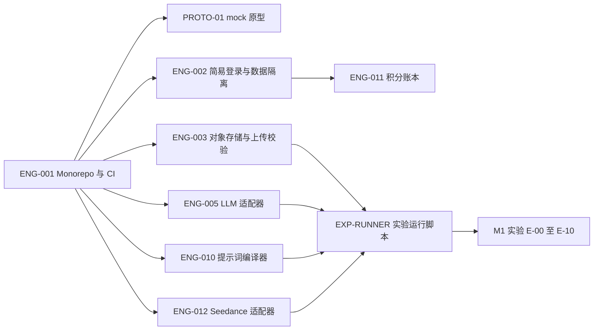

# 第一批任务计划与验收（AGENTS.md 第一轮交付 ③）

> 版本：v0.2 · 2026-11-10。覆盖 M0（mock 原型）和 M1（Seedance 真实闭环实验）。完整任务清单见 [05](05-迭代计划与验收.md) §3，价格见 [06](06-模型能力与约束.md) §8。
>
> **在用户确认具体开发任务前，不自动实现全部功能；实验中的真实调用必须在用户确认 §3 的预算后才执行。**

## 1. 范围与顺序

第一批包含 9 项任务：PROTO-01、ENG-001、ENG-002、ENG-003、ENG-005、ENG-010、ENG-011、ENG-012、EXP-RUNNER。

建议顺序：ENG-001 → PROTO-01、ENG-002、ENG-003、ENG-005、ENG-010、ENG-012 并行 → ENG-011 → EXP-RUNNER → 实验。ENG-011 不阻塞实验，但要在 M2 前完成。

## 2. 任务明细

### PROTO-01 Expo mock 原型

- **目标**：让商家在手机上走完整个创作流程，验证能否理解故事线、故事板和“确认即扣积分”。
- **依赖**：ENG-001。
- **内容**：02 §7 的全部页面；底部 4 个 Tab；mock 数据与真实接口的界线按 mvp-flows.md §4。故事板的时长调整使用真实算法（03 §6.4）。
- **验收标准**：
  - 从灵感首页和创作首页两个入口都能走到作品详情。
  - 所有假数据、模拟进度、占位视频在界面上标注 mock；占位视频画面写明“MOCK 占位视频，非 AI 生成”。
  - 生成确认页显示分辨率、总时长、所需积分、余额和退回规则文案；余额不足时确认按钮不可用。
  - 任务进度页能演示排队中取消、失败（已退积分）、已完成三种结局。
- **风险**：商家把 mock 视频当成真实效果。对策：标注 mock，演示时口头说明。
- **mock / 真实**：全部 mock，不调用任何外部服务。

### ENG-001 Monorepo 与基础 CI

- **目标**：建立代码仓库基础结构。
- **依赖**：无。
- **内容**：`apps/mobile`（Expo）、`apps/server`（NestJS，API 与 worker 两个入口）、`apps/ops`（React + Arco，可先空壳）、`packages/shared`（领域类型与 zod schema：ProductProfile、Storyline、Storyboard、RenderPlan、Quote）。包管理、lint、格式化、单元测试、CI。环境变量示例文件只含变量名，不含密钥。
- **验收标准**：三个应用可本地启动；`packages/shared` 被 App 和服务端共同引用；CI 运行 lint 与测试通过；仓库中没有任何密钥。
- **风险**：Expo 与 Monorepo 工具链兼容问题。对策：使用 Expo 官方文档推荐的 Monorepo 配置。
- **mock / 真实**：不涉及外部服务。

### ENG-002 简易登录与用户数据隔离

- **目标**：MVP 登录方式可用，并从第一天起保证跨用户隔离（D-15）。
- **依赖**：ENG-001。
- **内容**：`POST /app/v1/auth/dev-login`；会话令牌；所有资源访问的 `userId` 归属校验（统一守卫）；运营角色区分。登录模块与业务解耦，以后可替换为手机号、Apple / Google 登录。
- **验收标准**：用户 A 读取、修改、下载用户 B 的商品、项目、任务、成片均返回拒绝（自动化测试覆盖每类资源）；退出后令牌失效；`dev-login` 只能在配置开启时使用。
- **风险**：`dev-login` 误部署到公开环境。对策：配置开关默认关闭，生产环境启动时检查并拒绝启动。
- **mock / 真实**：真实实现，无外部服务。

### ENG-003 云对象存储、签名链接与上传校验

- **目标**：商品图能直传对象存储，并且能被火山服务器拉取（06 §4.5）。
- **依赖**：ENG-001。
- **内容**：上传签名 URL；服务端校验格式、大小（< 30 MB）、宽高比（0.4–2.5）、边长（300–6000 px）、sha256；读取签名 URL 有效期可配置（参考图默认 2 小时）；成片与证据帧的存储路径规范。
- **验收标准**：不合规图片在上传完成后被拒并给出具体原因；签名 URL 过期后无法访问；用一条公网请求（或 E-00）验证火山能拉取签名 URL 指向的图片；对象存储桶不可匿名列举。
- **风险**：开发环境用本机存储导致 Seedance 拉不到图片。对策：开发环境也用云对象存储。
- **mock / 真实**：真实对象存储（费用很低，不涉及模型调用）。

### ENG-005 LLM 适配器与 zod 校验

- **目标**：DeepSeek 官方 API 与方舟托管可配置切换（D-03）。
- **依赖**：ENG-001。
- **内容**：`LlmProvider.completeJson`（04 §6）；两套 ProviderConfig；图片输入；JSON 输出经 zod 校验，失败时带错误信息重试（上限默认 2）；记录用量与模型 ID；超时与 429 退避。
- **验收标准**：用录制的响应样例完成单元测试（正常、JSON 不合法、schema 不符、429、超时）；切换配置不改业务代码；用量写入日志；不执行模型返回的任何指令。
- **风险**：两条路径的图片输入格式或 JSON 模式参数不同。对策：适配器内部分别实现，接口统一。
- **mock / 真实**：单元测试用录制样例；联调时少量真实调用（DeepSeek 费用很低，可在开发中直接使用）。

### ENG-010 RenderPlan 与提示词编译器

- **目标**：把 Storyboard + ProductProfile 确定性地编译成 Seedance 请求（03 §6）。
- **依赖**：ENG-001（共享包中的 Storyboard schema）。
- **内容**：Storyboard 校验规则（03 §5）；时长调整算法（03 §6.4）；提示词模板；RenderPlan（1 段）；`VideoTaskRequest` 构造（`ratio=9:16`、`generate_audio=true`、`watermark=false`、不传联网搜索参数）；用户文本清洗（去掉换行与模板标记）。
- **验收标准**：
  - 快照测试：同一输入多次编译结果完全相同；编译器版本写入 RenderPlan。
  - 含 `visual_guess` 或 `unverified` 事实的 `claimsUsed` 编译失败。
  - 时长算法覆盖：`[3,5,7,6,4]` 调到 15、25、30 秒的结果与 03 §6.4 一致；镜头数大于总秒数时报错；边界 4 秒和 30 秒。
  - 口播、字幕原文在提示词中逐字出现。
- **风险**：模板写法不是 Seedance 的最佳写法。对策：模板带版本，M1 实验后迭代。
- **mock / 真实**：纯代码，不调用外部服务。

### ENG-011 积分账本、报价与扣退

- **目标**：先扣积分再调用视频 API（D-06），失败全额退回（D-10）。
- **依赖**：ENG-002。
- **内容**：CreditPriceTable（带版本，数值先用占位配置，P-04）、Quote、CreditAccount、CreditLedger；`render-quote` 与 `render` 接口的事务逻辑（04 §7）；新用户赠送；运营发放接口；每日对账。
- **验收标准**：
  - 余额不足、报价过期、报价与故事板版本不一致时拒绝，余额不变。
  - 同一幂等键并发提交 20 次只产生 1 个任务、1 条 DEBIT。
  - 对同一任务重复触发退回只产生 1 条 REFUND。
  - 对账：余额 = Σ GRANT − Σ DEBIT + Σ REFUND。
- **风险**：并发下余额被扣成负数。对策：条件更新 + 唯一约束 + 并发测试。
- **mock / 真实**：真实实现；第一批中“创建渲染任务”可先写入 RenderJob（QUEUED）而不入队，ENG-013 再接上队列。

### ENG-012 Seedance 2.5 适配器与契约测试

- **目标**：按 06 §3、§6 封装 Seedance 的创建、查询、取消。
- **依赖**：ENG-001。
- **内容**：`VideoProvider` 实现（04 §6）；请求构造；状态映射（未知状态 → `unknown` 并告警）；429 与 5xx 退避；用量与费用计算（06 §8）；ProviderConfig（并发 3、RPM 180、查询 QPS 20）。实现前按官方 API 参考确认：联网搜索的开关与默认状态、`omni_reference_task_type`、错误码格式（06 U-11）。
- **验收标准**：契约测试先用官方文档中的请求与返回示例构造，M1 后替换为真实录制样例；覆盖 queued、running、succeeded、failed、未知状态、429、超时、取消成功与取消被拒；测试中不调用真实接口；费用计算与 06 §8.5 的示例一致。
- **风险**：官方参数与文档示例不一致。对策：E-00 先用最便宜的规格验证。
- **mock / 真实**：测试全部离线；真实调用只在 EXP-RUNNER 中、预算确认后进行。

### EXP-RUNNER M1 实验运行脚本

- **目标**：在没有完整 App 的情况下跑通 M1 闭环，并为每个实验生成可复查的记录。
- **依赖**：ENG-003、ENG-005、ENG-010、ENG-012。
- **内容**：服务端命令行工具，输入“商品图 + 已确认事实 JSON + 分辨率 + 时长”，依次执行：DeepSeek 生成 Storyboard → 编译 → 调用 Seedance → 轮询 → 下载转存 → ffprobe → 抽帧 → DeepSeek 质检比对 → 输出实验报告（JSON + 截图）。设置单次实验预算上限，累计费用超过上限即停止。
- **验收标准**：
  - 每次运行记录：RenderPlan、请求哈希、供应商任务 ID、各状态时间、`usage.completion_tokens`、按公式计算的费用、错误信息、质检结论、成片对象存储路径。
  - 费用上限生效：模拟累计超限时不再创建新任务。
  - 重复运行同一实验配置时，不会因为脚本崩溃而重复创建供应商任务（先写记录再调用）。
- **风险**：脚本绕过产品的积分流程。对策：仅限内部实验，费用记入实验预算，不写入用户积分。
- **mock / 真实**：**真实调用 Seedance 和 DeepSeek**，必须先由用户确认 §3 的预算。

## 3. M1 实验清单与预算

所有费用为按 06 §8.4 每秒价格计算的**估算**（不含输入视频：480p 0.672 元/秒、720p 1.512 元/秒、1080p 3.742 元/秒；含输入视频 720p 0.9072 元/秒，按“输入 + 输出”秒数计）。失败的任务不计费；需要重跑时按同样公式另算。非画质类实验用 480p 降低成本。样本使用自有或授权商品，商品事实由团队按真实情况确认。

| 编号 | 目的 | 对应未实测项 | 样本与规格 | 计算 | 预算（元） |
|---|---|---|---|---|---:|
| E-00 | 参数确认：联网搜索默认状态、`omni_reference_task_type`、“@图像N”写法、状态值、错误格式；顺带验证排队中取消 | U-11、U-12 | 3 次 × 4 秒 × 480p | 3 × 4 × 0.672 | 8.06 |
| E-01 | 基础闭环与商品保真（颜色、轮廓、Logo） | U-04 | 10 个 SKU × 25 秒 × 720p | 10 × 25 × 1.512 | 378.00 |
| E-02 | 口播是否逐字照念；校准 `maxNarrationCharsPerSec` | U-01 | 3 个 SKU × 3 档口播密度（每秒 3、4、5 字）+ 1 次复测 = 10 次 × 15 秒 × 480p | 10 × 15 × 0.672 | 100.80 |
| E-03 | 画面字幕准确度与分辨率的关系；校准 `maxCaptionChars` | U-02 | 3 个 SKU × 10 秒 × 480p、720p、1080p 各 1 次 | 3 × 10 × (0.672 + 1.512 + 3.742) | 177.78 |
| E-04 | 各镜头是否按提示词时间段出现 | U-03 | 复用 E-01 的 10 条成片，逐镜对照时间段 | — | 0 |
| E-05 | 排队与生成耗时分布；校准 30 分钟超时 | U-05 | 复用全部实验的状态时间记录 | — | 0 |
| E-08 | 含真人模特的服饰图是否被拒绝 | U-08 | 10 张图 × 4 秒 × 480p（被拒绝的不计费，按全部成功估上限） | 10 × 4 × 0.672 | 26.88 |
| E-09 | 9:16 参考图模式与首帧模式对比（首帧模式需先把商品图处理成 9:16） | U-09 | 5 个 SKU × 2 种模式 × 10 秒 × 720p | 5 × 2 × 10 × 1.512 | 151.20 |
| E-10 | 9:16 实际像素与计费是否与 16:9 相同 | U-10 | 复用 E-01，对比 `usage.completion_tokens` 与公式 | — | 0 |
| | **M1 合计（P0）** | | | | **842.72** |
| E-06 | （P1）编辑视频能否只改某几秒 | U-06 | 5 条 E-01 成片 × 编辑 25 秒 × 720p（输入 25 + 输出 25 秒） | 5 × 50 × 0.9072 | 226.80 |
| E-07 | （P1）多段生成时音色、光线是否一致 | U-07 | 5 个 SKU × 3 段（8 + 8 + 9 秒）× 480p，用上一段尾帧作下一段首帧 | 5 × 25 × 0.672 | 84.00 |
| | **P1 实验合计（M4 前再执行）** | | | | **310.80** |

另有 DeepSeek 调用费用（Storyboard 生成与质检），以实际用量统计，预计远小于视频费用。

**每次运行的记录模板**（EXP-RUNNER 自动输出）：

| 字段 | 内容 |
|---|---|
| 实验编号 / 运行编号 | 如 E-01 / run-03 |
| 输入 | SKU、参考图 assetId、已确认事实、Storyboard 版本、编译器版本 |
| 请求 | 分辨率、时长、模式、请求哈希 |
| 供应商 | 任务 ID、状态变化时间、`usage.completion_tokens`、`seed` |
| 费用 | 按 06 §8 计算的金额 |
| 结果 | 成片路径、ffprobe 结果（时长、尺寸）、质检结论与证据帧 |
| 人工评估 | 商品保真（颜色 / 轮廓 / Logo）、口播逐字准确率、字幕准确率、镜头时间是否符合、是否可发布 |
| 结论 | 对应未实测项的结论或“仍未确认” |

实验结束后：更新 06 §10 的结论、校准 03 §5 的两个提示阈值和 04 §4.2 的超时时间，并据此推进 P-01、P-06、P-09 的决定。
