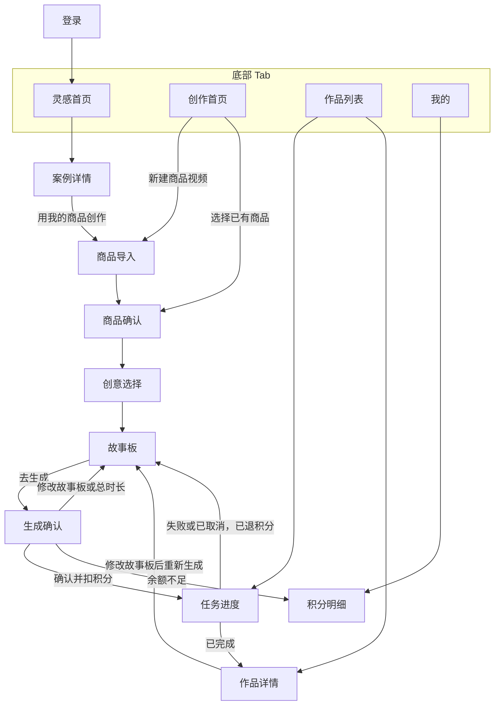
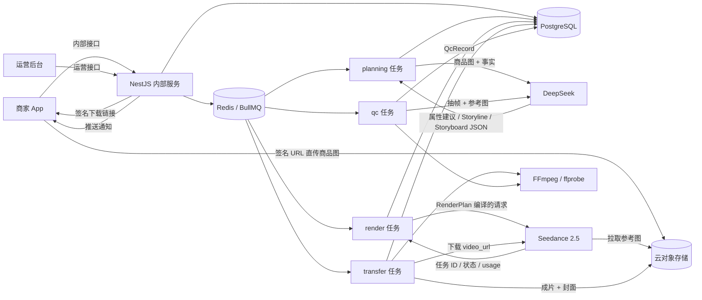
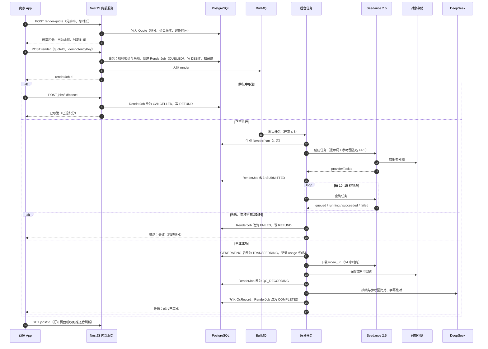

# MVP 页面与数据流（AGENTS.md 第一轮交付 ②）

> 版本：v0.2 · 2026-11-10。页面名与 [02](02-产品PRD与移动端交互.md) §7 一致，实体与状态名与 [04](04-技术架构与数据模型.md) 一致。

## 1. 页面流程

说明：

- 从“创作首页 → 选择已有商品”进入时，如果商品事实都已确认，商品确认页只做一次快速核对。
- “生成确认”是唯一会扣积分的页面；其他页面的操作都不扣积分。
- 重新生成一定回到故事板，再经生成确认重新报价、扣积分（D-10）。

## 2. 数据流

| 数据 | 产生方 | 存放位置 | 使用方 |
|---|---|---|---|
| 商品图（ProductAsset） | App 上传 | 对象存储 + PostgreSQL 元数据 | DeepSeek 看图、Seedance 参考图、质检比对 |
| 商品事实（ProductFact） | DeepSeek 建议 + 商家确认 | PostgreSQL | Storyline、Storyboard、提示词编译器 |
| Storyline / Storyboard | DeepSeek 生成 + 商家编辑 | PostgreSQL（带版本） | 报价、提示词编译器 |
| Quote / CreditLedger / CreditAccount | NestJS | PostgreSQL | 生成确认、积分明细、运营成本报表 |
| RenderJob / RenderPlan / RenderSegment / ProviderTask | NestJS / render 任务 | PostgreSQL | 任务进度、对账、成本 |
| 成片与封面（VideoOutput） | transfer 任务 | 对象存储 + PostgreSQL 元数据 | 作品详情、下载、分享、质检 |
| 质检记录（QcRecord） | qc 任务 | PostgreSQL + 对象存储（证据帧） | 运营后台 |

## 3. 生成时序

时序中省略的分支（规则见 04 §4.2）：

- **SUBMITTED 时取消**：API 调用供应商 `DELETE`，只有供应商仍在排队时成功，成功后 `CANCELLED` 并退积分；否则提示“生成中无法取消”。
- **转存失败**：在 24 小时、100 次下载上限内重试，用尽后 `FAILED` 并退积分。
- **超时后迟到成功**：任务已 `FAILED` 并退积分，之后供应商仍生成成功并计费的，记为平台损失，视频不交付。
- **质检出错**：写 `QcRecord(state=ERROR)`，任务照常 `COMPLETED`。

## 4. 原型阶段 mock 与真实接口的界线

M0 原型全部使用假数据。**界面上凡是 mock 的内容必须标注“mock”**，占位视频画面上写明“MOCK 占位视频，非 AI 生成”，模拟进度写明“模拟进度”（AGENTS.md 工作方式）。

| 页面 / 功能 | M0 原型（mock） | M2 真实接口 |
|---|---|---|
| 登录 | 本地假用户 | `POST /app/v1/auth/dev-login` |
| 灵感首页、案例详情 | 本地 JSON 假案例（原创示意素材） | `GET /app/v1/inspirations`、`/inspirations/:id` |
| 商品导入 | 本地相册图片，只在本机显示，不上传 | 签名 URL 直传 + `POST /products/:id/assets` |
| 商品确认 | 固定的假属性建议 | `POST /products/:id/analyze`（DeepSeek）+ `PATCH /products/:id/facts` |
| 创意选择 | 固定 3 条假 Storyline | `POST /projects/:id/storylines`（DeepSeek） |
| 故事板 | 固定假故事板，可本地编辑，时长调整算法用真实实现 | `POST /projects/:id/storyboards`、`PATCH /storyboards/:id` |
| 生成确认 | 本地按假价目表计算积分，假余额 | `POST /projects/:id/render-quote`、`/render` |
| 任务进度 | 定时器模拟状态变化（标注“模拟进度”） | `GET /jobs/:id`、`POST /jobs/:id/cancel` |
| 作品详情 | 占位视频（标注“MOCK 占位视频，非 AI 生成”） | `GET /projects/:id/outputs`、`/outputs/:id/download-url` |
| 我的、积分明细 | 假流水 | `GET /me/credits`、`/me/credits/ledger` |
| 运营后台 | 不做 | `/ops/v1/*` |
