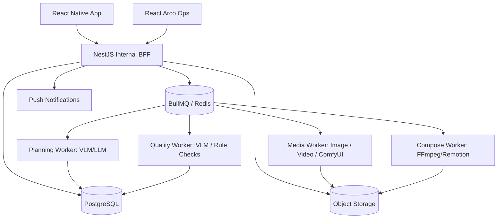
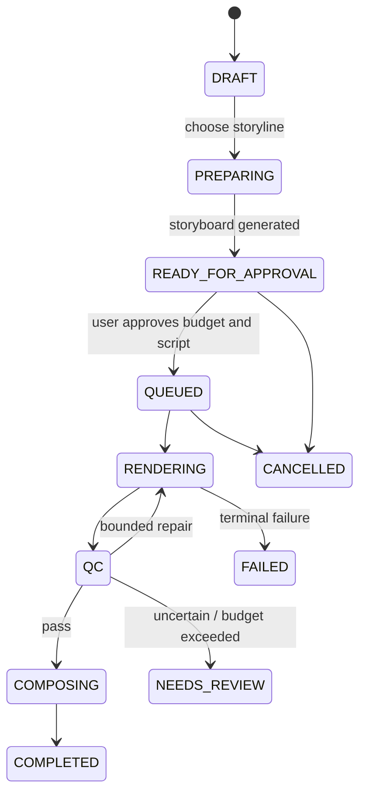

# 04｜技术架构、数据模型与内部工程协议

## 1. 技术栈建议

| 层 | 技术 | 责任 |
|---|---|---|
| iOS/Android | React Native + Expo + TypeScript | 相机/相册/上传、预览、故事板卡、作品/通知/分享 |
| 运营后台 | React + Arco Design | 案例审核、营销结构模板、任务质量运营、成本监控 |
| 业务后端 | NestJS + TypeScript | 登录、账户、作品、商品、支付/余额、权限、内部接口 |
| AI 策划服务 | Python + VLM/LLM 适配器 | 商品提取、案例理解、故事线、分镜、QC 诊断 |
| 队列与执行 | BullMQ + Redis | 异步流程、重试、任务恢复、进度与取消 |
| 数据库 | PostgreSQL | 业务实体、事件、版本、审计、账本记录 |
| 媒体存储 | OSS/S3 对象存储 + CDN | 素材、首帧、镜头、成片、缩略图、临时签名 URL |
| 生成模型 | 统一模型能力适配器；按需要调用 ComfyUI / 商业模型 API | 图像、视频、动作及场景能力 |
| 合成 | FFmpeg + Remotion | 旁白、字幕、音乐、封面、片尾、成片 |
| 监控 | 结构化日志 + OpenTelemetry（按需） | 任务分段耗时、成本、失败率、告警 |

**重要边界**：这是对移动 App 的内部服务架构，**不是计划出售的公共 API**。不要部署对外开发者文档、密钥管理后台、开放 SDK 或按调用次数面向开发者计费。

## 2. 逻辑部署结构



MVP 可以单体 NestJS + 几类独立 worker，不建议第一天把所有内部服务拆成复杂微服务。

## 3. 主要领域对象与最小字段

| 对象 | 必要字段 | 要点 |
|---|---|---|
| User | id, authProvider, status, createdAt | 隐私与注销 |
| Product | id, userId, sku, title, category, status | 归属和 SKU 版本 |
| ProductAsset | id, productId, objectKey, sha256, viewRole, consent | 原图与授权 |
| ProductFact | id, productId, key, value, evidenceType, verifiedAt | 商家事实 vs 模型猜测 |
| InspirationCase | id, title, previewAssetId, licenseState, patternId, tags | 可展示/可派生权限 |
| CreativePattern | id, version, beatsJson, allowedCategories, status | 可编辑/发布/废弃版本 |
| CreationProject | id, userId, productId, mode, patternId, state | 项目容器 |
| Storyline | id, projectId, version, title, beatOutlineJson, choiceState | 多方案候选 |
| Storyboard | id, projectId, storylineId, version, specJson, approvalState | 确认后冻结版本 |
| Shot | id, storyboardId, index, requirementJson | 分镜语义 |
| ShotVersion | id, shotId, renderTier, modelId, outputAssetId, qcState, cost | 不覆盖旧版本 |
| RenderJob | id, projectId, storyboardVersion, status, idempotencyKey | 主任务 |
| JobStep | id, renderJobId, shotId?, stepType, state, attempts, cost | 分步可恢复 |
| VideoOutput | id, projectId, renderJobId, assetId, duration, resolution | 成片版本 |
| VariantBatch | id, userId, baseProjectId, optionsJson, state | 同商品多版本 |
| CreditLedger | id, userId, jobId, amount, currencyOrCredit, reason, state | 可对账，不直接改余额 |
| UserFeedback | id, projectId, outputId, usable, reasonCodes | 可用率反馈 |

索引建议：`Product(userId, sku)`、`CreationProject(userId, createdAt)`、`RenderJob(userId?, status, createdAt)`、`JobStep(renderJobId, state)`、`InspirationCase(status, category/tags)`；新增数据量前先以实际访问模式验证。

## 4. 任务状态机



注意：`FAILED` 和 `NEEDS_REVIEW` 的重试必须创建新的受控尝试记录，不能绕过预算和历史结算。

## 5. 内部接口草案（只用于 App，不向第三方公开）

```text
POST /app/v1/products                    创建商品
POST /app/v1/products/:id/assets         请求上传凭据 / 提交素材元数据
PATCH /app/v1/products/:id/facts         商家确认商品属性
GET  /app/v1/inspirations                查询已获授权案例
GET  /app/v1/inspirations/:id            案例详情
POST /app/v1/projects                    创建项目（来源可选 inspiration）
POST /app/v1/projects/:id/storylines      生成候选故事线
POST /app/v1/projects/:id/storyboards     从选定故事线生成故事板
PATCH /app/v1/storyboards/:id            编辑未提交的镜头与文案
POST /app/v1/projects/:id/render-quote    返回预估费用
POST /app/v1/projects/:id/render          确认费用并创建异步任务
GET  /app/v1/jobs/:id                    查询状态与进度
POST /app/v1/projects/:id/shots/:shotId/revise  局部修改（P1）
GET  /app/v1/projects/:id/outputs         输出版本列表
POST /app/v1/projects/:id/variants        创建裂变批次（P1）
```

安全要求：所有项目、素材、任务必须服务端校验 `userId` 归属；上传使用短时签名 URL，下载需要授权；敏感操作审计；对上传文件类型、大小、时长与恶意文件进行校验；内网 worker 使用服务身份，不把模型密钥传到手机端。

## 6. 业务与模型解耦协议

`ProductProfile` 和 `Storyboard` 是内部**领域协议**，不直接暴露 ComfyUI Workflow JSON 或供应商专有字段。生成 worker 负责将结构化 `ShotSpec` 编译为模型请求。

```ts
interface ShotRenderRequest {
  shotId: string;
  productId: string;
  refs: Array<{assetId:string; role:string}>;
  durationSec: number;
  aspectRatio: '9:16'|'1:1'|'16:9';
  visualIntent: string;
  lockedTraits: string[];
  qualityProfile: 'economy'|'premium';
  maxBudgetMinor: number;
  fallbackTier?: 'L0'|'L1'|'L2';
}

interface ShotRenderResult {
  assetId: string;
  modelId?: string;
  renderTier: 'L0'|'L1'|'L2'|'L3';
  actualCostMinor: number;
  qualityState: 'PASS'|'REVIEW_REQUIRED'|'FAIL';
  reasonCodes: string[];
}
```

生产部署须通过 zod/class-validator 等验证接口输入与跨服务事件；不能直接执行 LLM 返回的任意脚本、URL 或 ComfyUI 节点定义。模型提示词、能力配置和策略必须版本化。

## 7. 费用控制与账务

- 在用户确认渲染时产生 Quote（过期时间、预估范围、策略版本）；不把模型单次调用价直接伪装成成片成本。
- 任务创建有幂等键，避免重复扣费；预授权或额度预留后按确认的计费政策结算，多次请求不能重复扣费。
- 保存每次供应商调用的实际成本、重试成本、生成输出和失败原因。
- 系统故障所致的失败如何退额度必须通过产品规则明确，不能产生不可解释的扣费。
- 在应用商店上架前核实数字内容支付、订阅、税费和退款政策；不要先写死绕过平台内购的支付路线。

## 8. 安全/合规与可靠性

- 仅处理用户有权使用的商品图、人物图、音频和参考视频。提供违规报告与素材删除。
- 可见人物需要合适肖像/声音授权；无授权不得克隆真实人物声纹和身份。
- 第三方素材许可、生成模型商用条款和音乐配乐许可单独记录。
- 对外部链接先进行 SSRF 防护、跳转验证、尺寸限制和文件内容验证；不支持私有网络访问。
- 用户离线/掉线不影响服务端任务；App 重启后按项目/任务 ID 恢复进度。
- 任务应设超时、并发限制、重试上限、熔断、预算上限和死信监控。
- 成片必须复制进受控对象存储，不能长期依赖供应商临时结果链接。
- 不滥用相似片批量灌水或规避平台原创性要求；保持成片真实、独立、有商品信息价值。

## 9. 部署建议

首期：一个 NestJS 服务 + 一个 PostgreSQL + Redis/BullMQ + 对象存储 + 按需可扩展 worker，先以第三方模型 API 为主；ComfyUI 仅在确定某工作流需要时作为 worker 接入。不要在缺乏基准测试之前为自建视频模型采购大量 GPU。
