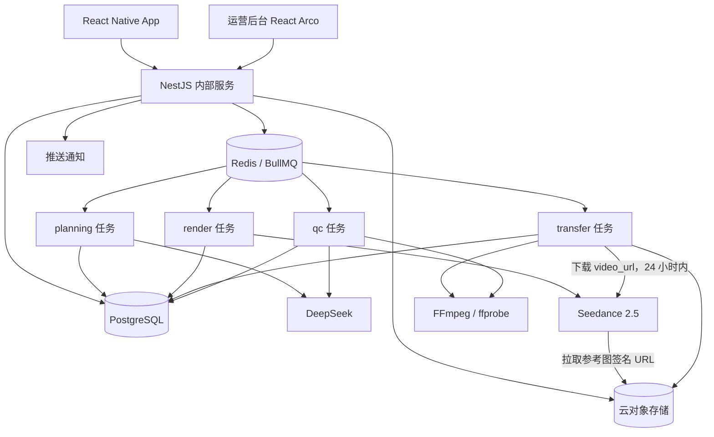
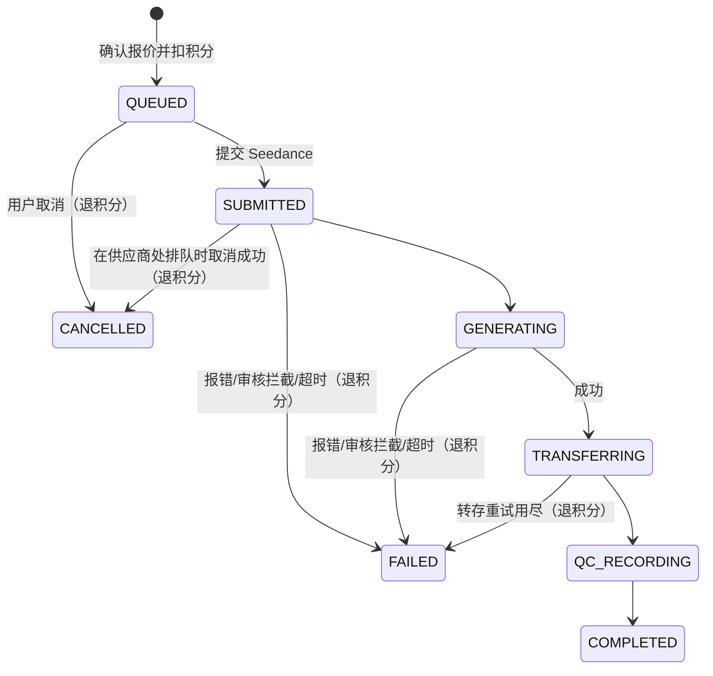

# AI 电商营销视频 App｜完整产品设计方案（v0.2 合并版）

> 版本：v0.2 · 2026-11-10。以豆包 Seedance 2.5 为主要渲染方式，大模型使用 DeepSeek；生成前确认并扣积分。v0.1 合并版见根目录 `设计方案.md`（存档，不再修改）。
>
> 本文由 `docs/` 下各文档按顺序合并而成，内容以 `docs/` 中的单篇文档为准。合并版中文档之间的相对链接以 `docs/` 目录为基准。页面与数据流图见 `docs/mvp-flows.md`，第一批任务与实验预算见 `docs/first-batch-tasks.md`。

## 文档目录

1. 01-竞品与设计依据
2. 02-产品PRD与移动端交互
3. 03-AI创作工作流与质量成本
4. 04-技术架构与数据模型
5. 05-迭代计划与验收
6. 06-模型能力与约束
7. 决策记录（decisions）
8. 项目约束（与根目录 AGENTS.md 同步）


---

# 01｜Kickart × Aidge 竞品与设计依据

**研究截止**：2026-11-10。只依据公开官方资料；没有账户内实测、非公开工作流或竞品内部代码。

> 版本：v0.2 · 2026-11-10。竞品事实（第 1、2、5 节）与 v0.1 相同；借鉴矩阵的实现方式按 v0.2 决策更新，变化说明见第 7 节。

## 1. 已核实的 Kickart 产品机制

来源 [K1] 的“一键成片新手指引”明确描述：

1. 商品链接/ID 输入及商品素材获取（官方列出抖店、快手、小红书等支持来源；用户授权和产品接入条件另行适用）。
2. 素材理解：分析商品、卖点、图片质量并允许修正。
3. Storyline：可生成四条差异化创意方向，支持刷新/编辑。
4. Storyboard：逐镜脚本、人物/商品/场景参考图，支持换图和对话修改。
5. 成片渲染、预览、下载和自由创作二次编辑。

来源 [K2] 的自由创作指南还公开了多参考图、结构化镜头信息、局部重新生成等能力。
来源 [K3] 的产品说明覆盖灵感广场、爆款复刻/裂变、视频混剪，并说明部分灵感排行涉及 GMV、互动率、播放量；这些数据不是我们的产品天然可获取的。

> **设计解释（非竞品事实）**：移动端不必照搬复杂工作台，而应保留“案例 → 商品 → 故事线 → 故事板 → 成片 → 精修”这一用户认知顺序。

## 2. 已核实的 Aidge 机制

- [A1] 视频生成控制台：商品标题与 1–8 张商品图片输入；自动理解与规划；异步产出竖屏短视频。
- [A2] 高级 VideoGeneration：描述参考图优先（Reference-Image-First）、6 维度视觉检测、脚本约束、失败感知重试。
- [A3] 裂变服务：`rebuild` 对母版脚本与分镜拆解重生成；`reference` 主张保留母版更高程度的画面、动作与节奏，并支持商品/人物定向替换。
- [A4] 2026-11-09 的基础版生成文档：非服饰类目可依据商品标题与多图自动规划三段分镜。

> **能力边界**：官方资料中的“高保真”“低废片率”“高相似”是厂商对自身产品的描述；我们未实测其通过率，也无法从公开资料推断其内部模型权重、提示词或私有评估器。

## 3. 借鉴矩阵

| 可借鉴能力 | 优先参考 | 我们的 To C 实现 | 范围 |
|---|---|---|---|
| 灵感广场与案例选择 | Kickart | 自制/授权创意案例，按品类、镜头结构、营销风格搜索 | P0 |
| 商品理解与卖点确认 | 两者 | 商品档案与“已确认事实”清单，商家可修改 | P0 |
| 多方案 Storyline | Kickart | 默认 3 个方案（可调整），不照搬固定 4 个 | P0 |
| 卡片式 Storyboard | Kickart | 手机单列镜头卡，画面描述、口播、画面字幕、时长可修改；总时长 4–30 秒可调 | P0 |
| 单镜头精修 | Kickart | 用 Seedance 2.5 编辑视频修改受影响镜头（MVP 为整条重新生成） | P1 |
| 商品保真流程 | Aidge | 多张商品参考图锚定 + 提示词锁定外观特征 + 只记录不拦截的质检 | P0 |
| 母版 Rebuild | 两者 | 提取授权参考视频的高层营销结构，原创重组 | P1 |
| 高相似度 Reference 替换 | Aidge | 后期研究，不承诺 1:1 还原 | P2 |
| 视频混剪 | Kickart | 商家自有视频作为 Seedance 参考视频或延长素材组合 | P1 |
| 商家易用的费用控制 | 自研差异 | 积分报价、确认即扣积分、未能成片全额退回 | P0 |

## 4. 刻意不复制的内容

- 不复制竞品商标、品牌识别、界面图片、文案、专有模板视频或非公开实现。
- 不以未经授权抓取抖音视频/数据、绕过登录或下载限制作为案例库来源。
- 不宣称知道竞品内部模型链路，也不把官方宣传数据当作实测指标。
- 不直接展示“真实 GMV / 爆款 / 高转化”等标签，除非有可审计的数据来源与授权。
- 不做面向开发者的商业 API 产品（内部 App 接口不在此限制内）。

## 5. 官方资料与核实入口

- [K1] Kickart 一键成片新手指引：<https://docs.volcengine.com/docs/CreativeAgent/autocut-beginners-guide?lang=zh>
- [K2] Kickart 自由创作新手指引：<https://docs.volcengine.com/docs/creative-agent/free-creation-beginners-guide?lang=zh>
- [K3] Kickart 产品使用指南/模板概念：<https://docs.volcengine.com/docs/CreativeAgent/IntroductiontoTemplateConceptandTemplateConsumptionAPI?lang=zh>
- [K4] Kickart 视频混剪：<https://docs.volcengine.com/docs/creative-agent/video-mash-up?lang=zh>
- [K5] Kickart 分步式与端到端能力概览：<https://docs.volcengine.com/docs/creative-agent/api-overview?lang=zh>
- [A1] Aidge 控制台电商视频生成操作指南（更新 2026-11-03）：<https://help.aliyun.com/zh/aidge/e-commerce-video-generation-operation-guide/>
- [A2] Aidge 视频生成能力：<https://help.aliyun.com/zh/aidge/api-aidge-2026-04-28-videogeneration>
- [A3] Aidge 电商视频裂变：<https://help.aliyun.com/zh/aidge/ecomvideorecreation>
- [A4] Aidge 电商视频基础版（更新 2026-11-09）：<https://help.aliyun.com/zh/aidge/api-aidge-2026-04-28-productvideogeneration>

## 6. 仍待实测和确认的问题

- Kickart 各模式实际商品相似度、修复成功率、生成时延、套餐的最新有效价格。
- Aidge 的相同输入商品在不同品类下的成片可用率与生成时延。
- Seedance 2.5 与 DeepSeek 的商用条款、数据使用条款与地区限制（能力与价格见 06）。
- 具体电商平台官方商品接口的合作/认证条件与用户授权范围。
- 真实商家愿意使用的故事线数量、付费方式和可接受的等待时间。

## 7. v0.2 设计变化

v0.2 以豆包 **Seedance 2.5** 作为主要渲染方式（decisions D-04）。Seedance 2.5 是我们的**供应商**，不是竞品；它与 Kickart 同属火山引擎，但我们只使用其公开的模型 API，不复制 Kickart 的界面、模板或流程实现。

| 项 | v0.1 | v0.2 |
|---|---|---|
| 渲染方式 | 按镜头分层（真实素材、轻量运镜、经济型与高质量模型），多数镜头用真实素材 | 整条视频由 Seedance 2.5 一次生成；分层方案保留为未来扩展（03 §8） |
| 声音与字幕 | 配音、字幕后期合成 | 口播、环境音、画面字幕由 Seedance 一次生成（D-17） |
| 商品保真 | 质量门控、不合格时降级为真实素材 | 1–30 张商品参考图 + 提示词锁定外观；质检只记录（D-12） |
| 单镜头精修 | 只重生成受影响镜头 | P1，用 Seedance 编辑视频（D-14） |
| 费用控制 | 预估费用、生成前确认 | 积分报价，确认即扣积分，未能成片全额退回（D-06、D-10） |
| 成本目标 | 研发假设的单条成本上限 | 取消，改为记录真实成本（D-08） |

Seedance 2.5 的能力、限制和价格见 [06-模型能力与约束.md](06-模型能力与约束.md)；全部决策见 [decisions.md](decisions.md)。


---

# 02｜To C 产品 PRD 与移动端交互

> 版本：v0.2 · 2026-11-10。v0.2 起成片由 Seedance 2.5 一次生成（含口播、环境音、画面字幕），生成前扣积分。决策依据见 [decisions.md](decisions.md)，页面与数据流图见 [mvp-flows.md](mvp-flows.md)。

## 1. 产品目标

**目标用户**：没有专业视频制作团队的电商卖家、小型店铺运营者、短视频电商内容创作者。产品为用户提供商品内容创作工具，而不是替用户承诺销量。

**核心价值**：不写提示词、不做复杂剪辑，也能在手机上通过成熟营销创意结构生成可用的商品视频；商品外观和宣传事实尽量可信；花积分之前把内容确认清楚。

**北极星指标**：每周完成至少 1 条“商家主动确认可用成片”的活跃用户数（后续可改为周有效成片商家数）。

辅助指标：首条成片完成率、从进创作到确认故事板的操作数、首次生成可用率、每条合格成片真实成本、重新生成率、退积分率、7 天留存与次周复用率。

## 2. 产品原则

- **手机优先，少选项**：面向行动路径，不暴露模型列表或复杂提示词。商家只需要选分辨率和总时长。
- **案例驱动优于随机生成**：一键推荐适合商品的合规创意结构，也支持自由创作。
- **先确认便宜的内容，再花积分生成**：商品事实、Storyline 和 Storyboard 在扣积分前确认。不出样片（D-05）。
- **重要信息有据可查**：不能凭图片编造产地、功效、检测认证、价格等。
- **费用透明、规则先说清**：确认按钮旁写明所需积分和退回规则；异步任务可恢复。
- **效果指标诚实**：营销案例上的“热门/高转化”标签需要真实证据；初期只标“精选/适合品类/风格”。

## 3. 信息架构

底部 Tab：**灵感｜创作｜作品｜我的**。

- 灵感：案例推荐、搜索、收藏、筛选、创意结构说明、“用我的商品创作”。
- 创作：新建商品视频、历史商品、草稿与故事板；参考视频重构（P1）。
- 作品：全部任务（草稿 / 排队中 / 生成中 / 转存中 / 质检中 / 已完成 / 失败 / 已取消）、预览、导出、整条重新生成。
- 我的：账户、积分余额与明细、通知、设置、内容授权与投诉入口。

不要为了新增一个模型或品类而增加 Tab。

## 4. 核心用户流程 A：灵感带动的创作（P0）

1. 用户打开**灵感首页**，看到本平台已获授权的示例案例。
2. 进入**案例详情**，查看 9:16 预览、适用品类、营销结构标签与示例分镜。
3. 点击“用我的商品创作”，在**商品导入**页从相机 / 相册上传商品图，或从自己的商品库选择。
4. **商品确认**页：AI 看图给出颜色、外观等建议，**商家确认或纠正事实**；未确认的属性不会进入口播和字幕。
5. **创意选择**页：推荐 3 条差异化 Storyline（例如“痛点切入”“使用展示”“细节讲解”），标注时长和参考积分。
6. **故事板**页：选定后得到 3–6 张镜头卡，逐镜显示画面描述、口播原文、画面字幕原文、时长和引用的商品图；商家可修改，可调整总时长（4–30 秒）。
7. **生成确认**页：选择分辨率（480p / 720p / 1080p，默认 720p），确认总时长，查看所需积分和当前余额。点击确认后**立即扣除积分**，随后才开始调用视频生成。
8. 后台异步生成。用户可以离开，从**作品列表**或通知回到**任务进度**页。
9. 完成后进入**作品详情**：预览、保存到设备、分享；不满意可以修改故事板后整条重新生成（需新报价、再次扣积分）。

### 关键验收示例

- GIVEN 用户选择本平台可商用的案例且已上传商品图片，WHEN 点击“用我的商品创作”，THEN 进入商品确认流程，并保留该案例的营销结构 ID。
- GIVEN 商品事实中存在未确认的“材质/功效”，WHEN 生成 Storyline 或 Storyboard，THEN 口播和画面字幕中不得出现该属性；用户可以补充真实资料并确认。
- GIVEN 用户未在生成确认页点击确认，WHEN 浏览故事板或报价，THEN 不扣积分、不调用视频生成接口。

## 5. 核心用户流程 B：一键生成（P0）

创作首页 → 商品导入（选商品 / 拍照）→ 商品确认 → “自动推荐创意” → 创意选择 → 故事板 → 生成确认（选分辨率、时长，确认扣积分）→ 任务进度 → 作品详情。

用户没有任何案例偏好时，使用平台已审核的通用营销结构，不完全随机编造拍摄方法。

## 6. 核心用户流程 C：参考视频 Rebuild（P1）

创作 → 上传**有权使用**的参考视频 → 确认内容使用授权 → 自动转写及分镜分析 → 抽取抽象营销结构 → 绑定自有商品 → 生成新的 Storyboard → 生成确认 → 新视频。

依赖 Seedance 的参考视频能力（总长 ≤ 30 秒，含真人人脸的视频不能直接上传，见 06 §4）。不默认逐帧复制他人视频、声音、人物或标志；不提供任意外链视频下载功能。分享链接可以先只做“灵感书签”，需要解析时引导上传合法拥有的源文件。

## 7. 核心页面与交互要求

| 页面 | 首版核心控件 | 边界 / 异常态 |
|---|---|---|
| 登录 | MVP 简易登录（D-15） | 会话过期后重新登录并恢复上次页面 |
| 灵感首页 | 搜索、分类 chips、视频预览卡、收藏、使用此创意 | 无案例、网络不可用、素材授权到期 |
| 案例详情 | 预览、营销结构摘要、适用品类、“用我的商品创作” | 案例不可复用时只展示说明，不提供创作入口 |
| 创作首页 | 新建商品视频、选择已有商品、草稿列表 | 无商品时引导上传 |
| 商品导入 | 拍照、相册、已有商品、标题与关键属性；提示“不要上传带模特脸部的图片” | 图片不符合要求（格式、宽高比 0.4–2.5、边长 300–6000 px、≥ 30 MB）时说明原因；不同 SKU 混入；上传失败 |
| 商品确认 | 可编辑属性表；“已确认 / AI 建议 / 未知”三种标识 | 未确认的功效、材质等不能进入口播和字幕 |
| 创意选择 | 3 张 Storyline 卡：标题、风格、时长、文案摘要、参考积分 | 模型规划失败时使用审核过的通用方案；允许重试 |
| 故事板 | 单列镜头卡：画面描述、口播原文、画面字幕原文、时长、引用商品图；总时长调整（4–30 秒）；“去生成” | 镜头数大于总秒数时提示删减；口播过长、字幕过长时提示（不拦截）；提示“画面字幕生成后无法修改，请仔细核对” |
| 生成确认 | 分辨率（480p / 720p / 1080p，默认 720p）、总时长（4–30 秒）、所需积分、当前余额、确认按钮；按钮旁写明：“确认后立即扣除积分；未能生成成片全额退回；生成后不满意不退” | 余额不足时禁用确认并说明；报价过期（默认 15 分钟）需刷新报价；故事板改动后需重新报价 |
| 任务进度 | 状态：排队中（显示排队位置）、生成中、转存中、质检中、已完成、失败（已退积分）、已取消（已退积分）；“取消”按钮 | 只有排队中可以取消；生成中不能取消；断线、App 重启后恢复显示 |
| 作品列表 | 全部任务与状态筛选 | 空列表引导去创作 |
| 作品详情 | 视频预览、下载、分享、“修改故事板后重新生成” | 下载链接过期时自动重新获取 |
| 我的 | 账户、积分余额、积分明细入口、授权记录、反馈 | — |
| 积分明细 | 流水：赠送、运营发放、扣除、退回，关联到具体作品 | — |

### 移动端设计规范

- 默认 9:16 竖屏；底部导航适配 Safe Area。
- 重要按钮放在单手可触达的底部，复杂高级参数折叠。
- 视频后台生成，App 前后台切换后保持任务状态。
- 轻交互采用卡片与抽屉；长文本修改提供编辑页而不是多层模态框。
- 减少自动连续播放带来的流量消耗，提供静音预览与 Wi-Fi 相关设置。
- 所需积分和退回规则在用户点击确认之前清楚可见。
- 原型阶段的假数据、模拟进度和占位视频必须在界面上标注 mock（见 mvp-flows.md §4）。

## 8. MVP 需求清单

| ID | 优先级 | 功能 | 完成定义 |
|---|---|---|---|
| F-01 | P0 | 简易登录 / 基础账户 | 可登录、退出、恢复会话；登录方式可替换（D-15） |
| F-02 | P0 | 自制 / 授权案例库 | 可筛选、搜索、预览并关联营销结构；未授权案例不能用于创作 |
| F-03 | P0 | 商品素材导入和商品库 | 可上传多图并按 Seedance 图片要求校验、编辑 SKU、复用已存商品 |
| F-04 | P0 | 商品事实确认 | AI 建议属性与商家确认属性明确区分；只有已确认属性能进入口播和字幕 |
| F-05 | P0 | Storyline 生成与选择 | 同一商品输出 3 个差异化方案，允许重试 |
| F-06 | P0 | Storyboard 卡片编辑 | 逐镜修改画面描述、口播、画面字幕、时长与商品图引用；总时长 4–30 秒可调；每次修改生成新版本 |
| F-07 | P0 | 异步视频生成和回显 | 整条一次生成；排队、进度、排队中取消、断线恢复；成片转存后可预览、下载、分享 |
| F-08 | P0 | 音画一体生成 | 口播、环境音、画面字幕由 Seedance 2.5 一次生成；我们不加背景音乐、不做后期叠加 |
| F-09 | P0 | 商品保真质检记录 | 每条成片有质检记录（颜色、轮廓、Logo、字幕比对），只记录不拦截，运营可查看 |
| F-10 | P0 | 积分 | 报价、确认扣积分、失败与排队中取消全额退回、积分明细；新用户赠送、运营发放 |
| F-11 | P1 | 单镜头重做 | 用 Seedance 编辑视频修改指定镜头，版本可比较与回退（D-14、P-01） |
| F-12 | P1 | 授权参考视频 Rebuild | 自动抽取营销结构、创作新片 |
| F-13 | P1 | 同 SKU 多版本裂变 | 多故事线 / 卖点 / 场景版本，项目关联保存 |
| F-14 | P1 | 真实素材组合 | 商家自有视频片段作为 Seedance 参考视频或延长素材，与生成镜头组合 |
| F-15 | P2 | 高相似定向替换 | 仅在专门技术验证和授权机制成熟后上线 |
| F-16 | P1 | 案例视频作参考视频 | 授权案例视频作为 Seedance 参考视频，参考运镜与节奏（P-05） |

### 积分与生成验收用例（P0）

- GIVEN 当前余额小于报价积分，WHEN 用户打开生成确认页，THEN 确认按钮不可用，并提示余额不足与获取方式；不创建任务、不扣积分。
- GIVEN 用户连续多次点击确认（同一幂等键），WHEN 请求到达服务端，THEN 只创建一个任务、只扣一次积分。
- GIVEN 报价已超过有效期，WHEN 用户点击确认，THEN 提示重新报价，不扣积分。
- GIVEN 报价后用户修改了故事板或总时长，WHEN 用户点击确认，THEN 原报价失效，需要重新报价。
- GIVEN 已扣积分的任务，WHEN 供应商报错、审核拦截或任务超时，THEN 任务状态为“失败（已退积分）”，积分全额退回，积分明细中出现一条退回记录。
- GIVEN 供应商已生成成功，WHEN 我方转存在重试上限内仍失败，THEN 任务失败并全额退积分。
- GIVEN 成片已交付，WHEN 商家表示不满意，THEN 不退积分；商家可以修改故事板，经新报价、再次扣积分后重新生成。
- GIVEN 任务处于排队中，WHEN 用户点击取消，THEN 任务变为“已取消（已退积分）”，积分全额退回。
- GIVEN 任务处于生成中，WHEN 用户尝试取消，THEN 提示“生成中无法取消”，不改变任务状态。
- GIVEN 同一任务已经退回过积分，WHEN 系统再次收到失败或取消事件，THEN 不会再次退回。
- GIVEN 故事板有 6 个镜头，WHEN 用户把总时长改为 5 秒，THEN 提示删减或合并镜头，不能进入生成确认。
- GIVEN 质检结果为 FAIL，WHEN 任务完成，THEN 成片照常交付给商家，质检记录只在运营后台可见。

## 9. 非目标与合规

- 不建设公开 API 市场、不做 SDK、不提供任意第三方视频抓取器。
- 不直接依赖抖音播放量 / GMV 数据；未经验证不得展示对应指标。
- 不在首版实现专业多轨时间轴、完整剪辑套件或自动发布平台账号。
- **不出样片**：确认后直接生成正式成片（D-05）。
- **首版不加背景音乐**：我们不加也不去除，由 Seedance 生成的声音决定（D-13）。
- 不做后期配音和字幕叠加，字幕由 Seedance 生成在画面里（D-17）。
- 不自动生成虚假测评、假冒真人体验或未经证实的营销功效。
- 不承诺生成的视频一定通过平台广告审核，也不承诺销量提升。
- MVP 不接支付，积分来自新用户赠送和运营发放（D-11）。面向消费者销售数字内容时，iOS / Android 的内购、订阅、退款等规则在上架前按最新政策核实（P-07）。
- 关闭 Seedance 水印（D-18）；AI 生成内容标识要求在确定首发地区后核实（P-02）。


---

# 03｜AI 创作工作流、质量控制与成本体系

> 版本：v0.2 · 2026-11-10。v0.2 起以豆包 Seedance 2.5 为主要渲染方式（decisions D-04）。模型能力、限制和价格见 [06-模型能力与约束.md](06-模型能力与约束.md)，决策依据见 [decisions.md](decisions.md)。

## 1. 设计范式

**商品事实 → Storyline → Storyboard → RenderPlan（段）→ Seedance 2.5 生成 → 转存 → 质检记录。**

- **DeepSeek 负责“想”**：商品看图建议属性、生成 Storyline 和 Storyboard、质检看图。它只输出结构化 JSON，经 zod 校验后才使用。
- **确定性代码负责“做”**：把 Storyboard 编译成 Seedance 请求、排队、扣退积分、转存、记录成本。提示词由固定模板生成，不让大模型直接写视频请求。
- **Seedance 2.5 负责“拍”**：画面、口播、环境音、画面字幕一次生成（D-04、D-17）。我们不做后期配音、配乐或字幕合成；背景音乐不加也不去除（D-13）。
- **先确认便宜的内容，再花钱生成**：商品事实、Storyline、Storyboard 都在扣积分前确认。不出样片（D-05）；商家确认并扣积分后才调用视频 API（D-06）。

Agent 不临时发明生产流程。它选择经过评估的营销结构、填入商品事实、修改创意；执行器负责固定的任务图、状态和成本。

### 工作流 A：由商品一键创作（P0）

`商品图片 + 商家信息 → DeepSeek 看图建议属性 → 商家确认事实 → 检索营销结构 → 3 个 Storyline → 选定后生成 Storyboard → 商家编辑并确认分辨率、时长 → 报价并扣积分 → 编译 RenderPlan（1 段）→ Seedance 2.5 一次生成 → 转存 → 质检记录 → 成片`

### 工作流 B：灵感案例创作（P0）

`授权案例 → 已整理的抽象营销结构（CreativePattern）→ 绑定商家商品 → Storyline → Storyboard → 后续同工作流 A`

MVP 中案例只提供营销结构，**不把案例视频传给 Seedance**。把授权案例视频作为 Seedance 参考视频（参考运镜、节奏）是 P1（ENG-020，decisions P-05），因为参考视频会计入费用，并需要案例的派生授权。

### 工作流 C：授权参考视频 Rebuild（P1）

`上传拥有权利的参考视频 → 场景切分 / 转写 → 提取营销目的、节奏与镜头类型 → 生成抽象结构 → 新商品独立创作 → 新视频`

依赖 Seedance 的**参考视频**能力（最多 10 段、总长 ≤ 30 秒，06 §4.2）。不承诺保留原视频的人物、音色和画面，也不复制受保护的具体表达；含真人人脸的参考视频不能直接上传（06 §4.4）。

### 工作流 D：多版本裂变（P1）

`同一 ProductProfile + 同一/不同营销结构 → N 条 Storyline/Storyboard → 各自生成`

依赖 Seedance 的**编辑视频**（换场景、换主体）和**延长视频**能力。每条版本都是一次独立生成并单独计费，复用的是商品资产和故事板，而不是生成结果。

## 2. 商品事实层 ProductProfile

所有商品使用统一的 ProductProfile；服装、宠物、家居的差异由属性 schema 配置处理，不另做独立后端。

```json
{
  "productId": "prod_001",
  "sku": "SHOP-SKU-001",
  "title": "示例商品标题",
  "category": "pet_accessory",
  "assets": [
    {"assetId": "asset_front", "role": "front", "owner": "user", "width": 1500, "height": 2000, "hasHumanFace": false},
    {"assetId": "asset_detail", "role": "detail", "owner": "user", "width": 1200, "height": 1200, "hasHumanFace": false}
  ],
  "facts": [
    {"key": "color", "value": "灰色", "source": "merchant_confirmed", "confidence": 1.0},
    {"key": "material", "value": null, "source": "unverified", "confidence": null},
    {"key": "pattern", "value": "条纹", "source": "visual_guess", "confidence": 0.7}
  ],
  "immutableVisualTraits": ["shape", "main_color", "logo_position"],
  "claimsWhitelist": ["商家已经确认且可以证明的属性"],
  "claimsBlocked": ["未知功效", "未经证实的认证"]
}
```

- `source` 取值：`merchant_confirmed`（商家确认）、`visual_guess`（模型看图建议，未确认）、`unverified`（未知）。只有 `merchant_confirmed` 能进入口播和画面字幕。
- 视觉模型可以**建议**外观属性，商家确认后才成为商品事实。
- 不能凭画面推断材质、功效、安全认证、价格、库存、适用年龄等非可见事实。
- 多图混入不同 SKU 时提示用户重新选择。
- **Seedance 对参考图的要求**（06 §4.1）在上传时校验：格式、宽高比 0.4–2.5、边长 300–6000 px、单张 < 30 MB。单次最多使用 30 张参考图，MVP 默认取商家标记的前 1–6 张。
- **参考图不能含真人人脸**（06 §4.4）。上传页提示商家不要上传带模特脸部的图片；`hasHumanFace` 由看图模型给出建议，仅用于提示，不作为拦截依据。若 Seedance 因此拒绝任务，任务失败并全额退积分（D-10、P-09）。
- 商品包装文字、Logo 的精确呈现依赖参考图。画面中的文字由 Seedance 生成，准确度未实测（06 U-02），所以字幕只写短句，不写参数表。

## 3. 案例与营销结构库

案例 `InspirationCase`：可展示的视频、版权与许可记录、适用品类标签、营销结构 ID、风格标签、素材来源、展示许可到期日。

结构 `CreativePattern`：不包含某个原创视频的具体台词或画面，只描述营销目的和镜头功能序列，例如：

```json
{
  "patternId": "pattern_problem_demo_cta",
  "name": "需求切入—使用展示—购买引导",
  "tags": ["demonstration", "explanation"],
  "beats": [
    {"intent": "hook", "durationSec": 3, "goal": "提出真实使用情境"},
    {"intent": "product_intro", "durationSec": 5, "goal": "介绍商品"},
    {"intent": "benefit_demo", "durationSec": 7, "goal": "展示可核验卖点"},
    {"intent": "detail", "durationSec": 6, "goal": "强化细节证据"},
    {"intent": "cta", "durationSec": 4, "goal": "清晰行动提示"}
  ]
}
```

推荐候选按**适用品类、素材要求、镜头可实现性、参考案例授权状态、预计商品保真风险**综合排序，而不是只按视频标题相似度。

缺少授权视频时，可以先用手工整理的通用创意结构作为模板，并制作**原创示例视频**供用户浏览。

## 4. Storyline（轻量创意方案）

每个方案至少有：`id`、`title`、`hook`、`pitch`、`creativePatternId`、`targetAudience`、`durationSec`、`tone`、`claimsUsed`、`estimatedCredits`、`riskFlags`。

- `estimatedCredits`：按 `durationSec` 和默认分辨率 720p 折算的积分，算法同 §7 的报价公式，仅供参考；正式积分以生成确认页的报价为准。
- 默认 3 个风格不同且可执行的方案。
- `claimsUsed` 的每一项必须对应 ProductProfile 中 `source=merchant_confirmed` 的事实，否则校验失败、要求模型重写（重试有上限）。
- 不编造真实用户体验、医学功效或安全认证。
- 模型规划失败时，使用审核过的通用方案。

## 5. Storyboard（可编辑、可执行）

**Storyline ≠ Storyboard**。故事板逐镜写明画面、口播原文、画面字幕原文和时长；它是提示词编译器的唯一输入。

```json
{
  "schemaVersion": "2.0",
  "storyboardId": "sb_001",
  "version": 3,
  "projectId": "project_001",
  "productId": "prod_001",
  "storylineId": "story_001",
  "aspectRatio": "9:16",
  "targetDurationSec": 25,
  "tone": "温暖、生活化",
  "shots": [
    {
      "shotId": "shot_01",
      "segmentId": "seg_01",
      "index": 1,
      "purpose": "hook",
      "durationSec": 3,
      "visualBrief": "傍晚的客厅，一只猫蜷在沙发角落，镜头缓慢推近",
      "assetRefs": [],
      "narration": "家里的猫，总在找自己的角落？",
      "caption": "给猫一个自己的角落",
      "claimsUsed": [],
      "renderTier": "seedance"
    }
  ]
}
```

字段说明：

| 字段 | 说明 |
|---|---|
| `narration` | 口播原文，Seedance 按此生成中文口播。是否逐字照念未实测（06 U-01） |
| `caption` | 画面字幕原文，Seedance 生成在画面里，**生成后不能修改**（06 U-02） |
| `segmentId` | 所属段。MVP 所有镜头都属于 `seg_01`（D-09） |
| `assetRefs` | 本镜头重点呈现的商品图；为空表示只在全片设定中引用商品 |
| `renderTier` | 可选，默认 `"seedance"`；为未来多模型扩展预留（§8） |
| `claimsUsed` | 本镜头口播和字幕用到的商品事实 key |

校验规则（扣积分前执行，任何一条不满足都给出商家能看懂的提示）：

1. 镜头数 3–6；总时长 `targetDurationSec` 为 4–30 的整数（D-19），且等于各镜头时长之和；每个镜头至少 1 秒。
2. `claimsUsed` 全部对应已确认事实；口播和字幕中不出现 `claimsBlocked` 中的说法。
3. 引用的商品图都存在、归属当前用户、满足 Seedance 图片要求。
4. 口播字数提示：每秒超过 `maxNarrationCharsPerSec`（配置项，默认 4，经验值，待 E-02 校准）时提示“口播可能说不完”，只提示不拦截。
5. 字幕长度提示：单个镜头字幕超过 `maxCaptionChars`（配置项，默认 12，待 E-03 校准）时提示“字幕过长可能出错”，只提示不拦截。

## 6. RenderPlan 与提示词编译器

### 6.1 RenderPlan

扣积分成功后，按 Storyboard 的冻结版本生成 RenderPlan。它记录“这次生成到底向供应商要了什么”，供重试、对账和 P1 单镜头重做使用。

```json
{
  "renderPlanId": "plan_001",
  "renderJobId": "job_001",
  "storyboardId": "sb_001",
  "storyboardVersion": 3,
  "compilerVersion": "prompt-compiler@1.0.0",
  "providerId": "volcengine-ark",
  "modelId": "doubao-seedance-2-5-260628",
  "resolution": "720p",
  "aspectRatio": "9:16",
  "totalDurationSec": 25,
  "segments": [
    {
      "segmentId": "seg_01",
      "index": 1,
      "mode": "reference_images",
      "shotIds": ["shot_01", "shot_02", "shot_03", "shot_04", "shot_05"],
      "startSec": 0,
      "durationSec": 25,
      "referenceAssetIds": ["asset_front", "asset_detail"],
      "generateAudio": true,
      "watermark": false
    }
  ]
}
```

- MVP 永远只有 1 段，`durationSec` 等于总时长（D-09）。
- P1 单镜头重做：对该段调用 Seedance **编辑视频**，输入是已转存的成片，提示词描述要改的镜头和时间段（D-14）。编辑视频的输出时长只能与输入一致（06 §5），能否只改某几秒待 E-06 验证。

### 6.2 提示词模板

编译器是确定性代码：同一 Storyboard 版本 + ProductProfile 版本 + 编译器版本，输出完全相同（快照测试保证）。模板如下，`{}` 为填充字段：

```text
【全片设定】
9:16 竖屏电商短视频，总时长 {T} 秒，风格：{tone}。
主体商品见 @图像1 至 @图像{N}：外观、颜色、结构、Logo 位置与参考图保持一致，不改变商品设计。
声音：中文口播，语速自然；环境音贴合画面。
画面字幕：每个镜头只显示下面给出的字幕原文，不增加其他文字。

【分镜】
镜头1（0–3 秒）：画面：{visualBrief}。口播：“{narration}”。画面字幕：“{caption}”。
镜头2（3–8 秒）：……
……

【限制】
只表达上面口播和字幕中的商品信息；不出现价格、功效承诺、认证标志或其他品牌标识。
```

- 时间段由各镜头 `durationSec` 依次累加得出。
- 只写入 `merchant_confirmed` 事实对应的口播和字幕（§5 校验规则 2）。
- 提示词**不写背景音乐要求**（D-13）。
- 参考图引用写法 “@图像N” 来自官方示例（06 §3），E-00 实验确认。
- 用户输入的文字（口播、字幕、画面描述）在填入模板前去掉换行和模板标记符号（如【】），防止改写模板结构。

### 6.3 Seedance 请求

编译结果示例（字段含义见 06 §3）：

```json
{
  "model": "doubao-seedance-2-5-260628",
  "content": [
    {"type": "text", "text": "<编译后的多镜头提示词>"},
    {"type": "image_url", "image_url": {"url": "<商品正面图签名URL>"}, "role": "reference_image"},
    {"type": "image_url", "image_url": {"url": "<商品细节图签名URL>"}, "role": "reference_image"}
  ],
  "ratio": "9:16",
  "resolution": "720p",
  "duration": 25,
  "generate_audio": true,
  "watermark": false
}
```

- 不传任何联网搜索工具参数。联网搜索的默认状态和关闭方式、`omni_reference_task_type` 是否必填，实现 ENG-012 前按官方 API 参考确认（06 §3、U-11）。
- 参考图用对象存储的临时签名 URL，有效期要覆盖“排队 + 生成”的最长时间（配置项，默认 2 小时）。
- 请求体在保存到 ProviderTask 前去掉签名参数，只保存 assetId 和请求哈希。

### 6.4 时长调整规则

商家可在故事板页或生成确认页修改总时长 T（4–30 的整数，D-19）。修改总时长会生成新的 Storyboard 版本，原报价失效。

1. 若镜头数 n > T，提示商家删减或合并镜头，不能确认。
2. 按比例缩放：`raw_i = d_i × T ÷ Σd`，先取整数部分，再把剩余秒数按小数部分从大到小逐个补 1 秒（小数相同按镜头顺序），总和等于 T。
3. 若有镜头为 0 秒：设为 1 秒，并从当前最长的镜头（同长取靠后的）减 1 秒，重复直到没有 0 秒镜头。因为已检查 n ≤ T，一定能完成。

示例：镜头 `[3, 5, 7, 6, 4]`（25 秒）→ T=15 得 `[2, 3, 4, 4, 2]`；T=30 得 `[4, 6, 8, 7, 5]`；T=25 保持不变。

商家也可以逐个修改镜头时长，此时总时长等于各镜头之和，同样必须在 4–30 秒内。

## 7. 积分与报价

- **报价（Quote）**：`credits = ceil(T × creditsPerSecond[resolution])`。`creditsPerSecond` 来自带版本的积分价目表（配置项）。具体数值与积分人民币换算待定（P-04）。
- 报价记录 `storyboardVersion`、`resolution`、`durationSec`、`credits`、`priceTableVersion`、`estimatedCostMinor`（按 06 §8 估算的平台成本，用于毛利监控）、`expiresAt`（默认 15 分钟）。
- 确认生成时，在同一数据库事务中：校验报价有效且与当前故事板版本一致、校验余额、创建渲染任务、写入扣除流水（DEBIT）、扣减余额。幂等键保证重复点击只扣一次。细节见 04 §7。
- **退积分**（D-10）：供应商报错、审核拦截、我方超时、我方转存失败、排队中取消 → 全额退回（REFUND），每个任务最多退一次。视频生成出来但商家不满意，不退；重新生成需要新报价并再次扣积分。
- 不出样片（D-05）。

## 8. 未来多模型扩展（MVP 不使用）

v0.1 的分层渲染保留为将来接入能力较弱、价格更低的模型时的扩展方案。**MVP 只用 Seedance 2.5**（D-04）。

| 层级 | 方法 | 典型镜头 | 特点 |
|---|---|---|---|
| L0 | 真实素材 + FFmpeg 合成 | 包装字、Logo、商品参数、购买引导 | 信息真实，生成风险最低 |
| L1 | AI 首帧/场景图 + 2.5D 运镜 | 风格化产品场景、细节推拉 | 动态可控，费用较低 |
| L2 | 经济型图生视频 | 简单镜头运动、轻互动 | 需检测漂移和不合理动作 |
| L3 | 高质量生成模型（当前即 Seedance 2.5） | 关键动作、复杂交互、音画同步 | 单次费用高 |

扩展时的约定：

- Storyboard 镜头的 `renderTier` 从默认 `seedance` 改为按镜头选择；一段内的镜头必须使用同一种方式。
- ProviderConfig（04 §6）登记每个模型的能力、限制、价格、地区与商用许可；路由按“预计合格镜头成本 = 每次调用价格 ÷ 合格概率 + 额外开销”选择，概率必须来自历史数据，不能把未知当已知。
- 接入不能生成声音或字幕的模型时，再评估后期合成工具（届时再决定是否引入 Remotion 等），并同步修改 D-17。

## 9. 商品保真与质检（MVP 只记录）

### 9.1 生成前

- 上传时校验 Seedance 图片要求和 SKU 一致性（§2）。
- 参考图优先选择清晰、主体完整、无真人人脸的商品图；提示词写明“外观、颜色、结构、Logo 位置与参考图保持一致”。
- `immutableVisualTraits` 写入提示词的全片设定。

### 9.2 生成后（D-12：只记录，不拦截，不自动重试）

1. 转存完成后，用 FFmpeg 抽帧：开头、中间、结尾，以及每个镜头边界前后各 1 帧（按故事板时间）。
2. 用 DeepSeek 看图模型，把抽帧与商品参考图对比：主要颜色、轮廓、关键部件、图案/Logo。
3. 读出画面中的字幕文字，与故事板 `caption` 原文逐镜比对。
4. 生成 QcRecord：`PASS` / `REVIEW_REQUIRED` / `FAIL`、原因代码、证据帧、模型 ID、质检提示词版本。
5. 质检结果在运营后台查看，不影响交付；质检步骤自身出错也只记录错误，任务照常完成。
6. 口播内容检查需要能听音频的模型，MVP 暂不做（P-06）。
7. 同时用 ffprobe 记录实际时长、分辨率与请求是否一致，写入 QcRecord。

大模型看图的结论不能当作 100% 可靠；有了 ≥ 30 个 SKU 的记录后再决定是否拦截与阈值（P-08）。

### 9.3 商家不满意时

- **MVP**：整条重新生成，需要新报价并再次扣积分（D-10）。商家可以先修改故事板再生成。
- **P1**：用 Seedance 编辑视频做单镜头重做（D-14、F-11），费用按“输入 + 输出”时长计算（06 §8.5 的 P1 参考）。

## 10. 示例：25 秒宠物用品视频（演示结构，不是实测成片）

示例商品：猫窝。以下事实**假设**已由商家确认：颜色灰色、尺寸 50×40 厘米、外罩可拆洗。参考图：正面图（@图像1）、外罩拉链细节图（@图像2）。

| 镜头 | 时间 | 目的 | 画面 | 口播 | 画面字幕 |
|---|---|---|---|---|---|
| 1 | 0–3 秒 | 生活情境开场 | 傍晚客厅，猫蜷在沙发角落，镜头缓慢推近 | 家里的猫，总在找自己的角落？ | 给猫一个自己的角落 |
| 2 | 3–8 秒 | 商品外观 | 灰色猫窝放在木地板上，镜头环绕半圈（@图像1） | 这款灰色猫窝，尺寸五十乘四十厘米。 | 灰色 · 50×40cm |
| 3 | 8–15 秒 | 使用场景 | 猫走进猫窝趴下，镜头平移 | 放在客厅角落，给猫一个自己的位置。 | 客厅角落也能放 |
| 4 | 15–21 秒 | 细节与已确认属性 | 一只手拉开外罩拉链并取下外罩（@图像2） | 外罩可以拆下来清洗。 | 外罩可拆洗 |
| 5 | 21–25 秒 | 购买引导 | 猫窝正面定格，背景虚化 | 喜欢的话，点下方链接看看。 | 点击下方了解详情 |

- 整条视频是**一次 Seedance 调用**：5 个镜头写成提示词中的 5 个时间段，`duration=25`。
- 口播只使用三条已确认事实；“猫一定喜欢”“防螨”等未确认说法不出现。
- 费用估算（06 §8.5）：25 秒 × 720p 1.512 元/秒 ≈ **37.80 元**；480p ≈ 16.80 元；1080p ≈ 93.55 元。生成成功即计费，与质检结果无关。

## 11. 核心经营与工程指标

| 指标 | 定义 | 说明 |
|---|---|---|
| 合格成片真实成本 | 全部 Seedance 费用（按 `usage.completion_tokens` 计算，含不合格、重新生成、超时后仍计费的损失）+ DeepSeek 费用 + 存储与转码费用 ÷ 商家确认可用的成片数 | 决定积分定价（P-04） |
| 首次生成可用率 | 第一次生成就被商家确认可用的成片数 ÷ 首次生成的成片数 | 衡量提示词编译与故事板质量 |
| 成片确认率 | 商家点击“确认可用”的成片数 ÷ 已完成的成片数 | 用户价值验证 |
| 重新生成率 | 同一项目再次扣积分生成的次数 ÷ 完成的成片数 | 反映不满意程度和额外成本 |
| 退积分率 | 退回积分的任务数 ÷ 扣积分的任务数，按原因拆分 | 供应商稳定性与我方可靠性 |
| 质检记录分布 | PASS / REVIEW_REQUIRED / FAIL 占比，按品类、分辨率拆分 | 为 P-08 提供数据 |
| 案例采用率 | 从案例进入并最终确认成片的创作数 ÷ 进入案例创作的用户数 | 验证案例驱动优势 |

v0.1 的成本目标已取消（D-08）。积分定价前，先用真实数据统计合格成片成本，不能用单次模型标价代替。

## 12. 数据收集与用户同意

最少记录：项目状态、素材授权状态、Storyboard 版本、RenderPlan、供应商任务 ID 与用量、实际成本、错误类型、质检记录、用户对成片的主观评价。对用户上传的图片和生成的视频提供删除路径和明确的用途说明（保留期见 P-10）。不默认将私有素材用于其他客户的案例或训练；任何额外使用都需要单独的许可。上传给 Seedance、DeepSeek 的素材只用于本次生成，供应商侧的数据使用条款在上线前核实。


---

# 04｜技术架构、数据模型与内部工程协议

> 版本：v0.2 · 2026-11-10。工作流见 [03](03-AI创作工作流与质量成本.md)，模型约束见 [06](06-模型能力与约束.md)，决策见 [decisions.md](decisions.md)。

## 1. 技术栈（MVP，D-21）

| 层 | 技术 | 责任 |
|---|---|---|
| iOS/Android | React Native + Expo + TypeScript | 相机/相册/上传、故事板卡、生成确认、任务进度、作品预览/下载/分享、积分明细 |
| 运营后台 | React + Arco Design | 发积分、看任务和成本、看质检记录、案例授权审核（D-20） |
| 业务后端 | NestJS + TypeScript（单个服务） | 登录、商品、案例、项目、故事板、报价与积分、内部接口、后台任务 |
| 后台任务 | BullMQ + Redis（与 NestJS 同一代码库，可单独起 worker 进程） | planning、render、transfer、qc 四类任务；并发、重试、超时 |
| 数据库 | PostgreSQL | 业务实体、版本、积分流水、供应商任务、审计 |
| 媒体存储 | 云对象存储（OSS/S3 兼容）+ CDN | 商品图、成片、封面、质检抽帧；临时签名 URL |
| 视频生成 | Seedance 2.5（火山方舟，经 VideoProvider 适配器） | 画面、口播、环境音、画面字幕一次生成 |
| 大模型 | DeepSeek（官方 API 或方舟托管，经 LlmProvider 适配器） | 看图建议属性、Storyline、Storyboard、质检看图 |
| 媒体工具 | FFmpeg / ffprobe | **只用于**质检抽帧、截封面、校验成片时长和尺寸 |
| 监控 | 结构化日志 + 指标（OpenTelemetry 按需） | 任务分段耗时、成本、失败率、排队长度、告警 |

**推迟到真正需要时的组件**：

- **Python AI 服务**：Seedance 和 DeepSeek 都是 HTTP 接口，NestJS 直接调用即可。
- **ComfyUI**：MVP 不自建生成工作流。
- **Remotion**：MVP 不做后期合成，口播、字幕都由 Seedance 生成（D-17）。

**重要边界**：这是移动 App 的内部服务架构，**不是对外出售的公共 API**。不部署对外开发者文档、开发者密钥管理、开放 SDK，也不按调用次数向开发者计费（D-22）。

## 2. 逻辑部署结构



- MVP 是一个 NestJS 代码库：API 进程处理 App 和运营后台请求；worker 进程消费 BullMQ 任务。两者可以先部署在同一台机器上。
- planning 任务也可以在 API 请求内同步执行（Storyline、Storyboard 生成耗时较短时），超过配置的超时再改为异步。实现时按实测耗时决定。
- Seedance 要从公网拉取参考图，所以对象存储必须公网可达（06 §4.5）。

## 3. 主要领域对象与最小字段

| 对象 | 必要字段 | 要点 |
|---|---|---|
| User | id, authProvider, status, createdAt | MVP `authProvider=dev`（D-15）；隐私与注销 |
| Product | id, userId, sku, title, category, status, profileVersion | 归属和 SKU 版本 |
| ProductAsset | id, productId, objectKey, sha256, viewRole, width, height, sizeBytes, mimeType, hasHumanFaceHint, consent | 原图与授权；上传时按 Seedance 图片要求校验 |
| ProductFact | id, productId, key, value, source（merchant_confirmed / visual_guess / unverified）, evidenceType, verifiedAt | 商家事实与模型猜测分开 |
| InspirationCase | id, title, previewAssetId, licenseState, licenseExpiresAt, patternId, tags, status | 可展示 / 可派生权限 |
| CreativePattern | id, version, beatsJson, allowedCategories, status | 草稿 / 发布 / 废弃版本 |
| CreationProject | id, userId, productId, inspirationCaseId?, patternId, state | 状态见 §4.1 |
| Storyline | id, projectId, version, title, beatOutlineJson, claimsUsed, estimatedCredits, choiceState | 多方案候选 |
| Storyboard | id, projectId, storylineId, version, targetDurationSec, specJson, editedAt | 每次编辑（含总时长调整）生成新版本；报价绑定版本 |
| Shot | id, storyboardId, storyboardVersion, index, segmentId, durationSec, requirementJson | 分镜语义（口播、字幕、画面描述） |
| CreditPriceTable | version, creditsPerSecondJson（按分辨率）, effectiveFrom, status | 配置项，带版本（P-04） |
| Quote | id, userId, projectId, storyboardId, storyboardVersion, resolution, durationSec, credits, priceTableVersion, estimatedCostMinor, expiresAt, status（ACTIVE / USED / EXPIRED / SUPERSEDED） | 报价默认 15 分钟过期 |
| CreditAccount | userId, balance, version, updatedAt | 余额缓存，与流水同事务更新 |
| CreditLedger | id, userId, type（GRANT / DEBIT / REFUND）, amount, reason, renderJobId?, quoteId?, operatorId?, createdAt | 只追加不修改 |
| RenderJob | id, userId, projectId, quoteId, storyboardId, storyboardVersion, idempotencyKey, status, failureReason?, queuedAt, submittedAt?, finishedAt? | 状态见 §4.2 |
| RenderPlan | id, renderJobId, compilerVersion, providerId, modelId, resolution, aspectRatio, totalDurationSec, planJson | 03 §6.1 |
| RenderSegment | id, renderPlanId, index, mode, shotIds, startSec, durationSec, referenceAssetIds | MVP 每个计划只有 1 段（D-09） |
| ProviderTask | id, renderSegmentId, attempt, providerId, modelId, providerTaskId, requestHash, status, rawStatus, usageTokens?, costMinor?, seed?, videoObjectKey?, providerVideoUrlExpiresAt?, errorCode?, errorMessage?, createdAt, submittedAt, finishedAt?, lateResult? | 一次供应商调用；签名 URL 不入库 |
| VideoOutput | id, projectId, renderJobId, assetObjectKey, coverObjectKey, durationSec, width, height, sizeBytes | 我方存储中的成片 |
| QcRecord | id, videoOutputId, state（PASS / REVIEW_REQUIRED / FAIL / ERROR）, reasonCodes, evidenceFrameKeys, captionDiffJson, probeJson, modelId, promptVersion, createdAt | 只记录，不影响交付（D-12） |
| UserFeedback | id, projectId, outputId, usable, reasonCodes | 可用率反馈 |

03 中的 `ProductProfile` 不是单独的表，而是由 Product、ProductAsset、ProductFact 按 `profileVersion` 组装出的只读视图，供 DeepSeek 和提示词编译器使用。

P1 才建的对象：`ShotVersion`（单镜头重做的版本与回退）、`VariantBatch`（多版本裂变）。

`costMinor` 单位为人民币分，按 ProviderTask 的 `usageTokens` 和当时价目计算；原始用量保留，以便价格调整后重算。

**唯一约束与索引**：

- `RenderJob(userId, idempotencyKey)` 唯一；`RenderJob(quoteId)` 唯一（一个报价只能用一次）。
- `CreditLedger(renderJobId, type)` 在 `type IN (DEBIT, REFUND)` 时唯一：每个任务最多一条扣除、一条退回。
- `ProviderTask(providerId, providerTaskId)` 唯一。
- 索引：`Product(userId, sku)`、`CreationProject(userId, createdAt)`、`RenderJob(status, queuedAt)`、`RenderJob(userId, createdAt)`、`ProviderTask(status, submittedAt)`、`CreditLedger(userId, createdAt)`、`QcRecord(state, createdAt)`、`InspirationCase(status, tags)`。新增数据量前先按实际访问模式验证。

## 4. 状态机

### 4.1 创作项目（CreationProject.state）

`DRAFT → STORYLINES_READY → STORYBOARD_READY → QUOTED → RENDERING → COMPLETED / FAILED`

- 编辑故事板（含调整总时长）使报价失效：`QUOTED → STORYBOARD_READY`。
- 渲染任务被取消：`RENDERING → STORYBOARD_READY`。
- `COMPLETED` 或 `FAILED` 后重新生成：需要新报价，回到 `QUOTED`。
- 项目状态只是汇总，渲染细节以 RenderJob 为准。

### 4.2 渲染任务（RenderJob.status）



| 状态 | 含义 | App 显示 |
|---|---|---|
| QUEUED | 已扣积分，在我方队列中等待（受并发 3 限制） | 排队中（显示排队位置） |
| SUBMITTED | 已在 Seedance 创建任务，供应商状态 `queued` | 排队中（已提交，等待供应商处理） |
| GENERATING | 供应商状态 `running` | 生成中 |
| TRANSFERRING | 供应商 `succeeded`，正在下载转存、截封面、ffprobe 校验 | 转存中 |
| QC_RECORDING | 抽帧与质检记录 | 质检中 |
| COMPLETED | 成片可预览、下载 | 已完成 |
| FAILED | 未能交付成片，已全额退积分 | 失败（已退积分） |
| CANCELLED | 用户在排队中取消，已全额退积分 | 已取消（已退积分） |

**规则**：

- **质检不影响交付**：`QC_RECORDING` 一定进入 `COMPLETED`；质检步骤自身出错也只写 `QcRecord(state=ERROR)`（D-12）。
- **取消**：本地 `QUEUED` 可直接取消。`SUBMITTED` 时调用供应商 `DELETE`，只有供应商仍在排队时才能成功；已在生成中（`GENERATING`）的不能取消（06 §6）。
- **超时**：从 `SUBMITTED` 起计时，默认 30 分钟（配置项，待 E-01 耗时数据校准）。超时后先尝试 `DELETE`，然后标记 `FAILED` 并退积分。之后对该供应商任务继续低频查询（最长 7 天，任务 ID 有效期内），只为记录最终状态和用量：若供应商仍生成成功并计费，费用记为平台损失（`ProviderTask.lateResult`），视频不交付。
- **退积分**：进入 `FAILED` 或 `CANCELLED` 时，在同一事务中写入 `REFUND` 流水并增加余额；唯一约束保证每个任务最多退一次（D-10）。
- **重新生成**：`FAILED`、`CANCELLED`、`COMPLETED` 都是终态，重新生成会创建新的 RenderJob，必须有新的报价和扣除流水。

## 5. 内部接口（只供 App 和运营后台使用，不对第三方公开）

```text
POST  /app/v1/auth/dev-login                     MVP 简易登录（D-15），返回会话令牌
POST  /app/v1/products                           创建商品
POST  /app/v1/products/:id/assets                请求上传凭据 / 提交素材元数据（服务端校验格式、大小、像素）
POST  /app/v1/products/:id/analyze               DeepSeek 看图建议属性（结果为 visual_guess）
PATCH /app/v1/products/:id/facts                 商家确认 / 修改商品事实
GET   /app/v1/inspirations                       查询已获授权案例
GET   /app/v1/inspirations/:id                   案例详情
POST  /app/v1/projects                           创建项目（来源可选 inspirationCaseId）
POST  /app/v1/projects/:id/storylines            生成 3 条候选故事线
POST  /app/v1/projects/:id/storyboards           从选定故事线生成故事板
PATCH /app/v1/storyboards/:id                    编辑镜头、口播、字幕、时长、总时长（生成新版本）
POST  /app/v1/projects/:id/render-quote          报价：{ resolution, durationSec } → { quoteId, credits, balance, expiresAt }
POST  /app/v1/projects/:id/render                确认生成：{ quoteId, idempotencyKey } → { renderJobId }
GET   /app/v1/jobs/:id                           任务状态、排队位置、失败原因
POST  /app/v1/jobs/:id/cancel                    取消（仅排队中）
GET   /app/v1/projects/:id/outputs               成片列表
GET   /app/v1/outputs/:id/download-url           短时签名下载链接
GET   /app/v1/me/credits                         积分余额
GET   /app/v1/me/credits/ledger                  积分明细（赠送、发放、扣除、退回）

POST  /ops/v1/credits/grant                      运营发放积分（记录 operatorId 与原因）
GET   /ops/v1/jobs                               任务列表与状态、耗时
GET   /ops/v1/costs                              成本报表（按日、分辨率、时长、退积分原因）
GET   /ops/v1/qc-records                         质检记录与证据帧
GET   /ops/v1/inspirations/review                案例授权审核列表
PATCH /ops/v1/inspirations/:id/license           更新案例授权状态（未授权不能上架创作）
```

- `render-quote` 中 `durationSec` 必须等于当前故事板版本的总时长；不相等时先 `PATCH` 故事板。
- `render` 重复提交同一 `idempotencyKey` 时返回同一个 `renderJobId`，不重复扣积分。
- 新用户首次登录时自动写入一条 `GRANT`（原因 `SIGNUP_BONUS`，数额为配置项）。
- 运营接口要求运营角色，所有调用写审计日志。

**安全要求**：所有项目、素材、任务、成片必须在服务端校验 `userId` 归属；上传用短时签名 URL；下载需要授权；对上传文件类型、大小、像素和恶意文件做校验；worker 使用服务身份；模型密钥不下发到手机端。

## 6. 业务与模型解耦协议

`ProductProfile`、`Storyboard`、`RenderPlan` 是内部**领域协议**，不暴露供应商专有字段。适配器负责把 RenderSegment 转成供应商请求，并把供应商状态映射成内部状态。

```ts
type Resolution = '480p' | '720p' | '1080p';

interface ProviderConfig {
  providerId: string;              // 例：'volcengine-ark'、'deepseek'
  kind: 'video' | 'llm';
  baseUrl: string;                 // 例：'https://ark.cn-beijing.volces.com/api/v3'、'https://api.deepseek.com'
  modelId: string;                 // 例：'doubao-seedance-2-5-260628'、'deepseek-flash'
  apiKeyEnv: string;               // 存放密钥的环境变量名；密钥本身不入库
  capabilities: string[];          // 例：['reference_images', 'generate_audio', 'edit_video'] 或 ['vision', 'json_output']
  limits: { maxConcurrency: number; rpm: number; queryQps?: number };  // 个人账号 Seedance：3 / 180 / 20
  priceTableVersion: string;
  enabled: boolean;
}

interface VideoTaskRequest {
  modelId: string;
  prompt: string;                                       // 提示词编译器输出（03 §6.2）
  referenceImages: Array<{ assetId: string; url: string }>; // 1–30 张，临时签名 URL
  ratio: '9:16';
  resolution: Resolution;
  durationSec: number;                                  // 4–30 的整数
  generateAudio: true;
  watermark: false;
  callbackUrl?: string;                                 // MVP 不用（D-23）
}

// 供应商状态值以官方文档为准：已确认 queued / running / succeeded，示例代码处理 failed（06 §6）。
// 其余值映射为 'unknown'，继续轮询并告警。
type VideoTaskState = 'queued' | 'running' | 'succeeded' | 'failed' | 'cancelled' | 'unknown';

interface VideoTaskStatus {
  providerTaskId: string;
  state: VideoTaskState;
  rawStatus: string;
  videoUrl?: string;               // 只保存 24 小时、最多下载 100 次
  usageTokens?: number;            // usage.completion_tokens，计费依据
  seed?: number;
  resolution?: string;
  ratio?: string;
  durationSec?: number;
  error?: { code: string; message: string };
}

interface VideoProvider {
  createTask(req: VideoTaskRequest): Promise<{ providerTaskId: string }>;
  getTask(providerTaskId: string): Promise<VideoTaskStatus>;
  cancelTask(providerTaskId: string): Promise<'cancelled' | 'not_cancellable'>;
}

interface LlmProvider {
  completeJson<T>(input: {
    system: string;
    user: string;
    images?: Array<{ url: string }>;   // 需要能看图的模型（06 §9）
    schema: import('zod').ZodType<T>;
    maxOutputTokens: number;
  }): Promise<{
    data: T;                           // 已通过 zod 校验
    usage: { inputTokens: number; outputTokens: number; cachedInputTokens?: number };
    modelId: string;
  }>;
}
```

- DeepSeek 官方 API 与方舟托管通过不同的 ProviderConfig 切换，业务代码只依赖 `LlmProvider`（D-03）。
- LLM 输出只当数据：zod 校验失败时带错误信息重试，次数有上限（配置项，默认 2）；不执行模型返回的任何脚本、URL 或指令。
- 提示词模板、质检提示词、编译器都带版本号，写入 RenderPlan 和 QcRecord。
- Seedance 创建接口未见幂等参数。worker 先写 ProviderTask（状态 `CREATING`、请求哈希），再调用 `createTask`，拿到任务 ID 后立即保存。若进程在“已创建、未保存任务 ID”之间崩溃，可能产生孤儿任务：由定时对账任务调用“查询任务列表”接口（QPS 1）找出并记录其成本。

## 7. 积分与账务

- **报价**：`credits = ceil(T × creditsPerSecond[resolution])`，价目表带版本（P-04）。报价同时记录 `estimatedCostMinor`（按 06 §8 估算的平台成本），默认 15 分钟过期。
- **确认生成（同一数据库事务）**：
  1. 锁定报价：属于当前用户、状态 `ACTIVE`、未过期、`storyboardVersion` 等于当前版本。
  2. 若 `(userId, idempotencyKey)` 已存在，直接返回已有任务。
  3. 条件扣减余额：`balance >= credits`，否则返回“余额不足”。
  4. 写入 `CreditLedger(DEBIT)`、创建 `RenderJob(QUEUED)`、报价改为 `USED`。
  5. 提交事务后入队 BullMQ。另设补偿任务，定时扫描“`QUEUED` 但不在队列中”的任务并重新入队。
- **退回**：`FAILED`、`CANCELLED` 时写 `REFUND`（同额），唯一约束保证只退一次（D-10）。
- **发放**：新用户赠送和运营发放写 `GRANT`，记录原因和操作人（D-11）。
- **对账**：余额 = Σ GRANT − Σ DEBIT + Σ REFUND，每日校验并告警。
- **成本**：每个 ProviderTask 记录 `usageTokens` 和 `costMinor`；超时后迟到成功的费用记为平台损失。成本报表按分辨率、时长、退积分原因拆分。
- MVP 不接支付（D-11）。上架前按首发地区核实应用商店的数字内容支付、订阅、税费和退款政策（P-07），不先写死绕过平台内购的支付路线。

## 8. 安全、合规与可靠性

**可靠性**

- **并发**：BullMQ render 队列并发 = ProviderConfig `maxConcurrency`（个人账号 3，D-16）；创建速率不超过 RPM 180。
- **轮询**：间隔 10–15 秒（配置项）；全局查询速率不超过 20 QPS（06 §7）。
- **429 与网络错误**：创建任务时遇到 429、5xx 或网络错误，指数退避重试（次数上限可配置）；这时还没有供应商任务，不产生费用。供应商返回 `failed` 视为终态，不自动重试。
- **立即转存**：`succeeded` 后马上下载 `video_url` 写入对象存储，用 ffprobe 校验可读、时长和尺寸。下载失败按退避重试，必须在 24 小时和 100 次下载上限内完成（重试上限默认 5 次，配置项）；用尽后 `FAILED` 并退积分。ffprobe 发现时长或尺寸与请求不一致时，只写入 QcRecord，不拦截。
- **封面**：FFmpeg 截取第 1 秒画面作为封面。
- **恢复**：App 离线不影响服务端任务；App 重启后按项目 / 任务 ID 恢复进度；worker 重启后从 RenderJob 和 ProviderTask 状态继续。
- **死信与告警**：重试用尽的任务进入死信队列；告警项包括排队时长、失败率、退积分率、`unknown` 状态、对账不平、孤儿任务。

**安全与合规**

- 密钥（`ARK_API_KEY`、DeepSeek API Key）只放在服务端环境变量或密钥管理服务，不入库、不写日志、不下发到 App。
- 参考图签名 URL 的有效期要覆盖“排队 + 生成”的最长时间（默认 2 小时，配置项）；日志和数据库只记录 assetId。
- 只处理用户有权使用的商品图；参考图不能含真人人脸（06 §4.4）；不克隆真实人物的声音和身份。
- 第三方素材许可、Seedance 与 DeepSeek 的商用条款单独记录。
- 外部链接先做 SSRF 防护、跳转校验、尺寸限制和文件内容校验，不访问私有网络。MVP 只接受用户上传文件，不抓取外链。
- 成片必须复制进我方对象存储，不依赖供应商的临时链接。
- AI 生成内容标识：MVP 关闭 Seedance 水印（D-18），上线前按首发地区核实标识要求（P-02）。
- 不批量生成相似片灌水，不规避平台原创性要求。

## 9. 部署建议

首期：一个 NestJS 服务（API 进程 + worker 进程）、一个 PostgreSQL、一个 Redis、一个公网可达的对象存储。开发环境同样使用云对象存储，因为 Seedance 要从公网拉取参考图。不采购 GPU，不部署 ComfyUI。部署到公网后再评估用 Seedance Webhook 替代轮询（D-23）。


---

# 05｜MVP 迭代计划、任务拆分与验收

> 版本：v0.2 · 2026-11-10。第一批任务的明细、验收与实验预算见 [first-batch-tasks.md](first-batch-tasks.md)；决策见 [decisions.md](decisions.md)；模型约束与价格见 [06](06-模型能力与约束.md)。

## 1. 路线总览

**坚持先跑通“选案例 → 商品 → 故事线 → 故事板 → 扣积分 → Seedance 成片”的完整用户路径，再追加高级能力。** 不以 UI 完成或单个生成示例成功认定 MVP 可用。

| 里程碑 | 要验证的假设 | 主要产物 |
|---|---|---|
| M0 文档与 mock 原型 | 普通商家是否理解故事线、故事板和“确认即扣积分”？ | v0.2 文档；Expo mock 原型（全部标注 mock）；20 个自制或授权案例种子 |
| M1 Seedance 真实闭环实验 | 一件商品经 DeepSeek 故事板 → 提示词编译 → Seedance 2.5 能否得到可用成片？真实成本多少？ | 实验运行脚本；E-00 至 E-10 实验记录（06 §10）；每条成片的用量、成本、耗时、质检记录 |
| M2 App MVP | 用户能否在手机上完成从输入到下载？ | 真实后端、积分账本、渲染队列、作品下载分享、运营后台最小版 |
| M3 质量数据 | 不同品类、分辨率下的质量与成本是否稳定？ | ≥ 30 个 SKU 的质检记录和真实成本；据此决定 P-08（是否拦截、阈值） |
| M4 P1 能力 | 单镜头重做、案例参考视频是否改善体验？ | 单镜头重做（编辑视频）、案例视频作参考、Rebuild、多版本裂变 |

以上按产物依赖排序，不是已经承诺的交付日期。M1 的真实调用需要用户先确认实验预算（first-batch-tasks.md §3）。

## 2. 首轮真实场景测试

**建议样本**：M1 先用 10 个自有或授权商品 SKU；M3 扩展到至少 30 个，覆盖家居标品、宠物用品、服饰等不同难度，并记录输入图片质量。样本数是试验建议，不是已完成的验证。

**场景选择原则**：初期优先商用价值明确、商品外观清楚、复杂物理交互少的场景。

- 黄金场景 G1：商品展示 + 运镜 + 卖点口播（Seedance 参考图模式，一次生成）。
- 黄金场景 G2：生活场景种草 + 商品使用动作。
- 黄金场景 G3（M4）：参考营销结构 Rebuild + 商品信息原创适配。

跨品类共用 Storyboard、提示词编译器和执行器；专项打磨的是参考图选择、提示词模板和质检规则，不新建独立产品。

## 3. 任务分解（供转成 Issues）

### 3.1 P0

| 编号 | 工作包 | 依赖 | 验收交付 |
|---|---|---|---|
| ENG-001 | Monorepo 与基础 CI | 无 | Expo App、NestJS、共享类型与 zod schema 包可启动、lint、测试 |
| ENG-002 | 简易登录与用户数据隔离 | 001 | `dev-login` 可用；跨用户访问任何资源被拒绝 |
| ENG-003 | 云对象存储、签名链接与上传校验 | 001 | 直传上传；按 Seedance 图片要求校验；签名 URL 有效期可配置；验证火山服务器能拉取 |
| ENG-004 | 商品库与商品事实 | 002、003 | 多图、SKU 保存与修改；事实来源（已确认 / AI 建议 / 未知）区分 |
| ENG-005 | LLM 适配器与 zod 校验 | 001 | DeepSeek 官方与方舟托管可通过配置切换；JSON 校验失败有限重试；记录用量 |
| ENG-006 | 商品看图建议属性 | 004、005 | 建议属性写为 `visual_guess`，商家确认后才变为 `merchant_confirmed` |
| ENG-007 | 案例库与授权审核 | 002 | 未授权或授权过期的案例不能用于创作 |
| ENG-008 | Storyline 生成 | 004、005、007 | 3 条方案；`claimsUsed` 只引用已确认事实 |
| ENG-009 | Storyboard 生成与编辑（含时长调整） | 008 | 3–6 镜头；每次编辑生成新版本；时长调整算法（03 §6.4）单元测试通过 |
| ENG-010 | RenderPlan 与提示词编译器 | 001（共享包中的 Storyboard schema） | 同一输入输出完全相同（快照测试）；未确认事实不能进入提示词；与 ENG-009 的接口集成在 ENG-013 中完成 |
| ENG-011 | 积分账本、报价与扣退 | 002 | 报价过期、版本不一致、余额不足被拒；重复提交只扣一次；每个任务最多退一次；并发扣款测试通过 |
| ENG-012 | Seedance 2.5 适配器与契约测试 | 001 | 请求构造与状态映射符合 06 §3、§6；契约测试用官方示例和 M1 录制样例，不调用真实接口；429 退避 |
| ENG-013 | 渲染任务编排 | 010、011、012 | BullMQ 并发 3（配置项）、轮询、超时、取消、幂等、补偿入队；失败与取消自动退积分 |
| ENG-014 | 成片转存、封面、下载与分享 | 003、013 | 24 小时内转存并 ffprobe 校验；转存失败重试用尽后退积分；签名下载链接 |
| ENG-015 | 质检记录 | 005、014 | 抽帧、DeepSeek 比对、字幕比对，写入 QcRecord；质检出错不影响交付 |
| ENG-016 | 运营后台最小版 | 007、011、013、015 | 发积分、看任务和成本、看质检记录、案例授权审核 |
| ENG-017 | RN 完整创作流程 | 004、006、007、008、009、011、013、014 | 用户从灵感或商品入口完成一条视频并下载 |
| ENG-018 | 指标与成本报表 | 011、013、014、015 | 合格成片真实成本、退积分率、排队与生成耗时可查 |

### 3.2 P1

| 编号 | 工作包 | 依赖 | 验收交付 |
|---|---|---|---|
| ENG-019 | 单镜头重做（Seedance 编辑视频） | 014、实验 E-06 | 修改指定镜头，前后版本可对比、可回退；扣积分规则同重新生成 |
| ENG-020 | 案例视频作参考视频 | 007、010 | 授权案例视频传入 Seedance 参考视频；报价包含输入视频时长 |
| ENG-021 | 授权参考视频 Rebuild | 020 | 只有用户有权上传的视频能进入分析；产出新商品的原创故事板 |
| ENG-022 | 多版本裂变 | 010、019 | 同一商品多版本生成，版本关联与成本记录准确 |

### 3.3 功能与任务对照

| 功能 | 对应任务 |
|---|---|
| F-01 简易登录 | ENG-002 |
| F-02 案例库 | ENG-007 |
| F-03 商品素材导入 | ENG-003、ENG-004 |
| F-04 商品事实确认 | ENG-004、ENG-006 |
| F-05 Storyline | ENG-008 |
| F-06 Storyboard 编辑 | ENG-009 |
| F-07 异步生成和回显 | ENG-013、ENG-014、ENG-017 |
| F-08 音画一体生成 | ENG-010、ENG-012 |
| F-09 质检记录 | ENG-015 |
| F-10 积分 | ENG-011、ENG-016 |

## 4. 每个里程碑的验收门槛

### M0 文档与 mock 原型
- 原型覆盖 02 §7 的全部页面；所有假数据、模拟进度、占位视频在界面上标注 mock（mvp-flows.md §4）。
- 至少 5 位商家走完原型并记录是否理解“确认即扣积分、失败退回、不满意不退”。

### M1 Seedance 真实闭环实验
- 至少一条由商品图 → DeepSeek 故事板 → 提示词编译 → Seedance 2.5 → 转存 → 质检记录的真实运行记录；禁止用伪造视频冒充生成结果。
- 每次调用保存：RenderPlan、请求哈希、供应商任务 ID、状态变化时间、`usage.completion_tokens`、按 06 §8 计算的费用、失败原因。
- 06 §10 的未实测项都有实验结论或明确的“仍未确认”。
- 成片可下载，可对照商品原图检查颜色、轮廓和 Logo。

### M2 App MVP
- 用户在手机上能：浏览案例、选自有商品、确认卖点、选故事线、编辑故事板、选分辨率和时长、确认扣积分、返回查看结果并下载。
- 任务在 App 进入后台、退出和重新登录后可恢复；重复提交不重复扣积分。
- 主要错误（网络断开、素材不合规、用户取消、供应商失败、审核拦截、余额不足、报价过期）有可操作的提示，需要退积分的都已退回。
- 无第三方密钥泄漏、无跨用户资产读取。

### M3 质量数据
- 至少 30 个 SKU 的质检记录，可按品类、分辨率、营销结构区分 PASS / REVIEW_REQUIRED / FAIL 占比。
- 真实报告“合格成片成本”，包含不合格、重新生成和超时后仍计费的损失；不能用单次模型标价代替。
- 基于数据给出 P-08 的建议（是否拦截、阈值）；质检不确定时不能标为 100% 可靠。

### M4 P1 能力
- 用户能指定修改一个镜头并查看前后版本（依赖 E-06 结论）。
- “用此创意创作”能关联营销结构 ID，并为新商品生成新的文案和画面，不复制原案例受保护的具体表达。
- 只有用户有权上传的参考视频能进入 Rebuild 分析流程。

## 5. 测试矩阵

| 领域 | 关键测试 |
|---|---|
| 素材 | 不同 SKU 混传、图片模糊、旋转 EXIF、大图、异常文件、无版权素材；含真人人脸；宽高比超出 0.4–2.5；边长 < 300 或 > 6000 px；单张 ≥ 30 MB；参考图总量导致请求体 > 64 MB |
| 商品事实 | 编造材质 / 功能、图片与标题矛盾、无法确认卖点、敏感宣传文案；未确认事实出现在口播或字幕中 |
| Agent | JSON 结构错误、错误引用素材、无限循环 / 大量 token、越权执行请求；用户在口播或字幕里写入模板标记 |
| 时长 | 镜头数大于总秒数；总时长 4 秒和 30 秒边界；调整总时长后各镜头之和等于总时长；修改时长后旧报价失效 |
| 积分 | 重复点击、网络重试、并发扣款；余额不足；报价过期；报价后修改故事板；失败只退一次；排队中取消退回；生成中取消被拒；对账不平告警 |
| 供应商 | 429 限流、5xx、网络超时；未知状态值；任务失败与审核拦截；我方超时后供应商又成功并计费；`video_url` 24 小时过期；下载次数达到 100 次上限；参考图签名 URL 过期 |
| 转存与质检 | 下载中断重试；ffprobe 发现时长或尺寸与请求不一致；质检模型报错；抽帧时间点超出视频长度 |
| 手机 | 弱网、后台切换、相册 / 相机权限、通知关闭、下载 / 分享权限 |
| 数据隔离 | 跨用户请求、过期下载链接、对象存储访问控制、项目删除 |

## 6. 核心指标与仪表板

至少每周查看：

1. 创作漏斗：案例浏览 → 创作点击 → 商品确认 → 方案选择 → 故事板确认 → 扣积分生成 → 成片确认。
2. 质量：首次生成可用率 → 重新生成率 → 质检记录分布 → 商家可发布确认率。
3. 成本：每条成片的 Seedance 费用（按 `usage.completion_tokens`）、DeepSeek 费用、存储费用，以及每条**合格**成片的真实总成本，按品类、分辨率、时长拆分；超时后迟到成功的损失单列。
4. 积分：发放、扣除、退回总量；退积分率按原因拆分。
5. 使用体验：完成率、排队与生成耗时、首次下载率。
6. 留存：首周回访创作、复用已有商品、重复使用同一案例、7 天与次周留存。

v0.1 的单条成本目标已取消（D-08）。积分定价（P-04）基于这里的真实数据，不写成宣传承诺。

## 7. 开发顺序建议

1. 阅读 v0.2 全部文档与 [decisions.md](decisions.md)。
2. 按 [first-batch-tasks.md](first-batch-tasks.md) 搭建 Monorepo，完成 mock 原型，让商家看懂整个流程；明确 mock 和真实后端的界线。
3. 完成 LLM 适配器、提示词编译器、Seedance 适配器，在用户确认预算后跑 M1 实验，建立真实成本明细。
4. 根据 M1 结论调整提示词模板、默认时长与分辨率，再进入 M2。
5. 有了 M3 的真实数据后，决定质检拦截（P-08）、企业账号（P-03）和是否接入其他视频模型（03 §8）。

## 8. 待定的产品决策

见 [decisions.md](decisions.md) §3（P-01 至 P-10）。

## 9. 最小验收用户故事

> 我是普通卖家，手里有一件商品的三张照片。我打开 App，从灵感广场找到一个适合的营销创意，使用自己的商品替换其营销主题。App 提取卖点让我确认，再提供三套故事线。我选一套，逐镜看过故事板，看到费用预算后点生成。无需一直等待；之后我从作品页打开结果，发现第三个镜头商品变形，于是仅要求重新生成第三镜头〔注〕。最终我把真实商品展示、口播字幕完整的视频保存到手机。

〔注〕“仅重新生成第三镜头”属于 P1（F-11 单镜头重做，Seedance 编辑视频）。它与 MVP 范围的矛盾记录在 [decisions.md](decisions.md) P-01，尚未决定。

MVP 阶段对应的版本：……看到所需积分后确认生成，积分立即扣除。之后从作品页打开结果，发现第三个镜头商品变形，于是修改故事板后整条重新生成（再次扣积分）；如果生成失败，积分自动退回。最终把口播、画面字幕完整的视频保存到手机。

只要这条用户故事不能稳定完成，就不要宣称首版已经具备 Kickart 的完整同类能力。


---

# 06｜模型能力与约束（Seedance 2.5 · DeepSeek）

> 版本：v0.2 · 2026-11-10。本文集中记录 MVP 依赖的两家模型供应商的**已核实事实**，其余文档引用本文，不再重复抄写数字。
>
> 每条信息标注来源编号和类别：
> - **官方**：来自下列官方文档原文。
> - **计算**：按官方公式或官方示例推算，不是官方直接给出的数字。
> - **未实测**：官方没有说明、或必须真实调用才能确认的事项，见第 10 节。
>
> 本项目尚未发起任何真实调用，文中没有“已实测”的结论。

## 1. 来源与查询日期

所有来源均于 **2026-11-10** 查询。Seedance 的能力表、输入限制、生命周期、限流和价格在写入本文当天重新打开核对过。

| 编号 | 文档 | 链接 |
|---|---|---|
| S1 | 火山方舟 · 视频生成使用说明（Seedance） | <https://docs.volcengine.com/docs/82379/1366799> |
| S2 | 火山方舟 · 模型列表 | <https://docs.volcengine.com/docs/82379/1330310> |
| S3 | 火山方舟 · 模型价格 | <https://docs.volcengine.com/docs/82379/1544106> |
| S4 | Seedance 2.5 全模态参考调用示例 | <https://docs.volcengine.com/docs/82379/1520757> |
| S5 | 查询视频生成任务返回示例 | <https://docs.volcengine.com/docs/82379/1521309> |
| S6 | Seedance 肖像素材方案（仅记录链接，本次未调研） | <https://docs.volcengine.com/docs/ark/seedance-portrait-asset-guide> |
| D1 | DeepSeek · 模型与价格 | <https://api-docs.deepseek.com/quick_start/pricing> |

供应商会调整模型、价格和限制。实现 ENG-012（Seedance 适配器）和 ENG-005（LLM 适配器）前，必须按上表重新核对，并更新本文和价目表版本。

## 2. Seedance 2.5 能力表

模型 ID：`doubao-seedance-2-5-260628`［官方 S1、S2］

| 能力 | 支持 | MVP 是否使用 | 说明 |
|---|---|---|---|
| 文生视频 | ✓ | 否 | 随机性大，不适合商品保真 |
| 首帧生视频 | ✓ | 否（E-09 对比实验） | `ratio` 只能是 adaptive，见第 5 节 |
| 首尾帧生视频 | ✓ | 否 | 同上 |
| 全模态参考：图片 | ✓（1–30 张） | **是**，商品参考图 | 可以指定 `ratio="9:16"` |
| 全模态参考：视频 | ✓（最多 10 段，总长 ≤ 30 秒） | 否（P1：案例视频作参考） | 输入视频时长计入费用 |
| 全模态参考：音频 | ✓（2.5 可以只用音频参考） | 否 | 2.0 系列需要搭配图片或视频 |
| 组合参考（图片/视频/音频任意组合） | ✓ | 否 | |
| 编辑视频（替换主体、对象增删改、局部重绘/修复） | ✓ | 否（P1：单镜头重做） | `duration` 只能是 -1 |
| 延长视频（向前/向后延长，或把多段串成连贯视频） | ✓ | 否（P1 候选） | `ratio` 只能是 adaptive |
| 生成有声视频 | ✓ | **是**：口播、环境音 | `generate_audio=true` |
| 联网搜索工具 | ✓ | **不启用** | 防止把未核实信息带进视频，见第 3 节 |
| 返回尾帧图（`return_last_frame`） | ✓ | 否（P1 分段衔接候选） | |
| 离线推理（`service_tier=flex`，半价） | ✗ | — | 2.5 和 2.0 系列都不支持 |
| 样片（Draft）模式 | ✓ | **不使用** | 用户决定不出样片（decisions D-05） |

输出规格［官方 S1］：

| 项 | 取值 |
|---|---|
| 分辨率 | 480p（8bit）、720p（8bit）、1080p（10bit） |
| 宽高比 | 21:9、16:9、4:3、1:1、3:4、9:16、adaptive |
| 帧率 | 24 fps |
| 时长 | 4–30 的整数秒，或 -1（由模型在范围内自选） |
| 格式 | mp4（S2 模型列表另写支持 mov；S4 示例用 `output_format="mov"`） |

## 3. MVP 使用的请求参数

调用方式［官方 S1］：`POST https://ark.cn-beijing.volces.com/api/v3/contents/generations/tasks` 创建任务，返回任务 ID；`GET .../tasks/{id}` 查询；`DELETE .../tasks/{id}` 取消排队中的任务或删除任务记录。鉴权头 `Authorization: Bearer $ARK_API_KEY`。

| 参数 | MVP 取值 | 来源与说明 |
|---|---|---|
| `model` | `doubao-seedance-2-5-260628` | 官方 S1；从 ProviderConfig 读取，不写死在代码里 |
| `content[]` | 1 条 `text`（编译后的提示词）+ 1–30 条 `image_url`，`role="reference_image"` | 官方 S1、S4；图片不带 role 时按首帧处理（S1 示例） |
| `ratio` | `"9:16"` | 官方 S1；参考图模式可指定 |
| `resolution` | `"480p"` / `"720p"` / `"1080p"`，默认 `"720p"` | 官方 S1；由商家选择 |
| `duration` | 4–30 的整数，等于故事板总时长 | 官方 S1 |
| `generate_audio` | `true` | 官方 S1 |
| `watermark` | `false`（true 会在右下角加“AI生成”水印） | 官方 S1；用户决定关闭（decisions D-18、P-02） |
| `seed` | 不传，记录返回值 | 官方 S1、S5；返回体含 `seed`，便于复现 |
| `camera_fixed` | 不传 | 官方 S1 |
| `callback_url` | MVP 不传，用轮询 | 官方 S1；Webhook 需要公网地址（decisions D-23） |
| `return_last_frame` | 不传 | 官方 S1 |
| 联网搜索 | **不传任何工具参数** | 能力表列出了“联网搜索工具”，但本次查到的页面没有写开关参数和默认状态。ENG-012 实现前查 API 参考确认；实验 E-00 验证 |
| `omni_reference_task_type` | 待确认 | S4 的 Python 示例通过 `extra_body` 传 `"reference"`。是否必填、在 HTTP 请求体里的位置，ENG-012 实现前确认；实验 E-00 验证 |
| `execution_expires_after` | 待确认 | S1、S5 返回体里出现（示例值 172800 秒）。在线推理下能否用它让供应商自动终止超时任务，未见说明 |

提示词里引用参考图的写法：S4 示例写作“参考@图像1”，S1 示例写作“图片1”。MVP 统一用“@图像N”，E-00 实验确认。

## 4. 输入限制

### 4.1 图片［官方 S1］

| 项 | 限制 |
|---|---|
| 传入方式 | URL、Base64、素材 ID（大文件不要用 Base64） |
| 格式 | jpeg、png、webp、bmp、tiff、gif；2.0 系列及以上另支持 heic、heif |
| 宽高比（宽/高） | 0.4–2.5 |
| 边长 | 300–6000 px |
| 单张大小 | < 30 MB |
| 请求体 | ≤ 64 MB |
| 数量 | 首帧 1 张；首尾帧 2 张；2.5 全模态参考 1–30 张 |
| 裁剪 | 图生视频时如果指定的宽高比与图片不一致，平台按图片中心裁剪 |

### 4.2 视频［官方 S1］（P1 才用）

| 项 | 限制 |
|---|---|
| 传入方式 | URL、素材 ID |
| 格式 | mp4、mov；视频编码 H.264/H.265；音频 AAC、MP3 |
| 单段时长（2.5） | 非编辑任务 2–30 秒；编辑任务 4–30 秒 |
| 数量 | 最多 10 段，总长 ≤ 30 秒 |
| 单段大小 | ≤ 200 MB |
| 帧率 | 24–60 fps |
| 宽高比 / 边长 | 0.4–2.5 / 300–6000 px |
| 总像素（宽×高） | 407,696–8,295,044 |

### 4.3 音频［官方 S1］（MVP 不用）

wav、mp3；2.5 单段 2–30 秒，最多 10 段，总长 ≤ 30 秒；单段 ≤ 15 MB；请求体 ≤ 64 MB。

### 4.4 肖像［官方 S1］

Seedance 2.5 和 2.0 系列**不支持直接上传含真人人脸的参考图或参考视频**。平台另有肖像素材方案（S6），本次未调研。影响：服饰类商品图经常带模特，见 decisions P-09。

### 4.5 图片必须能被火山服务器访问（设计推论）

参考图用 URL 传入时，火山服务器要能从公网拉取。开发环境也要使用云对象存储加临时签名链接，本机 localhost 存储不可用。Base64 方式受 64 MB 请求体限制，30 张高清图容易超限，MVP 不用。

## 5. 模式限制［官方 S1］

| 任务类型 | `ratio` | `duration` |
|---|---|---|
| 全模态参考（MVP 用） | 可指定，MVP 用 9:16 | 4–30 或 -1 |
| 首帧 / 首尾帧 | 只能 adaptive（跟随输入图） | 4–30 或 -1 |
| 延长视频 | 只能 adaptive | 4–30 或 -1 |
| 编辑视频 | 只能 adaptive | 只能 -1（与输入视频基本一致） |

影响：如果改用首帧模式，商品图必须先处理成 9:16；P1 用编辑视频做单镜头重做时，输出时长等于整段时长，费用按“输入 + 输出”计算。

## 6. 生命周期与取消［官方 S1］

| 对象 | 有效期 / 限制 |
|---|---|
| 任务 ID | 从 `created_at` 起 7 天（Draft 任务 ID 14 天，本项目不用） |
| 视频 URL（`content.video_url`） | **保存 24 小时，最多下载 100 次**，必须及时转存 |
| 取消 | `DELETE` 只能取消**排队中**的任务；也可删除任务记录 |
| 查询返回字段［S1、S5］ | `id`、`model`、`status`、`content.video_url`、`usage.completion_tokens`、`usage.total_tokens`、`created_at`、`updated_at`、`seed`、`resolution`、`ratio`、`duration`、`framespersecond`、`service_tier`、`execution_expires_after`、`generate_audio`、`draft` |
| 状态值 | 官方写明 `queued`、`running`、`succeeded`，示例代码处理 `failed`。是否还有取消、过期等其他状态值，未见说明；适配器把未知状态记为 `unknown` 并告警 |
| Webhook | 设置 `callback_url` 后，任务状态变化时 POST 通知，内容与查询接口一致；需要公网可访问的服务 |

## 7. 限流与并发［官方 S1、S2］

同一主账号、同一模型（不区分版本）共用限额：

| 账号类型 | RPM（每分钟创建任务数） | 最大并发任务数 |
|---|---|---|
| 个人（本项目当前） | 180 | 3 |
| 企业 | 600 | 10 |

- 超过 RPM：创建请求返回 `429 Too Many Requests`。
- 超过并发：新任务进入供应商队列等待。
- 账号级 QPS：查询任务 20；查询任务列表 1；取消/删除任务 20。

影响：整个 App 的所有用户共用 3 个并发。我方队列把并发限制在 3（配置项），避免任务在供应商侧长时间排队、无法预估等待时间。

## 8. 计费

### 8.1 规则［官方 S3］

- 视频费用 = token 单价 × token 用量。
- token 用量 ≈ (输入视频时长 + 输出视频时长) × 输出宽 × 输出高 × 帧率 ÷ 1024。准确用量以返回的 `usage.completion_tokens` 为准。
- **只对成功生成的视频计费**；审核等原因导致失败的不收费。

### 8.2 Seedance 2.5 单价［官方 S3］（元 / 百万 token，在线推理）

| 输出分辨率 | 输入不含视频 | 输入含视频 |
|---|---:|---:|
| 480p、720p | 70.00 | 42.00 |
| 1080p | 77.00 | 46.00 |

### 8.3 官方价格示例［官方 S3］（16:9）

| 分辨率 | 输出 5 秒，不含输入视频 | 输出 5 秒，含 2–30 秒输入视频 |
|---|---:|---:|
| 480p | 3.36 元 | 3.63–14.12 元 |
| 720p | 7.56 元 | 8.16–31.75 元 |
| 1080p | 18.71 元 | 20.12–78.25 元 |

官方示例注明：区间最低价对应输入 2–4 秒，最高价对应输入 30 秒。

### 8.4 每秒折算［计算］

计算过程：

- 720p 按 1280×720：每秒 token = 1280 × 720 × 24 ÷ 1024 = 21,600；不含视频 21,600 × 70 ÷ 10⁶ = **1.512 元/秒**；5 秒 = 7.56 元，与官方示例一致。
- 1080p 按 1920×1080：每秒 token = 48,600；不含视频 48,600 × 77 ÷ 10⁶ = **3.742 元/秒**；5 秒 = 18.71 元，与官方示例一致。
- 480p：官方示例 3.36 ÷ 5 = **0.672 元/秒**（对应每秒约 9,600 token；按 854×480 推算为 9,607.5 token、0.6725 元/秒，差异来自取整）。
- 含输入视频（单价 42 / 46），按“输入 + 输出”总秒数计：480p 约 0.403 元/秒，720p 约 0.907 元/秒，1080p 约 2.236 元/秒。验证：720p 输入 4 秒 + 输出 5 秒 = 9 × 0.9072 = 8.16 元；输入 30 秒 + 输出 5 秒 = 35 × 0.9072 = 31.75 元，与官方示例一致。
- 官方示例中输入 2–4 秒价格相同，推断输入视频不足 4 秒时按 4 秒计。官方没有文字说明，标为推断。

> **假设（未实测）**：9:16 与 16:9 在同一分辨率下像素数相同（例如 720×1280 与 1280×720），所以每秒价格相同。以实际返回的 `usage.completion_tokens` 为准，实验 E-10 核对。

### 8.5 成片费用示例［计算］（不含输入视频）

| 总时长 | 480p | 720p（默认） | 1080p |
|---:|---:|---:|---:|
| 4 秒 | 2.69 元 | 6.05 元 | 14.97 元 |
| 10 秒 | 6.72 元 | 15.12 元 | 37.42 元 |
| 15 秒 | 10.08 元 | 22.68 元 | 56.13 元 |
| 25 秒 | 16.80 元 | 37.80 元 | 93.55 元 |
| 30 秒 | 20.16 元 | 45.36 元 | 112.26 元 |

计算方法：总时长 × 8.4 节每秒价格。例：25 秒 720p = 25 × 1.512 = 37.80 元。

P1 参考：编辑一条 25 秒视频（输入 25 秒 + 输出 25 秒，含视频单价）：720p = 50 × 0.9072 ≈ 45.36 元；480p = 50 × 0.4032 ≈ 20.16 元。

**重要**：生成成功但我们或商家认为不合格的视频照样计费。这部分费用计入“合格成片真实成本”，见 03 第 11 节。

## 9. DeepSeek

两条接入路径都写成 ProviderConfig 配置项（decisions D-03）。

| 项 | DeepSeek 官方 API［官方 D1］ | 火山方舟托管［官方 S2、S3］ |
|---|---|---|
| Base URL | `https://api.deepseek.com`（OpenAI 格式；另有 `/anthropic` 格式） | `https://ark.cn-beijing.volces.com/api/v3` |
| 看图模型 | `deepseek-flash`（DeepSeek-V4.1-Flash-1017）：支持看图、JSON 输出、工具调用，上下文 1M | `deepseek-v4-1-flash-261017`：多模态理解、结构化输出、工具调用，上下文 1024k |
| 不能看图的模型 | `deepseek-v4-pro`（V4-Pro-0813） | `deepseek-v4-pro-ga-260813` |
| 计价 | 美元，按百万 token，分高峰/非高峰（高峰：UTC 周一至周五 01:00–04:00、06:00–10:00），以官网为准 | 人民币。`deepseek-v4-1-flash`：空闲时段输入 1.00、输出 4.00 元/百万 token；高峰时段（北京时间工作日 09:00–12:00、14:00–18:00）输入 2.00、输出 8.00 |
| 限流 | 并发上限：`deepseek-flash` 2500，`deepseek-v4-pro` 500 | `deepseek-v4-1-flash-261017`：RPM 3000、TPM 500 万 |
| 音频理解 | 不支持 | 不支持 |

MVP 中 DeepSeek 负责：商品看图建议属性、Storyline、Storyboard、质检看图。都要求 JSON 输出并经 zod 校验，必须使用**能看图的模型**（官方 `deepseek-flash` 或方舟 `deepseek-v4-1-flash-261017`）。

单条成片的 DeepSeek 费用预计远小于视频费用，具体以每次调用返回的 usage 统计，不在此预估。

**口播检查需要能听音频的模型。** DeepSeek 两条路径都不能听音频。方舟上支持音频理解的有 `doubao-seed-2-1-lite-260915`、`doubao-seed-2-0-lite-260428`、`doubao-seed-2-0-mini-260428`［官方 S2］。MVP 是否接入见 decisions P-06。

## 10. 未实测清单

以下事项官方文档没有给出结论，必须真实调用才能确认。对应实验见 [first-batch-tasks.md](first-batch-tasks.md) 第 3 节。

| 编号 | 事项 | 为什么重要 | 实验 |
|---|---|---|---|
| U-01 | 中文口播是否逐字照念脚本 | 口播与画面字幕都来自故事板原文，念错就与字幕不一致 | E-02（并复用 E-01 的结果） |
| U-02 | 画面内中文字幕的准确度 | 字幕生成在画面里，**商家生成后无法修改**，写错只能整条重新生成并再扣积分 | E-03（并复用 E-01 的结果） |
| U-03 | 模型是否按提示词里的时间段分配各镜头 | 故事板的镜头时长能否兑现 | E-04（复用 E-01 的结果） |
| U-04 | 商品保真率（颜色、轮廓、Logo） | 核心卖点 | E-01 |
| U-05 | 生成耗时分布（排队 + 生成） | 进度页预估、超时阈值（默认 30 分钟） | E-05（复用全部实验的记录） |
| U-06 | 编辑视频能否只改某几秒、其余画面是否保持不变 | P1 单镜头重做的可行性 | E-06（P1） |
| U-07 | 多段生成时音色、光线是否一致 | P1 分段方案的可行性 | E-07（P1） |
| U-08 | 含真人模特的服饰图被拒绝的情况 | 服饰类商品能否使用 | E-08 |
| U-09 | 9:16 参考图模式与首帧模式的效果差异 | MVP 默认用参考图模式是否最优 | E-09 |
| U-10 | 9:16 输出的实际像素尺寸，以及计费是否与 16:9 相同 | 报价与成本核算 | E-10（复用 E-01 的结果） |
| U-11 | 联网搜索的默认状态与关闭方式；`omni_reference_task_type` 是否必填；参考图引用写法 | 请求能否按预期执行 | E-00 |
| U-12 | 未知状态值（取消、过期等）与超时后迟到成功是否计费 | 状态映射和成本记录 | E-00 及全部实验 |


---

# 决策记录（decisions）

> 版本：v0.2 · 2026-11-10。本文是 v0.2 文档改写的依据：其余文档与本文冲突时，以本文为准，并修正其余文档。
>
> - 已定决策用 `D-xx` 编号，待定决策用 `P-xx` 编号。同一事项不会同时出现在两类中。
> - “来源”一栏：`v0.1 原文` 指 `交接包/` 与根目录 `设计方案.md`；`规划对话（2026-11-10）` 指本轮与产品负责人的确认对话。
> - 模型能力和价格以 [06-模型能力与约束.md](06-模型能力与约束.md) 为准。

## 1. 现状审查（AGENTS.md 第一轮交付 ①）

### 1.1 代码库

- 工作区 `/Users/devkite/Documents/Codex/AI-creative` 只有文档，**没有任何代码**、依赖清单、CI 配置或环境变量文件。
- `交接包/docs/01–05` 与根目录 `设计方案.md` 内容一致：合并版就是五份文档加 AGENTS.md 约束的拼接。
- v0.2 起，工作区根目录作为项目仓库：`AGENTS.md`、`README.md`、`docs/` 放在根目录。`交接包/` 和 `设计方案.md` 作为 v0.1 存档保留，不再修改。

### 1.2 v0.1 中被本次决策替换的内容

| v0.1 内容 | 位置 | v0.2 处理 | 依据 |
|---|---|---|---|
| 默认分层渲染：多数镜头用真实素材（L0）或轻量运镜（L1），少量用生成模型 | 03 §6、§9 | 改为“未来多模型扩展”，MVP 全部由 Seedance 2.5 生成 | D-04 |
| “20–30 秒合格成片成本 ≤ ¥5” 研发目标 | 03 §10、05 §6 | 取消，改为如实记录真实成本 | D-08 |
| 配音、背景音乐、字幕、片尾由后期合成（F-08，FFmpeg + Remotion） | 02 §8、03 §1、04 §1 | 口播、环境音、画面字幕由 Seedance 一次生成；不做后期叠加；背景音乐不加也不去除 | D-04、D-13、D-17 |
| Python AI 策划服务、ComfyUI worker、Remotion | 04 §1、§2 | 推迟到真正需要时 | D-21 |
| 质检不通过时拦截交付或降级为真实素材镜头（F-09），状态机含“QC → RENDERING 有限修复” | 02 §8、04 §4 | 质检只记录，不拦截、不自动重试 | D-12 |
| Storyboard 每镜头的 `fallback` 回退字段和 `renderTier` L0–L3 | 03 §5 | 删除 `fallback`；`renderTier` 改为可选，默认 `seedance` | D-04 |
| 每个镜头单独生成（v0.1 示例中 3 秒镜头） | 03 §9 | 镜头是同一次生成内的时间段，单次生成 4–30 秒 | D-09 |
| 生成确认页显示“预估费用范围” | 02 §7、04 §7 | 改为显示所需积分，确认即扣积分 | D-06、D-10 |
| “近期需要确认的产品决策”散落在 05 §8 | 05 §8 | 收拢到本文 §3 | — |
| 规划对话中曾提出“先出 480p 样片再出正式片” | 规划对话 | 已否决，不出样片 | D-05 |

### 1.3 v0.1 内部不一致

- 05 §9 最小验收用户故事要求“仅重新生成第三镜头”，但逐镜重生成在 02 §8 是 P1（F-11），M2 验收门槛也没有列这一项。按原文保留 P1，记为 P-01。

## 2. 已定决策

| 编号 | 决策 | 原因 | 来源 | 影响的文档 |
|---|---|---|---|---|
| D-01 | 本轮只出文档：改写后的设计方案、本文、页面与数据流图、第一批工程任务清单。不写代码，不调用付费接口 | 先对齐方案再开发 | 规划对话（2026-11-10） | 全部 |
| D-02 | 工作区根目录作为项目仓库，从 `交接包/` 复制 AGENTS.md、README.md、docs/；`交接包/` 与 `设计方案.md` 保持 v0.1 原样 | 便于后续直接在根目录写代码，同时保留原始材料 | 规划对话（2026-11-10） | README、AGENTS |
| D-03 | 大模型用 DeepSeek，可走 DeepSeek 官方 API 或火山方舟托管版本，做成配置项；必须使用能看图的模型 | 用户指定；看图能力用于商品属性建议和质检 | 规划对话（2026-11-10） | 03、04、06 |
| D-04 | 视频、口播、环境音、画面字幕都由 Seedance 2.5 音画同步一次生成。设计围绕 Seedance 2.5 的能力，以后再适配能力较弱的模型 | 用户判断 Seedance 2.5 是当前效果最好的视频模型，希望充分发挥其能力 | 规划对话（2026-11-10） | 01–05 |
| D-05 | 不出样片（不用 Seedance 的 Draft 模式） | 视频成本高，样片本身也要付费 | 规划对话（2026-11-10） | 02、03 |
| D-06 | 商家确认故事板、分辨率、时长和所需积分后，先扣积分，扣完才调用视频 API | 成本高，必须先锁定支付 | 规划对话（2026-11-10）；延续 v0.1“昂贵渲染前确认” | 02、03、04、mvp-flows |
| D-07 | 分辨率可选 480p、720p、1080p，默认 720p | 让商家在画质和积分之间选择 | 规划对话（2026-11-10） | 02、03、04 |
| D-08 | 取消 v0.1 的“每条 ≤ ¥5”目标，改为如实记录每条合格成片的真实成本（含失败与重做） | Seedance 2.5 下 25 秒 720p 约 37.8 元（06 §8.5），原目标不成立 | 规划对话（2026-11-10） | 03、05 |
| D-09 | MVP 默认整条视频一次生成；数据结构按“段”（RenderSegment）设计，整条 = 1 段 | 30 秒以内一次可生成，连贯性最好；P1 再按实测决定是否分段 | 规划对话（2026-11-10） | 03、04 |
| D-10 | 退积分：商家拿不到成片就全额退，包括供应商报错、审核拦截、我方超时、我方转存失败、排队中取消。视频生成出来但商家不满意，不退；重新生成要新报价并再扣积分 | 规则简单、可解释；不满意的成本已经实际发生 | 规划对话（2026-11-10） | 02、03、04 |
| D-11 | MVP 积分来源：新用户赠送 + 运营后台手动发放。不接支付 | 支付取决于首发地区和应用商店规则（P-07） | 规划对话（2026-11-10） | 02、04 |
| D-12 | 质检在 MVP 只记录，不拦截成片，也不自动重试 | 质检准确度未经验证，先积累数据（P-08） | 规划对话（2026-11-10） | 02、03、04 |
| D-13 | 背景音乐：我们不加，也不去除，Seedance 生成什么声音就用什么；提示词不写背景音乐要求，质检不检查 | 交给 Seedance 自身能力 | 规划对话（2026-11-10） | 02、03 |
| D-14 | 单镜头重做保持 P1，届时直接用 Seedance 2.5 的“编辑视频”能力，不自建拆分拼接 | 交给 Seedance 自身能力；原文档优先级为 P1 | 规划对话（2026-11-10）；v0.1 原文 F-11 | 02、03、05 |
| D-15 | 首发地区未定。MVP 用开发用的简易登录（`dev-login`），登录和支付以后可替换 | 地区决定登录方式和支付 | 规划对话（2026-11-10） | 02、04 |
| D-16 | 火山引擎使用个人账号：Seedance 并发 3、RPM 180，整个 App 共用；做成配置项 | 当前账号条件（06 §7） | 规划对话（2026-11-10） | 04、05 |
| D-17 | 字幕由 Seedance 在画面里生成，我们不做任何后期叠加；提示词写入每个镜头的字幕原文 | 用户决定；减少后期处理 | 规划对话（2026-11-10） | 02、03、04 |
| D-18 | 关闭 Seedance 的 AI 生成水印（`watermark=false`） | 用户决定 | 规划对话（2026-11-10） | 03、04；合规见 P-02 |
| D-19 | 商家可以调整成片总时长，范围 4–30 秒（Seedance 单次下限与上限） | 不同投放场景需要不同时长 | 规划对话（2026-11-10） | 02、03、04 |
| D-20 | 运营后台 MVP 只做：发积分、看任务和成本、看质检记录；另保留 v0.1 的案例授权审核 | 控制范围 | 规划对话（2026-11-10）；v0.1 原文 ENG-004 | 04、05 |
| D-21 | MVP 技术栈：Expo App、单个 NestJS 服务加 BullMQ 后台任务、PostgreSQL、Redis、云对象存储、FFmpeg（只用于质检抽帧和截封面）。Python worker、ComfyUI、Remotion 推迟到真正需要时 | Seedance 和 DeepSeek 都是 HTTP 接口；不做后期合成 | 规划对话（2026-11-10） | 04、AGENTS |
| D-22 | 延续 v0.1 边界：不做公开 API/SDK/开发者平台；不编造商品属性、功效、GMV 或测试结果；素材需要所有权或授权；模型密钥只放在服务端 | v0.1 强约束 | v0.1 原文 AGENTS.md | 全部 |
| D-23 | MVP 用轮询获取 Seedance 结果（间隔 10–15 秒，可配置）；Webhook 留待公网部署后 | Webhook 需要公网可访问的服务（06 §6） | 规划对话（2026-11-10） | 04、mvp-flows |

## 3. 待定决策（AGENTS.md 第一轮交付 ④）

| 编号 | 事项 | 为什么待定 | 影响 | 建议何时决定 |
|---|---|---|---|---|
| P-01 | 05 §9 最小验收用户故事“仅重新生成第三镜头”与 F-11（P1）前后矛盾 | 原文档优先级与验收故事不一致；单镜头重做依赖 Seedance 编辑视频，效果未实测（06 U-06） | MVP 验收范围；是否提前做 ENG-019 | M1 实验 E-06 有结果后、M2 验收前 |
| P-02 | 关闭水印后的 AI 生成内容标识 | 首发地区未定。若在中国大陆首发，《人工智能生成合成内容标识办法》自 2025-09-01 起施行，可能要求 AI 生成视频带显式标识 | 是否重新开启 Seedance 水印，或由我们在成片、分享页另加标识 | 确定首发地区时（与 P-07 一起），上线前必须完成 |
| P-03 | 正式上线前是否升级火山企业账号（并发 10、RPM 600） | 个人账号并发 3 是全 App 共用，用户一多就排队 | 等待时间、队列设计、上线容量 | M2 内测前，根据排队时长数据决定 |
| P-04 | 每秒积分价目、积分与人民币换算 | 取决于定价策略与真实成本数据 | Quote 计算、新用户赠送额度、毛利 | M2 前定初版价目表（配置项、带版本） |
| P-05 | 授权案例视频能否作为 Seedance 参考视频 | 参考视频计入费用（06 §8.4），且需要案例的派生授权 | 案例创作的效果与成本（P1 ENG-020） | M4 规划时 |
| P-06 | 口播内容检查用哪个能听音频的模型 | DeepSeek 不能听音频；方舟上 `doubao-seed-2-1-lite-260915` 等支持（06 §9） | 质检能否覆盖口播；是否新增供应商配置 | M1 实验 E-02 后 |
| P-07 | 首发地区、登录方式、支付方式 | 影响内容合规、应用商店内购规则、模型供应商地区限制 | 替换 `dev-login`、接入支付、P-02 | M2 结束前 |
| P-08 | 有质检数据后是否拦截、阈值多少 | 质检准确度未知，误判会损害商家体验 | 是否把 QcRecord 接入交付流程、退积分规则是否扩展 | M3（≥ 30 个 SKU 的质检记录后） |
| P-09 | 含真人模特的服饰商品图如何处理 | Seedance 不接受含真人人脸的参考图（06 §4.4）；平台肖像方案（S6）未调研 | 服饰类目能否覆盖 | M1 实验 E-08 后。MVP 先做：上传页提示 + 被拒绝时任务失败并退积分 |
| P-10 | 成片与素材在对象存储的保留期和删除策略 | 涉及存储成本、用户隐私承诺和删除路径 | 存储生命周期规则、“我的”页删除入口 | M2 前 |


---

## 项目约束（与根目录 AGENTS.md 同步）

> 版本：v0.2 · 2026-11-10。v0.1 原文存档于 `交接包/AGENTS.md`，不再修改。

## 项目上下文

阅读 `README.md`、`docs/decisions.md` 与 `docs/` 下设计文档。项目目标是**移动优先、面向电商卖家的 To C 视频创作 App**，参考 Kickart 公开的创作交互与 Aidge 公开的商品保真策略，但不复制专有素材、UI 或私有技术。v0.2 起以豆包 Seedance 2.5 为主要渲染方式。文档之间冲突时以 `docs/decisions.md` 为准。

## 强约束

1. **不做公开 API/SDK/开发者平台**。NestJS 内部 API 仅供移动端和运营后台使用。
2. MVP 技术栈：React Native + Expo + TypeScript（iOS/Android）；运营后台 React + Arco Design；服务端单个 NestJS 服务 + BullMQ 后台任务、PostgreSQL、Redis；云对象存储；FFmpeg 只用于质检抽帧、截封面和校验成片。**MVP 不用 Python worker、ComfyUI、Remotion**，需要时再引入（D-21）。
3. **不要按品类复制独立流程**。使用 ProductProfile、CreativePattern、Storyboard、RenderPlan、ProviderConfig 与规则配置。
4. 先完成 MVP 的“选案例 → 商品 → Storyline → Storyboard → 扣积分 → Seedance 成片”闭环，再追加单镜头重做、Rebuild、裂变等 P1 能力。
5. **以 Seedance 2.5 为主要渲染方式**：画面、口播、环境音、画面字幕一次生成；字幕由 Seedance 生成，**不做后期叠加**；背景音乐不加也不去除；请求固定 `ratio="9:16"`、`generate_audio=true`、`watermark=false`，不启用联网搜索。**不出样片**。参数与限制以 `docs/06-模型能力与约束.md` 为准。
6. **DeepSeek 与 Seedance 都通过可配置的适配器调用**（LlmProvider、VideoProvider、ProviderConfig）。DeepSeek 可走官方 API 或火山方舟托管，必须使用能看图的模型。业务代码不写死供应商、模型 ID 或价格。
7. **先确认并扣积分，才调用视频 API**。报价绑定故事板版本并会过期；扣积分与创建渲染任务在同一事务内，幂等键防重复扣费。未能交付成片（供应商报错、审核拦截、超时、转存失败、排队中取消）全额退回，每个任务最多退一次；成片交付后商家不满意不退。失败、重试、退积分和幂等逻辑必须有测试。
8. **Seedance 视频链接只保存 24 小时、最多下载 100 次**：生成成功后立即转存到我方对象存储，不长期依赖供应商链接。
9. **并发按配置**：当前为火山个人账号，Seedance 并发 3、RPM 180，整个 App 共用；遇到 429 退避重试。
10. **质检只记录，不拦截成片，也不自动重试**（D-12），结果供运营后台查看。
11. 外部模型以外的商品平台、视频平台、音乐与第三方素材服务都视为**尚未获得授权/密钥**，除非仓库实际提供可验证配置。真实调用 Seedance 做实验前，必须先由用户确认预算（`docs/first-batch-tasks.md` §3）。
12. 不得假定任意抖音分享链接可以下载视频；不构建绕过站点访问限制的抓取器。参考视频需要合法来源和适当权利。参考图和参考视频不能含真人人脸。
13. 不能编造商品属性、功效、GMV/爆款数据或测试结果。区分商家确认事实、模型视觉猜测、设计目标和实测结果；只有商家确认的事实能进入口播和画面字幕。
14. 不允许将模型原始输出、提示词或可执行代码当成可信输入直接运行，不执行非可信 URL/命令。LLM 输出只当数据，经 zod 校验后使用；提示词由确定性编译器生成。
15. 所有媒体资源须校验用户所有权、版权授权与访问控制；模型密钥只放在服务端，不下发到移动端、不写日志。

## 工作方式

- 修改前先梳理代码现状与功能约束，尽量保留已有代码和用户的决策。
- 尽量按纵向可交付切片实现：UI → 内部 API → 任务 → 转存 → 质检记录。
- 每个 PR/变更应明确范围、核心实现、测试结果与仍存在的限制。
- UI 的假数据、模拟生成进度、占位视频必须在界面上标记为 mock，不得称作真实效果。
- 优先复用成熟库，不需要为了“Agent”引入复杂的框架；使用确定性任务图。
- 每个可扣积分、可访问别人资产、可生成内容的操作都需要服务端权限和输入校验。
- 更新 schema/接口后同步更新相关 docs 和测试；新的已定或待定决策写入 `docs/decisions.md`。

## 第一轮交付（已完成）

| 交付项 | 文档 |
|---|---|
| ① 代码库结构审查 | `docs/decisions.md` §1 |
| ② MVP 页面与数据流图 | `docs/mvp-flows.md` |
| ③ 第一批任务计划与验收 | `docs/first-batch-tasks.md`、`docs/05-迭代计划与验收.md` §3 |
| ④ 无法由现有文档决定的关键问题 | `docs/decisions.md` §3（P-01 至 P-10） |

**在用户确认具体开发任务前，不要自动实现全部功能，也不要发起付费的 Seedance 实验调用。**
