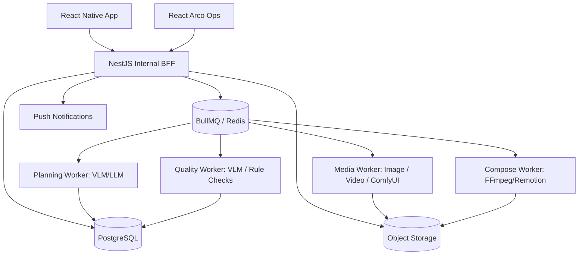
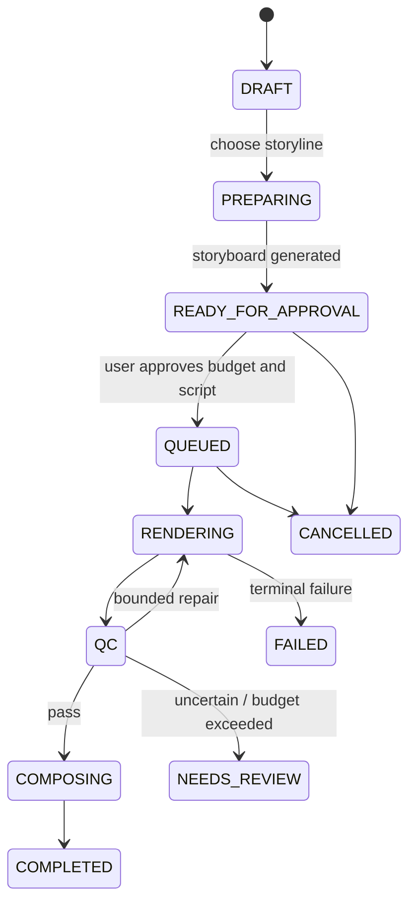

# AI 电商营销视频 App｜完整产品设计方案（Codex 交接版）

> 版本：v0.1 · 2026-11-10。主要对标 Kickart，参考 Aidge 商品保真；移动端 To C，非公开 API 平台。

## 文档目录

1. 01-竞品与设计依据
2. 02-产品PRD与移动端交互
3. 03-AI创作工作流与质量成本
4. 04-技术架构与数据模型
5. 05-迭代计划与验收

---

# 01｜Kickart × Aidge 竞品与设计依据

**研究截止**：2026-11-10。只依据公开官方资料；没有账户内实测、非公开工作流或竞品内部代码。

## 1. 已核实的 Kickart 产品机制

来源 [K1] 的“一键成片新手指引”明确描述：

1. 商品链接/ID 输入及商品素材获取（官方列出抖店、快手、小红书等支持来源；用户授权和产品接入条件另行适用）。
2. 素材理解：分析商品、卖点、图片质量并允许修正。
3. Storyline：可生成四条差异化创意方向，支持刷新/编辑。
4. Storyboard：逐镜脚本、人物/商品/场景参考图，支持换图和对话修改。
5. 成片渲染、预览、下载和自由创作二次编辑。

来源 [K2] 的自由创作指南还公开了多参考图、结构化镜头信息、局部重新生成等能力。
来源 [K3] 的产品说明覆盖灵感广场、爆款复刻/裂变、视频混剪，并说明部分灵感排行涉及 GMV、互动率、播放量；这些数据不是我们的产品天然可获取的。

> **设计解释（非竞品事实）**：移动端不必照搬复杂工作台，而应保留“案例 → 商品 → 故事线 → 故事板 → 成片 → 精修”这一用户认知顺序。

## 2. 已核实的 Aidge 机制

- [A1] 视频生成控制台：商品标题与 1–8 张商品图片输入；自动理解与规划；异步产出竖屏短视频。
- [A2] 高级 VideoGeneration：描述参考图优先（Reference-Image-First）、6 维度视觉检测、脚本约束、失败感知重试。
- [A3] 裂变服务：`rebuild` 对母版脚本与分镜拆解重生成；`reference` 主张保留母版更高程度的画面、动作与节奏，并支持商品/人物定向替换。
- [A4] 2026-11-09 的基础版生成文档：非服饰类目可依据商品标题与多图自动规划三段分镜。

> **能力边界**：官方资料中的“高保真”“低废片率”“高相似”是厂商对自身产品的描述；我们未实测其通过率，也无法从公开资料推断其内部模型权重、提示词或私有评估器。

## 3. 借鉴矩阵

| 可借鉴能力 | 优先参考 | 我们的 To C 实现 | 范围 |
|---|---|---|---|
| 灵感广场与案例选择 | Kickart | 自制/授权创意案例，按品类、镜头结构、营销风格搜索 | P0 |
| 商品理解与卖点确认 | 两者 | 商品档案与“已确认事实”清单，商家可修改 | P0 |
| 多方案 Storyline | Kickart | 默认 3 个方案（可调整），不照搬固定 4 个 | P0 |
| 卡片式 Storyboard | Kickart | 手机单列镜头卡，口播、画面、素材、时长可修改 | P0 |
| 单镜头精修 | Kickart | 仅对受影响镜头重生成；其他镜头不动 | P1 |
| 商品保真流程 | Aidge | 参考图锚定、商品结构特征、质量门控和可解释错误 | P0 |
| 母版 Rebuild | 两者 | 提取授权参考视频的高层营销结构，原创重组 | P1 |
| 高相似度 Reference 替换 | Aidge | 后期研究，不承诺 1:1 还原 | P2 |
| 视频混剪 | Kickart | 真实素材优先、模板化剪辑与组合 | P1 |
| 商家易用的费用控制 | 自研差异 | 预估费用、生成前确认、失败重试策略 | P0 |

## 4. 刻意不复制的内容

- 不复制竞品商标、品牌识别、界面图片、文案、专有模板视频或非公开实现。
- 不以未经授权抓取抖音视频/数据、绕过登录或下载限制作为案例库来源。
- 不宣称知道竞品内部模型链路，也不把官方宣传数据当作实测指标。
- 不直接展示“真实 GMV / 爆款 / 高转化”等标签，除非有可审计的数据来源与授权。
- 不做面向开发者的商业 API 产品（内部 App 接口不在此限制内）。

## 5. 官方资料与核实入口

- [K1] Kickart 一键成片新手指引：<https://docs.volcengine.com/docs/CreativeAgent/autocut-beginners-guide?lang=zh>
- [K2] Kickart 自由创作新手指引：<https://docs.volcengine.com/docs/creative-agent/free-creation-beginners-guide?lang=zh>
- [K3] Kickart 产品使用指南/模板概念：<https://docs.volcengine.com/docs/CreativeAgent/IntroductiontoTemplateConceptandTemplateConsumptionAPI?lang=zh>
- [K4] Kickart 视频混剪：<https://docs.volcengine.com/docs/creative-agent/video-mash-up?lang=zh>
- [K5] Kickart 分步式与端到端能力概览：<https://docs.volcengine.com/docs/creative-agent/api-overview?lang=zh>
- [A1] Aidge 控制台电商视频生成操作指南（更新 2026-11-03）：<https://help.aliyun.com/zh/aidge/e-commerce-video-generation-operation-guide/>
- [A2] Aidge 视频生成能力：<https://help.aliyun.com/zh/aidge/api-aidge-2026-04-28-videogeneration>
- [A3] Aidge 电商视频裂变：<https://help.aliyun.com/zh/aidge/ecomvideorecreation>
- [A4] Aidge 电商视频基础版（更新 2026-11-09）：<https://help.aliyun.com/zh/aidge/api-aidge-2026-04-28-productvideogeneration>

## 6. 仍待实测和确认的问题

- Kickart 各模式实际商品相似度、修复成功率、生成时延、套餐的最新有效价格。
- Aidge 的相同输入商品在不同品类下的成片可用率与生成时延。
- 我们可获得且可用于商用的图像、视频、TTS、音乐模型接口及其具体许可证/地区限制。
- 具体电商平台官方商品接口的合作/认证条件与用户授权范围。
- 真实商家愿意使用的故事线数量、付费方式和可接受的等待时间。


---

# 02｜To C 产品 PRD 与移动端交互

## 1. 产品目标

**目标用户**：没有专业视频制作团队的电商卖家、小型店铺运营者、短视频电商内容创作者。产品为用户提供商品内容创作工具，而不是替用户承诺销量。

**核心价值**：不写提示词、不做复杂剪辑，也能在手机上通过成熟营销创意结构生成可用的商品视频；商品外观和宣传事实尽量可信；局部不满意无需全片重做。

**北极星指标**：每周完成至少 1 条“商家主动确认可用成片”的活跃用户数（后续可改为周有效成片商家数）。

辅助指标：首条成片完成率、从进创作到确认故事板的操作数、可发布通过率、每条合格成片成本、二次修订占比、7 天留存与次周复用率。

## 2. 产品原则

- **手机优先，少选项**：面向行动路径，而不是暴露模型列表或复杂 Prompt。
- **案例驱动优于随机生成**：一键推荐适合商品的合规创意结构，也支持自由创作。
- **先确认便宜的内容，再花钱渲染**：商品事实、Storyline 和 Storyboard 在高成本渲染前确认。
- **重要信息有据可查**：不能凭图片编造产地、功效、检测认证、价格等。
- **局部可修改、成本可见**：高成本动作显式确认，异步任务可恢复。
- **效果指标诚实**：营销案例上的“热门/高转化”标签需真实证据；初期只标“精选/适合品类/风格”。

## 3. 信息架构

底部 Tab：**灵感｜创作｜作品｜我的**。

- 灵感：案例推荐、搜索、收藏、筛选、创意结构说明、“用我的商品制作”。
- 创作：新建商品视频、参考视频重构（P1）、历史商品、草稿与故事板。
- 作品：全部任务（草稿/排队/生成中/需确认/已完成/失败）、预览、局部修改、导出。
- 我的：账户、额度/费用、订单、通知、设置、内容授权与投诉入口。

不要为了新增一个模型或品类而增加 Tab。

## 4. 核心用户流程 A：灵感带动的创作（P0）

1. 用户打开灵感广场，看到本平台已获授权的示例案例。
2. 选择案例，查看 9:16 预览、适用品类、营销结构标签与示例分镜。
3. 点击“用我的商品创作”，从相机/相册上传商品，或从自己商品库选择。
4. AI 解析商品主图、品类、颜色、外观，提出疑似卖点，**用户确认/纠正事实**。
5. 推荐 3 条差异化 Storyline（例如“痛点切入”“使用展示”“细节讲解”），标注预计长度与预计费用范围。
6. 用户选择故事线，获得 3–6 张镜头卡组成的 Storyboard，逐镜显示参考图、画面描述、字幕与口播。
7. 用户修改必要镜头；确认稿件和预算后启动渲染。
8. 后台异步任务。用户可离开，返回作品页继续查看，允许通知完成后回到任务。
9. 成片预览并选择保存到设备、分享、修改某镜头或变换创意。

### 关键验收示例

- GIVEN 用户选择本平台可商用的案例且已上传商品图片，WHEN 点击“用我的商品创作”，THEN 系统进入商品确认页，并保留该案例的抽象营销结构 ID。
- GIVEN 商品事实中存在未确定的“材质/功效”，WHEN 生成营销文案，THEN 不得自动将其作为确定性宣传语；用户可补充真实资料。
- GIVEN 用户未确认故事板与预计费用，WHEN 尝试正式渲染，THEN 不扣除正式渲染额度、不创建付费任务。

## 5. 核心用户流程 B：一键生成（P0）

创作首页 → 选商品/拍照 → “自动推荐创意” → 选择 Storyline → 预览 Storyboard → 渲染 → 作品。

首版若用户没有任何案例偏好，使用平台已审核的通用营销结构模板，不能完全随机编造拍摄方法。

## 6. 核心用户流程 C：参考视频 Rebuild（P1）

创作 → 上传**有权使用**的参考视频 → 确认内容使用授权 → 自动转写及分镜分析 → 抽取抽象营销结构 → 绑定自有商品 → 生成新的 Storyboard → 渲染新的素材。

不默认逐帧复制他人视频、声音、人物或标志；不提供任意外链视频绕过平台限制的下载功能。分享链接可先只做“灵感书签”，需要解析时引导上传合法拥有的源文件。

## 7. 核心页面与交互要求

| 页面 | 首版核心控件 | 边界/异常态 |
|---|---|---|
| 灵感首页 | 搜索、分类 chips、视频预览卡、收藏、使用此创意 | 无案例、网络不可用、素材授权到期 |
| 案例详情 | 预览、营销结构摘要、适用品类、CTA | 案例不可复用则仅展示说明，不提供生成入口 |
| 商品导入 | 拍照、相册、已有商品、标题与关键属性 | 图片质量差、不同 SKU 混入、上传失败 |
| 商品确认 | 可编辑属性表、已证实/待确认标识 | 未确认的功效/材料等事实不可出现在确定文案 |
| 创意选择 | 3 张 Storyline 卡、风格、时长、文案摘要 | 模型规划失败则使用审核过的通用方案 |
| 故事板 | 单列卡片、首帧/示意图、旁白、字幕、时长、改镜头 | 无素材/风险镜头应有替代方案 |
| 生成确认 | 模式、预估费用范围、预计任务数量、确认 | 余额不足、内容不合规、用户取消 |
| 任务进度 | 阶段进度、状态、取消规则、失败提示 | 服务端幂等和断线后恢复 |
| 作品详情 | 视频预览、局部重生成、换风格、下载、复制项目 | 带时效素材应被复制为用户可用的持久成果 |
| 我的 | 账户、余额/订单、资产、授权记录、反馈 | 平台退款和支付政策需依上线渠道确认 |

### 移动端设计规范

- 默认 9:16 竖屏；底部导航适配 Safe Area。
- 重要按钮放在单手可触达的底部，复杂高级参数折叠。
- 视频可后台生成，App 前后台切换后保持任务状态。
- 轻交互采用卡片与抽屉；长文本修改提供编辑页而非挤在多层模态框里。
- 减少自动连续播放带来的流量消耗，提供静音预览与 Wi-Fi 相关设置。
- 最重要的费用信息在用户触发付费渲染前清楚可见。

## 8. MVP 需求清单

| ID | 优先级 | 功能 | 完成定义 |
|---|---|---|---|
| F-01 | P0 | 注册/登录/基础账户 | 可登录、退出、恢复会话 |
| F-02 | P0 | 自制/授权案例库 | 可筛选、搜索、预览并关联模板 |
| F-03 | P0 | 商品素材导入和商品库 | 可上传多图、编辑 SKU、复用已存商品 |
| F-04 | P0 | 商品事实确认 | 推断属性与商家核实属性有明确区分 |
| F-05 | P0 | Storyline 生成与选择 | 同一商品输出 3 个差异化方案，允许重试 |
| F-06 | P0 | Storyboard 卡片编辑 | 逐镜更改文案、画面意图、时长与素材引用 |
| F-07 | P0 | 异步视频渲染和回显 | 失败恢复、可返回查看、可下载成片 |
| F-08 | P0 | 基础视频合成 | 配音/字幕/片尾/背景音乐可配置且授权 |
| F-09 | P0 | 基础商品保真校验 | 严重不一致被拦截或降级为真实素材镜头 |
| F-10 | P0 | 费用预估/扣费记录 | 用户可确认预计支出，服务端记录实际用量 |
| F-11 | P1 | 逐镜重生成 | 不重做不受影响镜头，版本可比较与回退 |
| F-12 | P1 | 授权参考视频 Rebuild | 自动抽取营销结构、创作新片 |
| F-13 | P1 | 同 SKU 多角度裂变 | 多故事线/卖点/场景版本并保存项目关联 |
| F-14 | P1 | 真实素材混剪 | 以镜头组模板生成多个版本 |
| F-15 | P2 | 高相似定向替换 | 仅在专门技术验证和授权机制成熟后上线 |

## 9. 非目标与合规

- 不建设公开 API 市场、不做 SDK、不提供任意第三方视频抓取器。
- 不直接依赖抖音播放量/GMV 数据；未经验证不得展示对应指标。
- 不在首版实现专业多轨时间轴、完整剪辑套件或自动发布平台账号。
- 不自动生成虚假测评、假冒真人体验或未经证实的营销功效。
- 不承诺生成的视频一定通过平台广告审核，也不承诺销量提升。
- 面向消费者销售数字内容时，iOS/Android 的内购、订阅、退款等具体规则应在上架前按最新政策核实。


---

# 03｜AI 创作工作流、质量控制与成本体系

## 1. 设计范式

**案例/商品资产优先 → 事实与创意分离 → Storyline → 可编辑 Storyboard → 镜头编译 → 混合渲染 → QC → 合成 → 裂变。**

不要让 Agent 每次临时发明整个生产过程。Agent 负责选择经过评估的营销结构、填充商品事实和修改创意；执行器负责确定性任务图、状态和成本。

### 工作流 A：由商品一键创作（P0）

`商品图片+商家信息 → 校验商品/抽取事实 → 检索黄金营销结构 → 3 个 Storyline → 选定后编译 Storyboard → 生成首帧 → 质检 → 生成有必要的动态镜头 → 合成 TTS/字幕/音乐 → 视频成片`

### 工作流 B：灵感案例创作（P0）

`授权案例 → 已分析的抽象营销结构 → 商品适配 → Storyline → Storyboard → 新镜头/部分复用授权素材 → 成片`

### 工作流 C：授权参考视频 Rebuild（P1）

`上传拥有权利的参考视频 → 场景切分/音频转写 → 提取营销目的、节奏与镜头类型 → 生成抽象结构 → 新商品独立创作 → 新视频`

**不同于 Reference 1:1 复制**。不能直接承诺保留原视频完整人物、音色、声音和画面，也不能未经许可复制受保护的具体表达。

### 工作流 D：多版本裂变（P1）

`同一 ProductProfile + 同一/不同营销结构 → N 条 Storyline/Storyboard → 共享商品资产、首帧、静态镜头及配音可复用片段 → 仅生成差异化镜头 → 成片集合`

## 2. 商品事实层 ProductProfile

所有商品使用统一的 ProductProfile；服装、宠物、家居的差异由属性 schema 配置处理，不另做独立后端。

```json
{
  "productId": "prod_001",
  "sku": "SHOP-SKU-001",
  "title": "示例商品标题",
  "category": "pet_accessory",
  "assets": [{"assetId":"asset_front","role":"front","owner":"user"}],
  "facts": [
    {"key":"color","value":"white","source":"merchant_confirmed","confidence":1.0},
    {"key":"material","value":null,"source":"unverified","confidence":null}
  ],
  "immutableVisualTraits": ["shape", "main_color", "logo_position"],
  "claimsWhitelist": ["商家已经确认且可以证明的属性"],
  "claimsBlocked": ["未知功效", "未经证实的认证"]
}
```

- 视觉模型可以**建议**外观属性，但商家确认后才作为商品事实。
- 不能凭画面推断材质、功效、安全认证、价格、库存、适用年龄等非可见事实。
- 多图混入不同 SKU 时提示用户重新选择。
- 商品包装文字/Logo 的精确呈现优先使用真实商品资产，而非重新生成文字。

## 3. 案例与营销结构库

案例 `InspirationCase`：可展示的视频、版权与许可记录、适用品类标签、营销结构 ID、风格标签、素材来源、展示许可到期日。

结构 `CreativePattern`：不包含某个原创视频的具体台词/画面，而是营销目的和镜头功能序列，例如：

```json
{
  "patternId": "pattern_problem_demo_cta",
  "name": "需求切入—使用展示—购买引导",
  "tags": ["demonstration", "explanation"],
  "beats": [
    {"intent":"hook", "durationSec":3, "goal":"提出真实使用情境"},
    {"intent":"product_intro", "durationSec":5, "goal":"介绍商品"},
    {"intent":"benefit_demo", "durationSec":7, "goal":"展示可核验卖点"},
    {"intent":"detail", "durationSec":5, "goal":"强化细节证据"},
    {"intent":"cta", "durationSec":5, "goal":"清晰行动提示"}
  ]
}
```

推荐候选按**适用品类、素材要求、镜头可实现性、预算、参考案例授权状态、预计商品保真风险**综合排序，而不是只按视频标题相似度。

缺少授权视频时，可以先仅使用手工整理的通用创意结构作为模板，并制作**原创示例视频**供用户浏览。

## 4. Storyline（轻量创意方案）

每个方案至少有：`id`、`title`、`hook`、`pitch`、`creativePatternId`、`targetAudience`、`durationSec`、`tone`、`claimsUsed`、`estimatedCostBand`、`riskFlags`。

生成规则：默认 3 个风格不同且可执行的方案；所用卖点必须在 ProductProfile 中核实；不编造真实用户体验、医学功效或安全认证；预算不足时优先以真实图片演示和静态动效替代高难度生成视频。

## 5. Storyboard（可编辑、可执行）

**Storyline ≠ Storyboard**。故事板需要逐镜的素材绑定、口播、时长、生成方式与验收规则。

```json
{
  "schemaVersion": "1.0",
  "projectId": "project_001",
  "productId": "prod_001",
  "storylineId": "story_001",
  "aspectRatio": "9:16",
  "targetDurationSec": 25,
  "shots": [
    {
      "shotId": "shot_01",
      "purpose": "hook",
      "durationSec": 3,
      "visualBrief": "真实商品特写，轻微推近",
      "assets": ["asset_front"],
      "subjectRefs": ["prod_001"],
      "narration": "以实际商品特点开场",
      "caption": "商品特点",
      "renderTier": "L1",
      "lockedTraits": ["shape", "logo_position"],
      "qaRequirements": ["product_identity", "text_accuracy"],
      "fallback": "L0_real_asset_motion"
    }
  ]
}
```

在运行前验证：所有资产可访问、时长之和允许误差在策略阈值内、声明事实均已核实、每镜头有可用的主方案和回退方案、生成费用在预算内。任何不足都应产生面向用户可理解的错误信息。

## 6. 渲染模型路由（低成本不是无限重试）

| 层级 | 方法 | 典型镜头 | 质量与成本特点 |
|---|---|---|---|
| L0 | 真实素材 + FFmpeg/Remotion | 包装字、Logo、商品参数、CTA | 信息真实且最低生成风险 |
| L1 | AI 首帧/场景图 + 2.5D 运镜 | 风格化产品场景、细节推拉 | 动态可控，费用较低 |
| L2 | 经济型图生视频 | 简单镜头运动、轻互动 | 需检测漂移和不合理动作 |
| L3 | 高质量生成模型 | 关键动作/复杂交互镜头 | 单次生成费用高，限定使用 |

内部 `ModelCapabilityRegistry` 记录：Provider、模型版本、输入类型、最大时长、输出规格、是否支持参考元素/首尾帧/动作控制、当前商用许可、地域、预计单次成本、估计首次通过率、延迟分布、失败类型。

决策函数不是选最便宜模型，而是尽量减少：

`预计合格镜头成本 = 每次调用价格 / 首次或指定重试策略下的合格概率 + 额外素材/检测/合成开销`

*以上是策略原则，实际估计应基于观察到的历史数据和重试分布，不允许把未知概率当作已知。*

## 7. 商品保真 QC 与局部修复

### 生成前
- 参考图清晰度、同一 SKU、主体完整、文字区域、授权来源检查。
- 优先选择包含真实商品的参考图；对可能产生变化的结构做锁定清单。
- 风险大的互动镜头可重新规划为“真实商品图 + 宠物/人物氛围片段”的组合。

### 生成后
- 镜头抽帧：首帧、中段、末帧，动态密集镜头增加采样。
- 评价：主要颜色、轮廓、关键部件、图案/Logo、人物/动物一致性、实际使用合理性、字幕和口播准确性、禁用营销宣称。
- 自动分级：`PASS` / `REVIEW_REQUIRED` / `FAIL`，记录证据和失败原因。
- 对关键 Logo/包装文字的识别不应仅依赖大模型自评；优先保留真实素材，必要时人工复核。

### 修复策略
- 产品变形 → 换首帧、减少运动、改用 L0/L1。
- 动物动作不自然 → 简化动作或换成不强调接触的镜头。
- 人物不一致 → 加强参考条件或重新选择镜头。
- 文案失真 → 更新事实约束后只合成受影响音频/字幕。
- 达重试/预算上限 → 停止自动烧钱，反馈用户需要更换素材或人工确认。

`shotVersion` 是不可变的版本记录，不能直接覆盖已通过的旧镜头。局部修改会生成新版本，再更新视频合成清单。

## 8. 裂变与素材复用

创建 `VariantBatch`，定义共同商品、营销结构与可变化参数：口播、节奏、场景、背景音乐、标题卡、特定镜头。镜头级缓存键包括已授权素材哈希、模型及参数版本、提示词与约束版本；**禁止跨用户不当复用他人的私有图像/声音**。

一条成片的未变化镜头可以复用，而不是每次都重新生成。多版本输出应记录每条的镜头 lineage 和商品档案版本。

## 9. 示例：25 秒宠物用品视频（演示结构，不是竞品成片）

| 镜头 | 秒数 | 目标 | 建议层级 |
|---|---:|---|---|
| 生活情境开场 | 3 | 让用户知道产品解决什么需求 | L1 |
| 产品真实外观 | 5 | 使买家看到实际商品 | L0 |
| 自然使用场景 | 7 | 解释可验证的使用方式 | L2（必要时改 L1） |
| 细节与已核实属性 | 6 | 提供决策信息 | L0/L1 |
| 产品卡 + CTA | 4 | 引导进一步了解商品 | L0 |

方案中只有有必要的 7 秒使用 L2，其他主要靠真实素材或轻量运镜。在更多品类上复用的是**镜头意图**而不是具体的猫/服装视频内容。

## 10. 核心经营与工程指标

| 指标 | 定义 | 试验解释 |
|---|---|---|
| 合格成片成本 | 全部生成、重试、质检、合成、转码等真实成本 / 通过验收的成片数 | 真正决定定价的成本 |
| 首次镜头通过率 | 首次生成通过 QC 的镜头数 / 首次生成的镜头数 | 衡量路由与提示质量 |
| 成片确认率 | 商家点击“确认可用”的成片数 / 已完成的成片数 | 用户价值验证 |
| 局部修复效率 | 修复后合格且未重做其他镜头的任务数 / 局部修复请求数 | 衡量修订能力 |
| 人工干预比 | 需要人工审查的镜头数 / 生成镜头数 | 量产运营效率 |
| 案例采用率 | 从案例进入并最终确认成片的创作数 / 进入案例创作的用户数 | 验证案例驱动优势 |

内部目标可暂定“20–30 秒合格成片成本 ≤ ¥5”，但只作为**可验证的研发假设**；质量、不同行业、并发、模型商用费用都可能改变该数字。必须统计失败费用、重试费用和售后成本。

## 11. 数据收集与用户同意

最少记录：项目状态、素材授权状态、镜头版本、模型版本、实际成本、错误类型、用户对成片的主观评价。对用户上传图片/声音/视频提供删除路径和明确的用途说明。不默认将私有素材用于其他客户案例或训练；任何额外使用都需单独合适的许可。


---

# 04｜技术架构、数据模型与内部工程协议

## 1. 技术栈建议

| 层 | 技术 | 责任 |
|---|---|---|
| iOS/Android | React Native + Expo + TypeScript | 相机/相册/上传、预览、故事板卡、作品/通知/分享 |
| 运营后台 | React + Arco Design | 案例审核、营销结构模板、任务质量运营、成本监控 |
| 业务后端 | NestJS + TypeScript | 登录、账户、作品、商品、支付/余额、权限、内部接口 |
| AI 策划服务 | Python + VLM/LLM 适配器 | 商品提取、案例理解、故事线、分镜、QC 诊断 |
| 队列与执行 | BullMQ + Redis | 异步流程、重试、任务恢复、进度与取消 |
| 数据库 | PostgreSQL | 业务实体、事件、版本、审计、账本记录 |
| 媒体存储 | OSS/S3 对象存储 + CDN | 素材、首帧、镜头、成片、缩略图、临时签名 URL |
| 生成模型 | 统一模型能力适配器；按需要调用 ComfyUI / 商业模型 API | 图像、视频、动作及场景能力 |
| 合成 | FFmpeg + Remotion | 旁白、字幕、音乐、封面、片尾、成片 |
| 监控 | 结构化日志 + OpenTelemetry（按需） | 任务分段耗时、成本、失败率、告警 |

**重要边界**：这是对移动 App 的内部服务架构，**不是计划出售的公共 API**。不要部署对外开发者文档、密钥管理后台、开放 SDK 或按调用次数面向开发者计费。

## 2. 逻辑部署结构



MVP 可以单体 NestJS + 几类独立 worker，不建议第一天把所有内部服务拆成复杂微服务。

## 3. 主要领域对象与最小字段

| 对象 | 必要字段 | 要点 |
|---|---|---|
| User | id, authProvider, status, createdAt | 隐私与注销 |
| Product | id, userId, sku, title, category, status | 归属和 SKU 版本 |
| ProductAsset | id, productId, objectKey, sha256, viewRole, consent | 原图与授权 |
| ProductFact | id, productId, key, value, evidenceType, verifiedAt | 商家事实 vs 模型猜测 |
| InspirationCase | id, title, previewAssetId, licenseState, patternId, tags | 可展示/可派生权限 |
| CreativePattern | id, version, beatsJson, allowedCategories, status | 可编辑/发布/废弃版本 |
| CreationProject | id, userId, productId, mode, patternId, state | 项目容器 |
| Storyline | id, projectId, version, title, beatOutlineJson, choiceState | 多方案候选 |
| Storyboard | id, projectId, storylineId, version, specJson, approvalState | 确认后冻结版本 |
| Shot | id, storyboardId, index, requirementJson | 分镜语义 |
| ShotVersion | id, shotId, renderTier, modelId, outputAssetId, qcState, cost | 不覆盖旧版本 |
| RenderJob | id, projectId, storyboardVersion, status, idempotencyKey | 主任务 |
| JobStep | id, renderJobId, shotId?, stepType, state, attempts, cost | 分步可恢复 |
| VideoOutput | id, projectId, renderJobId, assetId, duration, resolution | 成片版本 |
| VariantBatch | id, userId, baseProjectId, optionsJson, state | 同商品多版本 |
| CreditLedger | id, userId, jobId, amount, currencyOrCredit, reason, state | 可对账，不直接改余额 |
| UserFeedback | id, projectId, outputId, usable, reasonCodes | 可用率反馈 |

索引建议：`Product(userId, sku)`、`CreationProject(userId, createdAt)`、`RenderJob(userId?, status, createdAt)`、`JobStep(renderJobId, state)`、`InspirationCase(status, category/tags)`；新增数据量前先以实际访问模式验证。

## 4. 任务状态机



注意：`FAILED` 和 `NEEDS_REVIEW` 的重试必须创建新的受控尝试记录，不能绕过预算和历史结算。

## 5. 内部接口草案（只用于 App，不向第三方公开）

```text
POST /app/v1/products                    创建商品
POST /app/v1/products/:id/assets         请求上传凭据 / 提交素材元数据
PATCH /app/v1/products/:id/facts         商家确认商品属性
GET  /app/v1/inspirations                查询已获授权案例
GET  /app/v1/inspirations/:id            案例详情
POST /app/v1/projects                    创建项目（来源可选 inspiration）
POST /app/v1/projects/:id/storylines      生成候选故事线
POST /app/v1/projects/:id/storyboards     从选定故事线生成故事板
PATCH /app/v1/storyboards/:id            编辑未提交的镜头与文案
POST /app/v1/projects/:id/render-quote    返回预估费用
POST /app/v1/projects/:id/render          确认费用并创建异步任务
GET  /app/v1/jobs/:id                    查询状态与进度
POST /app/v1/projects/:id/shots/:shotId/revise  局部修改（P1）
GET  /app/v1/projects/:id/outputs         输出版本列表
POST /app/v1/projects/:id/variants        创建裂变批次（P1）
```

安全要求：所有项目、素材、任务必须服务端校验 `userId` 归属；上传使用短时签名 URL，下载需要授权；敏感操作审计；对上传文件类型、大小、时长与恶意文件进行校验；内网 worker 使用服务身份，不把模型密钥传到手机端。

## 6. 业务与模型解耦协议

`ProductProfile` 和 `Storyboard` 是内部**领域协议**，不直接暴露 ComfyUI Workflow JSON 或供应商专有字段。生成 worker 负责将结构化 `ShotSpec` 编译为模型请求。

```ts
interface ShotRenderRequest {
  shotId: string;
  productId: string;
  refs: Array<{assetId:string; role:string}>;
  durationSec: number;
  aspectRatio: '9:16'|'1:1'|'16:9';
  visualIntent: string;
  lockedTraits: string[];
  qualityProfile: 'economy'|'premium';
  maxBudgetMinor: number;
  fallbackTier?: 'L0'|'L1'|'L2';
}

interface ShotRenderResult {
  assetId: string;
  modelId?: string;
  renderTier: 'L0'|'L1'|'L2'|'L3';
  actualCostMinor: number;
  qualityState: 'PASS'|'REVIEW_REQUIRED'|'FAIL';
  reasonCodes: string[];
}
```

生产部署须通过 zod/class-validator 等验证接口输入与跨服务事件；不能直接执行 LLM 返回的任意脚本、URL 或 ComfyUI 节点定义。模型提示词、能力配置和策略必须版本化。

## 7. 费用控制与账务

- 在用户确认渲染时产生 Quote（过期时间、预估范围、策略版本）；不把模型单次调用价直接伪装成成片成本。
- 任务创建有幂等键，避免重复扣费；预授权或额度预留后按确认的计费政策结算，多次请求不能重复扣费。
- 保存每次供应商调用的实际成本、重试成本、生成输出和失败原因。
- 系统故障所致的失败如何退额度必须通过产品规则明确，不能产生不可解释的扣费。
- 在应用商店上架前核实数字内容支付、订阅、税费和退款政策；不要先写死绕过平台内购的支付路线。

## 8. 安全/合规与可靠性

- 仅处理用户有权使用的商品图、人物图、音频和参考视频。提供违规报告与素材删除。
- 可见人物需要合适肖像/声音授权；无授权不得克隆真实人物声纹和身份。
- 第三方素材许可、生成模型商用条款和音乐配乐许可单独记录。
- 对外部链接先进行 SSRF 防护、跳转验证、尺寸限制和文件内容验证；不支持私有网络访问。
- 用户离线/掉线不影响服务端任务；App 重启后按项目/任务 ID 恢复进度。
- 任务应设超时、并发限制、重试上限、熔断、预算上限和死信监控。
- 成片必须复制进受控对象存储，不能长期依赖供应商临时结果链接。
- 不滥用相似片批量灌水或规避平台原创性要求；保持成片真实、独立、有商品信息价值。

## 9. 部署建议

首期：一个 NestJS 服务 + 一个 PostgreSQL + Redis/BullMQ + 对象存储 + 按需可扩展 worker，先以第三方模型 API 为主；ComfyUI 仅在确定某工作流需要时作为 worker 接入。不要在缺乏基准测试之前为自建视频模型采购大量 GPU。


---

# 05｜MVP 迭代计划、任务拆分与验收

## 1. 路线总览

**坚持先跑通“选案例 → 商品 → 故事线 → 故事板 → 成片”的完整用户路径，再追加模型高级能力。** 不以 UI 完成或单个生成示例成功认定 MVP 可用。

| 里程碑 | 要验证的假设 | 主要产物 |
|---|---|---|
| M0 证据与原型 | 普通商家是否理解故事线/故事板？ | 关键页面原型、5 条完整用户路径、20 个可使用的自制/授权案例种子 |
| M1 垂直闭环 | 一件商品是否可经低成本制作得到可用视频？ | 商品库、Storyline、Storyboard、单个混合渲染工作流 |
| M2 App MVP | 用户能否在手机完成从输入到下载？ | Expo App、异步任务、作品、费用确认、成片交付 |
| M3 质量稳定化 | 相似素材是否能稳定复现可用效果？ | 商品质检、回退策略、成本看板、失败原因面板 |
| M4 案例创作与裂变 | 案例使用是否改善创作体验？ | 案例匹配、Rebuild、逐镜修复、多版本生产 |

以上按产物依赖排序，不是已经承诺的交付日期。

## 2. 首轮真实场景测试

**建议样本**：至少 30 个自有/授权商品 SKU，覆盖家居标品、宠物用品、服饰等不同难度，并记录输入图片质量。样本只是试验建议，不是已完成验证。

**场景选择原则**：初期优先商用价值明确、真实商品能直接入镜、复杂物理交互少的工作流。

- 黄金场景 G1：真实商品展示 + 轻量运镜 + 卖点解释。
- 黄金场景 G2：可控生活场景种草 + 少量动态画面。
- 黄金场景 G3（M4）：参考营销结构 Rebuild + 商品信息原创适配。

跨行业共用 Storyboard/执行器，专项打磨的是参考图、动作限制、质量阈值和渲染策略，不新建独立产品。

## 3. 任务分解（供 Codex 转成 Issues）

| 编号 | 工作包 | 依赖 | 验收交付 |
|---|---|---|---|
| ENG-001 | Monorepo 结构/基础 CI | 无 | RN、NestJS、共享 types 可启动、可测试 |
| ENG-002 | 登录与用户数据隔离 | ENG-001 | 跨用户访问被拒绝 |
| ENG-003 | 商品库、上传和商品事实 | ENG-002 | 多图上传、SKU 保存/修改与事实核实 |
| ENG-004 | 案例库/授权元数据/运营审核 | ENG-002 | 未授权案例不能上架创作 |
| ENG-005 | Storyline 服务与结构校验 | ENG-003,004 | 3 个可编辑创意，事实不被编造 |
| ENG-006 | Storyboard 编译与编辑 | ENG-005 | 镜头卡可编辑，版本可追溯 |
| ENG-007 | 媒体资源与真实素材动效 | ENG-003,006 | 完成 L0/L1 镜头并生成输出 |
| ENG-008 | 异步任务编排及进度 | ENG-001,006 | 断线恢复、重试与幂等 |
| ENG-009 | 第三方视频模型适配器 | ENG-008 | 只支持至少一个可商用/可测模型，契约测试通过 |
| ENG-010 | QC 与单镜头回退 | ENG-007,009 | 商品严重漂移可阻止交付或退化为真实素材 |
| ENG-011 | 合成、成片存储、下载分享 | ENG-007,008,010 | 完整 9:16 成片，音画字幕基本一致 |
| ENG-012 | 预算预估/任务账本 | ENG-008,009 | 付费动作有预估、幂等、实际用量记录 |
| ENG-013 | RN 用户完整创作流程 | ENG-002..012 | 用户从灵感或商品入口完成一条视频 |
| ENG-014 | 观察指标、告警与成本报表 | ENG-008..012 | 可分析镜头失败、开销和合格率 |
| ENG-015 | 逐镜修改与版本回退（P1） | ENG-006,011 | 修改一镜不重新执行其它已通过镜头 |
| ENG-016 | 授权参考视频拆解 Rebuild（P1） | ENG-004,006,015 | 自动产出新商品的原创故事板 |
| ENG-017 | 多版本裂变与缓存（P1） | ENG-015,016 | 版本共享未变化资产，成本记录准确 |

## 4. 每个里程碑的验收门槛

### M1 演示闭环
- 至少一条由商品资产到 Storyboard 再到成片的真实运行记录；禁止用“伪结果视频”冒充 AI 渲染成果。
- 保存每个镜头的素材引用、模型/动效方式、耗时、实际调用费用和失败原因。
- 成片可下载，可对照商品原图检查结构、颜色和标志。

### M2 App MVP
- 用户能够在手机上：浏览案例、选自有商品、确认卖点、选故事线、查看故事板、确认费用、返回查看结果并下载。
- 任务在 App 进入后台、退出和重新登录后可恢复；重复提交不得重复扣费或无控制地创建任务。
- 主要错误（网络断开、素材缺失、用户取消、供应商失败、预算不足）有可操作的提示。
- 无第三方密钥泄漏、无跨用户资产读取。

### M3 质量与费用
- 至少 30 SKU 的评价记录，可按品类、模型、分镜意图区分通过率。
- 真实报告“合格成片成本”且包含失败/重试开销；不能用单次模型标价代替。
- QC 不确定时能请求人工复核，不能将无法验证的视觉一致性标为 100% 可靠。

### M4 差异化体验
- “用此创意创作”能清楚关联模板 ID，并为新商品生成新的文案和画面，不复制原案例受保护的具体表达。
- 用户能指定修改一个镜头并查看生成前后版本，未变镜头有可核查的复用记录。
- 用户有权上传的参考视频才能进入 Rebuild 分析流程。

## 5. 测试矩阵

| 领域 | 关键测试 |
|---|---|
| 素材 | 不同 SKU 混传、图片模糊、旋转 EXIF、大图、异常文件、无版权素材 |
| 商品事实 | 编造材质/功能、图片与标题矛盾、无法确认卖点、敏感宣传文案 |
| Agent | JSON 结构错误、错误引用素材、无限循环/大量 Token、越权执行请求 |
| 渲染 | 供应商超时、异步回调重复、失败/取消竞态、视频模型版本变化 |
| QA | Logo 错误、包装文字错误、主体漂移、物理交互异常、音画字幕不同步 |
| 计费 | 重复点击、网络重试、失败退额度、部分成功、余额不足 |
| 手机 | 弱网、后台切换、相册/相机权限、通知关闭、下载/分享权限 |
| 数据隔离 | 跨用户请求、过期下载链接、对象存储访问控制、项目删除 |

## 6. 核心指标的定义与仪表板

至少每周查看：

1. 创作漏斗：案例浏览 → 创作点击 → 商品确认 → 方案选择 → 故事板确认 → 渲染 → 成片确认。
2. 质量漏斗：镜头首次通过率 → 终稿通过率 → 人工复核率 → 商家可发布确认率。
3. 成本：单次模型成本、重试成本、合成成本、每条**合格**成片总成本，按品类和营销结构拆分。
4. 使用体验：完成率、单任务人工操作数、局部修改请求、首次下载率。
5. 留存：首周回访创作、复用已有商品、重复使用同一案例、7 天与次周留存。

**成本目标 ≤ ¥5/条**仅是初步假设；没做过真实供应商调用及用户可发布验证前，不能写成宣传承诺。

## 7. 首次使用 Codex 的建议顺序

1. 阅读全部方案，产出一份 `docs/decisions.md`，将已定决策与待定决策分开。
2. 识别现有 GitHub 仓库是否有代码；如空仓库，先输出 Monorepo 最小结构与开发环境要求，再开始创建。
3. 先完成 F-02~F-07 的**假数据 UI 原型**，让用户看懂整个流程；明确模拟和真实后端的界线。
4. 在后端跑通 G1 的真实素材与轻量渲染，建立可计算的成本明细。
5. 再接入一种实际可调用、商用权利明确的 AI 视频模型，收集失败案例，不要同时铺开数十种模型。
6. 有真实端到端数据后，决定是否开发自建 ComfyUI 工作流或加入新视频供应商。

## 8. 近期需要确认的少数产品决策

- 首发地区与收费币种（影响内容授权、支付与应用商店流程）。
- 首期支持哪类商品导入：拍照/相册一定支持；第三方商品链接何时接入以授权权限为准。
- 是否必须首发支持商家专属模特/角色。建议否。
- 首批可用的原创或授权案例数量。建议以经过完整成片测试的少量高质量案例为主。
- 首轮预算与现有算力条件；决定先接商业模型 API 还是引入自建执行节点。

## 9. 最小验收用户故事

> 我是普通卖家，手里有一件商品的三张照片。我打开 App，从灵感广场找到一个适合的营销创意，使用自己的商品替换其营销主题。App 提取卖点让我确认，再提供三套故事线。我选一套，逐镜看过故事板，看到费用预算后点生成。无需一直等待；之后我从作品页打开结果，发现第三个镜头商品变形，于是仅要求重新生成第三镜头。最终我把真实商品展示、口播字幕完整的视频保存到手机。

只要这条用户故事不能稳定完成，就不要宣称首版已经具备 Kickart 的完整同类能力。


---

## Codex 项目约束（与交接包 AGENTS.md 同步）


## 项目上下文

阅读 `README.md` 与 `docs/` 下设计文档。项目目标是**移动优先、面向电商卖家的 To C 视频创作 App**，参考 Kickart 公开的创作交互与 Aidge 公开的商品保真策略，但不复制专有素材、UI 或私有技术。

## 强约束

1. **不做公开 API/SDK/开发者平台**。NestJS 内部 API 仅供移动端和运营后台使用。
2. React Native + Expo + TypeScript 为 iOS/Android 首选；运营后台 React + Arco Design；服务端 NestJS + PostgreSQL + Redis/BullMQ；AI 任务可用 Python/ComfyUI worker；视频合成 Remotion + FFmpeg。
3. **不要按品类复制独立流程**。使用 ProductProfile、CreativePattern、Storyboard、ShotSpec、模型能力注册与规则配置。
4. 先 MVP 的“选案例 → 商品 → Storyline → Storyboard → 视频”闭环，再追加复杂裂变。
5. 外部模型、商品平台、视频平台、音乐与第三方素材服务都视为**尚未获得授权/密钥**，除非仓库实际提供可验证配置。
6. 不得假定任意抖音分享链接可以下载视频；不构建绕过站点访问限制的抓取器。参考视频需要合法来源和适当权利。
7. 不能编造商品属性、功效、GMV/爆款数据或测试结果。区分用户确认事实、视觉猜测、设计目标和实测结果。
8. 不允许将模型原始提示词/可执行代码当成可信输入直接运行，不执行非可信 URL/命令。
9. 所有媒体资源须校验用户所有权、版权授权与访问控制；后台不得泄露密钥给移动端。
10. 昂贵渲染前提示费用并获取确认；失败、重试和幂等逻辑必须有测试。

## 工作方式

- 修改前先梳理代码现状与功能约束，尽量保留已有代码和用户的决策。
- 尽量按纵向可交付切片实现：UI → 内部 API → 任务 → 合成 → 质量验证。
- 每个 PR/变更应明确范围、核心实现、测试结果与仍存在的限制。
- UI 的假数据、模拟生成进度、占位视频必须标记为 mock，不得称作真实效果。
- 优先复用成熟库，不需要为了“Agent”引入复杂的框架；合理使用确定性任务图。
- 每个可付费、可访问别人资产、可生成内容的操作都需要服务端权限和输入校验。
- 更新 schema/接口后同步更新相关 docs 和测试。

## 第一轮交付

先写出：① 代码库结构审查；② MVP 页面与数据流图；③ 第一批任务计划与验收；④ 少数无法由现有文档决定的关键问题。**在用户确认具体开发任务前，不要自动实现全部功能或接入付费供应商。**
